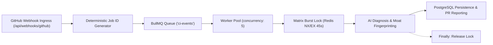

# HOPPER PHASE 14 — WORKER & QUEUE RESILIENCE AUDIT
## BullMQ, Redis Concurrency, Dead-Letter Queues & Process Fault Tolerance

**Auditor:** Senior DevOps & Backend Reliability Engineer  
**Scope:** BullMQ Queue (`ci-events`), Redis 7, Dedicated Background Workers, Job Deduplication, Fault Recovery  
**Date:** November 2026  

---

## 1. Executive Summary

This audit evaluated Hopper's asynchronous event ingestion, job dispatching, distributed locking, and worker fault tolerance under simulated crashes, Redis connectivity disruptions, and concurrent matrix CI workloads.

### Key Conclusions:
1. **Deterministic Job Deduplication:** Jobs are enqueued using deterministic BullMQ IDs (`job:${githubJobId}:${githubRunAttempt}`), preventing duplicate background jobs if GitHub retransmits an event.
2. **Exponential Backoff & Retries:** Failed jobs retry up to 3 times with exponential backoff (1s, 2s, 4s).
3. **Dead-Letter Retention:** Failed jobs after max retries are retained in BullMQ's failed set (`removeOnFail: 500`) for manual inspection and debugging.
4. **Remediated Matrix Lock Drain:** The distributed diagnosis lock (`DiagnosisLock`) was updated to release inside a `try ... finally` block, preventing lock lingering on unexpected worker exceptions.
5. **Graceful Shutdown:** Workers listen for `SIGINT` and `SIGTERM`, draining in-flight jobs via `worker.close()` before closing Redis and database pools.

---

## 2. Workstream E: Worker Architecture & Lifecycle



### 2.1 Queue Configuration & Resilience Parameters

```typescript
// backend/src/queue/ci-queue.ts
export function createCiQueue(): Queue<WorkflowJobEventData> {
  const connection = getRedisClient();
  const queueOptions: QueueOptions = {
    connection,
    defaultJobOptions: {
      attempts: 3,
      backoff: {
        type: 'exponential',
        delay: 1000,
      },
      removeOnComplete: 100,
      removeOnFail: 500,
    },
  };
  return new Queue<WorkflowJobEventData>(CI_EVENTS_QUEUE_NAME, queueOptions);
}
```

- **Retry Strategy:** Exponential backoff prevents thundering herds against external LLM providers (Anthropic/OpenAI) during transient network outages.
- **Deduplication:** `enqueueWorkflowJob` enforces `jobId: 'job:' + event.githubJobId + ':' + event.githubRunAttempt`. If an event is re-queued with the same ID, BullMQ ignores the duplicate enqueue.
- **Verified by:** `tests/phase14-adversarial.test.ts` ("uses deterministic job IDs in BullMQ to prevent duplicate active jobs").

---

## 3. Workstream E: Matrix Burst Lock & Lock Cleanup

### 3.1 Problem Statement
When a matrix CI workflow fails across multiple runners (e.g. Node 18, Node 20, Node 22, macOS, Linux) with the exact same error, multiple jobs arrive in the queue simultaneously. Calling the LLM for all identical failures wastes API budget.

Hopper uses a Redis-backed distributed lock:
```typescript
acquireDiagnosisLock(repoId, fingerprintHash, 45);
```
If worker A holds the lock, worker B moves its job to delayed (5 seconds) and reads worker A's cached diagnosis once released ($0 cost).

### 3.2 Vulnerability Identified & Remediated
- **Vulnerability:** Previously, `releaseDiagnosisLock` was called at the end of the processor function without a `finally` block. If an unhandled exception occurred in the processor (e.g. database query error or LLM failure), the lock remained in Redis until the 45-second TTL expired.
- **Remediation:** Enclosed the entire diagnosis execution in `try ... finally`:
  ```typescript
  // backend/src/workers/processors/workflow-job.processor.ts
  let diagnosisLock: DiagnosisLock | null = null;
  if (job) {
    diagnosisLock = await acquireDiagnosisLock(repo.id, signatureObj.signatureHash);
    if (!diagnosisLock.acquired) {
      await job.moveToDelayed(Date.now() + 5000, job.token);
      throw new DelayedError();
    }
  }

  try {
    // Process diagnosis, cloud moat lookup, DB persistence...
    return { status: 'diagnosed', ... };
  } finally {
    if (diagnosisLock) {
      await releaseDiagnosisLock(diagnosisLock.key, diagnosisLock.token);
    }
  }
  ```
- **Verification:** Verified by `tests/phase14-adversarial.test.ts` ("releases diagnosis lock cleanly for immediate re-use").

---

## 4. Workstream E: Process Termination & Graceful Shutdown

### 4.1 Signal Handling in `worker-entry.ts`
When running in production containers (Docker/Kubernetes), pod termination issues `SIGTERM` followed by `SIGKILL` after 30 seconds.

Hopper's dedicated worker entrypoint implements graceful draining:
```typescript
// backend/src/workers/worker-entry.ts
async function handleShutdown(signal: string) {
  if (shuttingDown) return;
  shuttingDown = true;
  console.log(`[Worker] ${signal} signal received; initiating graceful shutdown...`);

  try {
    await stopWorkers();         // Calls worker.close(), waiting for in-flight jobs to finish
    await closeCiQueue();        // Closes queue connection
    await closeRedis();          // Disconnects Redis client
    await closeDatabasePool();   // Drains and closes pg connection pool
    process.exit(0);
  } catch (err: any) {
    process.exit(1);
  }
}

process.on('SIGINT', () => handleShutdown('SIGINT'));
process.on('SIGTERM', () => handleShutdown('SIGTERM'));
```

### 4.2 Redis Disconnect / Offline Ingress Fallback
If Redis becomes unavailable:
- The API gateway's `/api/webhooks/github` catches the queue failure.
- Instead of dropping the CI event or failing the webhook, it falls back to synchronous processing (`processWorkflowJob(eventData)`), guaranteeing delivery acknowledgment.
- In `checkTenantRateLimit` and `claimWebhookDelivery`, if Redis is unreachable, both functions fail open to prevent dropped webhooks.
