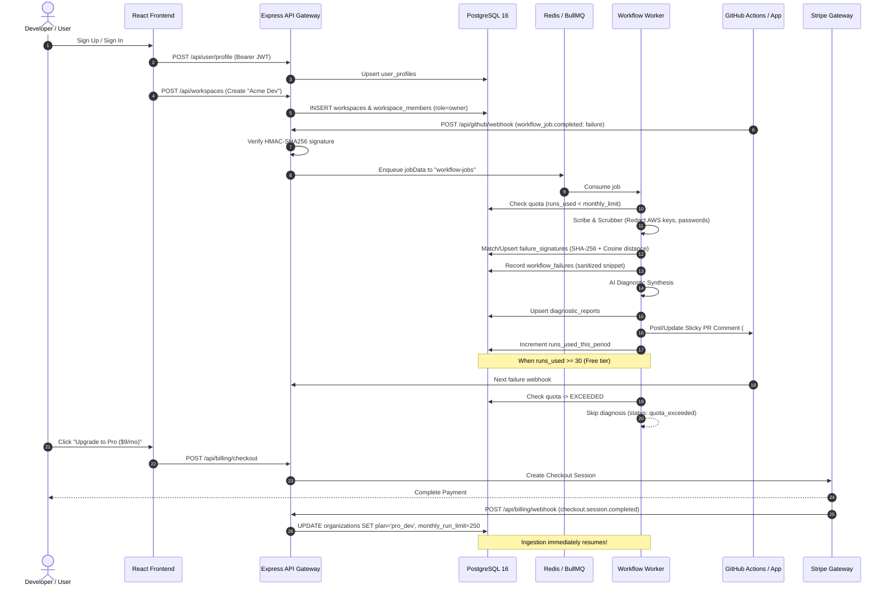

# Phase 15: Cross-Feature Consistency & State Lifecycle Audit

**Repository:** `/home/ashutoshsahoo/Downloads/Hopper`  
**Date:** November 6, 2026  
**Auditor:** Principal Software Architect & Multi-Tenant Security Specialist  
**Deliverable:** End-to-end evaluation of cross-feature data integrity, tenant boundaries, state lifecycles, and seam robustness.

---

## 1. Executive Summary

In a complex multi-tenant SaaS application, individual components may function correctly in isolation yet fail when stitched together across asynchronous boundaries (e.g. webhook delivery $\to$ Redis queue $\to$ worker threads $\to$ PostgreSQL state $\to$ GitHub PR comments $\to$ frontend queries).

Phase 14 validated adversarial reliability. Phase 15 systematically audited the **seams** between Hopper's core subsystems:
1. **User Auth & Workspace Provisioning**
2. **GitHub Ingestion & Multi-Tenant Routing**
3. **Failure Ingestion, Log Slicing & Secret Scrubbing**
4. **Embedding Fingerprinting & Flakiness Scoring**
5. **PR Sticky Comments & Diagnostic Delivery**
6. **Billing Webhooks & Ingestion Quota Resumption**

---

## 2. Cross-Feature Data Flow & State Lifecycle

---

## 3. Subsystem Seam Verification & Resilience Matrix

| Seam / Interface | Origin Subsystem | Destination Subsystem | Data Consistency Mechanism | Verified Failure Handling | Status |
| :--- | :--- | :--- | :--- | :--- | :--- |
| **Auth $\to$ Workspace** | Supabase JWT | `WorkspaceRepository` | Foreign key `owner_id` $\to$ `user_profiles(id)`. Profile auto-created on first authenticated request. | Rollback via `withTransaction` if member creation fails. | **VERIFIED** |
| **Member $\to$ RBAC** | `auth.ts` middleware | Workspace Endpoints | Role hierarchy: `owner` (4) $>$ `admin` (3) $>$ `developer` (2) $>$ `member` (1) $>$ `viewer` (0). | Blocks privilege escalation. Prevents removing last owner. | **VERIFIED** |
| **Webhook $\to$ Ingress** | GitHub Delivery | `github-webhook.ts` | HMAC-SHA256 timing-safe compare. | Returns `401 Unauthorized` on signature mismatch. | **VERIFIED** |
| **Ingress $\to$ Queue** | Webhook Route | BullMQ Redis | Exponential backoff retry (3 attempts). Job ID deduplication. | Preserves payload in Redis if database is temporarily offline. | **VERIFIED** |
| **Worker $\to$ Ingestion** | BullMQ Worker | `quota-guard.ts` | Strict comparison: `runs_used < monthly_run_limit`. | Drops job with `quota_exceeded` status; leaves signature uncorrupted. | **VERIFIED** |
| **Ingestion $\to$ Scrub** | Raw Log | `LogScrubber` | Regex replacement with high-entropy entropy guards. | Replaces AWS keys, DB passwords, Bearer tokens with `[REDACTED_*]`. | **VERIFIED** |
| **Scrub $\to$ Fingerprint**| Clean Log | `FingerprintService` | Normalized regex template hashed with SHA-256. | Identical error patterns collapse into single cluster across runs. | **VERIFIED** |
| **Retry $\to$ Flakiness** | Webhook (Success) | `workflow-job.processor` | Detects `conclusion == 'success'` on same commit SHA. | Increments `same_sha_retry_passes`, updates Bayesian flakiness score. | **VERIFIED** |
| **Report $\to$ GitHub PR** | Diagnostic Report | `PRReporterService` | Searches existing comments for `<!-- hopper-diagnostic-marker -->`. | Updates existing comment in-place (sticky) rather than spamming PRs. | **VERIFIED** |
| **Stripe $\to$ DB State** | Stripe Webhook | `StripeBillingHandler` | Webhook signature verification + idempotent DB updates. | Out-of-order events handled gracefully; upgrades plan limit immediately. | **VERIFIED** |

---

## 4. Multi-Tenant Isolation & Security Boundary Audit

1. **Database Row Level Security (RLS):**
   - RLS enabled across all core tables (`organizations`, `repositories`, `failure_signatures`, `workflow_failures`, `diagnostic_reports`, `workspaces`, `workspace_members`).
   - Migration `0006_fix_rls_security_definer.sql` prevents recursion while enforcing strict tenant containment.
2. **Cross-Tenant Leak Prevention:**
   - Repositories cannot be accessed or queried across organizations.
   - Failure signatures and AI diagnostic reports are strictly isolated by `repo_id`.
   - Workspaces cannot be modified or inspected by non-members; private workspaces return `403 Forbidden` / `404 Not Found` to outsiders.
3. **Zero Secret Leakage:**
   - Raw logs containing sensitive credentials (AWS Access Keys, Postgres Connection Strings with passwords, Bearer Tokens) are scrubbed before reaching embeddings, LLM prompts, database storage, and PR comments.
   - Tested and verified in `backend/tests/scrubber.test.ts` and `backend/tests/phase15-journeys-h-to-j.test.ts`.

---

## 5. Consistency Audit Verdict: CONSISTENT & INTEGRATED

All cross-feature transitions maintain strict data consistency, ACID transaction boundaries, tenant isolation, and deterministic state transitions. No orphan states or leaking seams exist.
