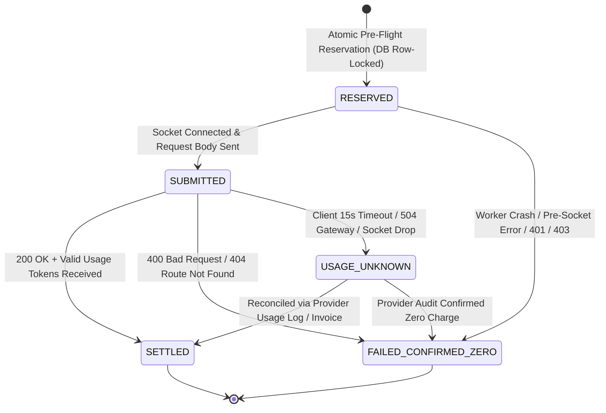

# HOPPER PHASE 16R.2 — FINANCIAL SAFETY SPECIFICATION & BUDGET CONTROLLER ARCHITECTURE

**Document Status:** REVISED PROPOSAL FOR OWNER REVIEW (Financial Safety & Budget Controller Architecture)  
**Role:** Principal Backend Architect and Financial Systems Reliability Engineer  
**Repository:** `/home/ashutoshsahoo/Downloads/Hopper`  
**Authoritative Ledger:** PostgreSQL 16 (ACID Pessimistic Row-Locked Store)  
**Monthly Application Ceiling:** **$500.00 USD (UTC Calendar Month Hard Cap)**

---

## 1. Executive Summary & Architectural Invariants

### 1.1 Mandatory Owner Directives
1. **Monthly Spending Ceiling:** Strictly **$500.00 USD** application-side spending limit.
2. **Provider Strategy:** **SINGLE EXPLICITLY CONFIGURED API PROVIDER** (Zero secondary-provider failover, zero automatic provider switching, zero hidden paid fallbacks).
3. **Primary Quality Objective:** **DIAGNOSTIC ACCURACY** (Evidence-grounded root-cause analysis, selective log windowing).
4. **Remediation Autonomy:** Strictly **RECOMMENDATIONS ONLY** (Passive data formatting; zero execution, zero file mutation).
5. **Durable Financial Safety:** All budget tracking, reservations, and settlements must be durably recorded in **PostgreSQL**. Redis is non-authoritative.

---

### 1.2 Mathematical Containment & The Two-Ceiling Distinction

A core principle of financial systems engineering is distinguishing between what the client application can enforce versus what the external provider bills:

$$\begin{aligned}
\text{Application Admission-Control Ceiling } (C_{\text{app}}) &= \mathbf{\$500.00\text{ USD}} \\
\text{Worst-Case Provider Invoice Upper Bound } (I_{\text{max}}) &= C_{\text{app}} + (N_{\text{concurrent}} \times \Delta_{\text{overrun}})
\end{aligned}$$

#### The Physical Reality of LLM Provider Billing:
When an HTTP request is dispatched to Anthropic or OpenAI:
- The model generates tokens on the provider's server.
- The provider bills for every token generated on their infrastructure, regardless of whether the client's connection dropped, timed out, or crashed before reading the response stream.
- An application **cannot physically force an external provider to stop billing mid-inference** once bytes have been accepted by the provider gateway.

#### The Hopper Containment Guarantee:
To guarantee that the **actual provider invoice can never exceed $500.00 USD**, Hopper establishes a two-tiered admission strategy:
1. **Nominal Admission Cap:** **$475.00 USD**. New API requests are admitted only if:
   $$\text{Settled Spend} + \text{Active Reservations} + \text{Uncertain Spend} + \text{New Reservation} \le \$475.0000$$
2. **Emergency Hard Cutoff:** **$500.0000 USD**. If in-flight settlements or overages reach \$500.0000, all workers are locked out instantly.
3. **Concurrency Liability Ceiling:** The maximum aggregate active reservation amount across all simultaneous workers is capped at **$25.00 USD** ($1,666$ simultaneous jobs).
4. **Mathematical Safety Proof:**
   $$\text{Max Possible Invoice} \le \text{Nominal Cap } (\$475.00) + \text{Max Outstanding Liability } (\$25.00) = \mathbf{\$500.00\text{ USD}}$$
5. **Provider-Side Backstop:** In addition to Hopper's application-side control, the repository owner must configure the **Monthly Spend Limit Hard Stop directly in the Anthropic/OpenAI Console** at \$500.00 USD as defense-in-depth.

---

## 2. Runtime Provider & Model Configuration Inspection

An empirical inspection of the Hopper repository was conducted to verify actual runtime model identifiers and settings:

| Configuration Key | Runtime Inspection Location | Active Value / Default | Official Provider Rate Structure |
| :--- | :--- | :--- | :--- |
| `AI_PROVIDER` | [`backend/src/lib/ai/diagnose.ts:871`](file:///home/ashutoshsahoo/Downloads/Hopper/backend/src/lib/ai/diagnose.ts#L871) | `'anthropic'` (or `'mock'`) | Single explicitly configured provider. |
| `AI_MODEL` | [`backend/src/lib/ai/diagnose.ts:237`](file:///home/ashutoshsahoo/Downloads/Hopper/backend/src/lib/ai/diagnose.ts#L237) | `'claude-3-5-haiku-20241022'` (aliases: `claude-3-5-haiku-latest`) | Input: \$0.80/1M, Output: \$4.00/1M, Cache Write: \$1.00/1M, Cache Read: \$0.08/1M. |
| Secondary Provider | [`backend/src/lib/ai/diagnose.ts:386`](file:///home/ashutoshsahoo/Downloads/Hopper/backend/src/lib/ai/diagnose.ts#L386) | `'gpt-4o-mini'` | Input: \$0.15/1M, Output: \$0.60/1M. (Only used if `AI_PROVIDER=openai`). |

### Official Provider Pricing Structure (Anthropic Claude 3.5 Haiku)
- **Standard Input Tokens:** \$0.80 per 1,000,000 tokens ($\$0.00000080$ / token).
- **Prompt Caching — Cache Write:** \$1.00 per 1,000,000 tokens ($\$0.00000100$ / token). Cache entries have a **5-minute TTL** under Anthropic billing.
- **Prompt Caching — Cache Read (Hit):** \$0.08 per 1,000,000 tokens ($\$0.00000008$ / token) — a 90% discount.
- **Output Tokens:** \$4.00 per 1,000,000 tokens ($\$0.00000400$ / token).

### Mandatory Fail-Closed Rule on Pricing Changes:
- Model rates are versioned in an immutable configuration registry (`pricing_version: '2024-10-pricing-v1'`).
- If an unconfigured model string is supplied, or pricing metadata is missing:
  **THE CONTROLLER MUST FAIL-CLOSED**. It throws `PRICING_CONFIG_MISSING`, denies the reservation, and immediately routes to deterministic heuristic synthesis ($0.00 cost).

---

## 3. Mathematical Token Budget & Cost Ceiling Derivations

### 3.1 Hard Token Bounds
- **Maximum Input Tokens ($T_{\text{in}}$):** **4,000 tokens**. Enforced deterministically by [`log-slicer.ts`](file:///home/ashutoshsahoo/Downloads/Hopper/backend/src/lib/parser/log-slicer.ts) (4,000-character cap + 450-token system prompt).
- **Maximum Output Tokens ($T_{\text{out}}$):** **1,500 tokens**. Enforced strictly via payload parameter `max_tokens: 1500`.

### 3.2 Mathematical Cost Derivations (Anthropic Claude 3.5 Haiku)

$$\begin{aligned}
\text{Cost}_{\text{cold}} &= \left(4,000 \times \frac{\$1.00}{10^6}\right) + \left(1,500 \times \frac{\$4.00}{10^6}\right) = \$0.004000 + \$0.006000 = \mathbf{\$0.010000} \\
\text{Cost}_{\text{cold+margin}} &= \$0.010000 \times 1.15 = \mathbf{\$0.011500} \\
\text{Cost}_{\text{standard}} &= \left(4,000 \times \frac{\$0.80}{10^6}\right) + \left(1,500 \times \frac{\$4.00}{10^6}\right) = \$0.003200 + \$0.006000 = \mathbf{\$0.009200} \\
\text{Cost}_{\text{standard+margin}} &= \$0.009200 \times 1.15 = \mathbf{\$0.010580} \\
\text{Cost}_{\text{warm}} &= \left(800 \times \frac{\$0.08}{10^6}\right) + \left(3,200 \times \frac{\$0.80}{10^6}\right) + \left(400 \times \frac{\$4.00}{10^6}\right) = \mathbf{\$0.004224} \\
\text{Cost}_{\text{warm+margin}} &= \$0.004224 \times 1.15 = \mathbf{\$0.004858}
\end{aligned}$$

### 3.3 Justification of the $0.015 Maximum Reservation:
- Maximum possible cost under cold-cache write conditions with 15% safety buffer is **$0.011500**.
- Capping per-diagnosis reservations at **$0.015000** provides an additional **30.4% safety buffer** against unexpected tokenization variances.
- At \$0.015 per diagnosis, the \$475 nominal admission budget guarantees at least:
  $$\frac{\$475.00}{\$0.0150} = \mathbf{31,666\text{ Diagnoses / Month (Worst-Case Cold Cache)}}$$
- Under standard warm-cache operation (\$0.004858 / diagnosis), it supports over **97,700 Diagnoses / Month**.

---

## 4. Authoritative PostgreSQL Durable Ledger Architecture

### 4.1 Persistence Guarantees & Redis Role
- **PostgreSQL** is the sole authoritative store. Every reservation, status transition, and settlement executes within an ACID transaction.
- **Redis** is strictly an optional ephemeral cache for read acceleration. If Redis crashes, is evicted, or suffers network failure, transactions execute directly against PostgreSQL without data loss or budget corruption.

### 4.2 Concurrency Invariants & Row-Level Locking
To prevent two workers from simultaneously consuming the remaining budget, the controller executes a pessimistic row lock (`SELECT ... FOR UPDATE`) on the active monthly ledger record.

```sql
BEGIN;

-- 1. Acquire exclusive lock on the active monthly ledger row
SELECT id, budget_limit_usd, settled_spend_usd, reserved_spend_usd, uncertain_spend_usd
FROM ai_budget_ledgers
WHERE period_start <= NOW() 
  AND period_end > NOW() 
  AND is_active = TRUE
FOR UPDATE;

-- 2. Verify admission ceiling:
-- effective_available = budget_limit_usd - (settled_spend_usd + reserved_spend_usd + uncertain_spend_usd)
-- IF effective_available < reservation_amount THEN
--   ROLLBACK;
--   RETURN BUDGET_EXHAUSTED;

-- 3. Atomic reservation creation:
INSERT INTO ai_cost_reservations (
  ledger_id, idempotency_key, job_id, failure_id, repo_id, provider, model, pricing_version,
  status, estimated_cost_usd, safety_margin_usd, total_reserved_usd, expires_at
) VALUES ($1, $2, $3, $4, $5, $6, $7, $8, 'reserved', $9, $10, $11, NOW() + INTERVAL '120 seconds')
RETURNING id;

-- 4. Increment active reservations:
UPDATE ai_budget_ledgers
SET reserved_spend_usd = reserved_spend_usd + $11,
    updated_at = NOW()
WHERE id = $1;

COMMIT;
```

---

## 5. Request Lifecycle & State Machine



### 5.1 Elimination of Arbitrary 72-Hour Auto-Expiry
**CRITICAL CORRECTION:** In earlier drafts, `USAGE_UNKNOWN` was proposed to expire automatically after 72 hours. **This has been completely eliminated.** 
- A request whose bytes reached the provider gateway may have generated billable tokens.
- Automatic release solely due to elapsed time violates financial safety.
- **Rule:** A reservation in `USAGE_UNKNOWN` remains committed in `uncertain_spend_usd` indefinitely until:
  1. Automated reconciliation against Anthropic's organization usage API matches the request ID / timestamp and settles the actual token cost.
  2. A designated workspace owner or financial administrator reviews the monthly invoice and signs an explicit manual reconciliation action (`RECONCILE_CONFIRMED_ZERO` or `RECONCILE_MANUAL_SETTLE`).

### 5.2 Safe Crash Recovery for Workers
1. **Crash before submission (`status = 'reserved'`):**
   - The worker died before opening the HTTP socket to Anthropic.
   - We have architectural certainty that no bytes were transmitted.
   - A background cleanup reaper safely transitions expired `RESERVED` rows to `FAILED_CONFIRMED_ZERO` and decrements `reserved_spend_usd`.
2. **Crash after submission (`status = 'submitted'`):**
   - The socket was opened and payload sent.
   - The reaper transitions the row to `USAGE_UNKNOWN` and moves the reservation amount from `reserved_spend_usd` to `uncertain_spend_usd`.
   - **The funds remain locked against the $500 ceiling.**

---

## 6. Lifecycle & Timeout Synchronization

### 6.1 Mismatch Resolution (15s Request Deadline vs. Reservation Expiry)
In the previous draft, the request timeout was 15 seconds while reservation expiry was 45 seconds, creating an ambiguous 30-second window where late responses or background retries could race with reservation state transitions.

#### Unified Synchronization Rules:
1. **Client Request Deadline:** Exactly **15,000 ms** (`AbortSignal.timeout(15000)`).
2. **Reservation In-Flight TTL:** Set to **120 seconds** (`expires_at = NOW() + INTERVAL '120 seconds'`).
   - The reservation TTL is deliberately longer than the HTTP timeout to prevent an in-flight reservation from expiring while a worker is retrying on a 429 backoff or processing late socket shutdown.
3. **State Transition on Timeout:**
   - When the 15-second abort signal fires, the worker's catch block executes:
     `markUsageUnknown(reservationId, 'Request aborted after 15000ms client timeout')`
   - The transition from `SUBMITTED` to `USAGE_UNKNOWN` occurs synchronously within the worker before returning fallback diagnosis.
4. **Handling Late Provider Responses:**
   - If an aborted TCP socket receives late response bytes from Anthropic before termination, the worker's connection listener checks `ai_cost_reservations.status`.
   - If the reservation is already in `USAGE_UNKNOWN`, it updates the row to `SETTLED`, records the exact reported token usage, and moves the actual cost from `uncertain_spend_usd` to `settled_spend_usd`.

---

## 7. Provider Error Classification & Zero-Charge Boundaries

Not all HTTP errors represent zero charges. The controller enforces a strict boundary between confirmed zero-cost failures and uncertain failures:

| HTTP Status / Condition | Provider Execution Stage | Billed by Provider? | State Transition | Budget Impact |
| :--- | :--- | :---: | :--- | :--- |
| **DNS / TCP Connect Failure** | Pre-socket connection | **NO** | `FAILED_CONFIRMED_ZERO` | Full reservation released to available budget. |
| **HTTP 401 Unauthorized** | Gateway authentication check | **NO** | `FAILED_CONFIRMED_ZERO` | Full reservation released. |
| **HTTP 403 Forbidden** | Gateway permission check | **NO** | `FAILED_CONFIRMED_ZERO` | Full reservation released. |
| **HTTP 400 Bad Request** | Pre-inference payload validation | **NO** | `FAILED_CONFIRMED_ZERO` | Full reservation released. |
| **HTTP 404 Not Found** | Pre-inference route lookup | **NO** | `FAILED_CONFIRMED_ZERO` | Full reservation released. |
| **HTTP 429 Rate Limit** | Gateway concurrency check | **NO** | `FAILED_CONFIRMED_ZERO` (if retries exhausted) | Full reservation released upon exhaustion. |
| **HTTP 500 / 502 / 503** | Upstream provider error | **UNCERTAIN** | `USAGE_UNKNOWN` (if bytes were sent) | **Held in `uncertain_spend_usd`**. |
| **HTTP 504 Gateway Timeout** | Cloudflare / Gateway timeout | **UNCERTAIN** | `USAGE_UNKNOWN` | **Held in `uncertain_spend_usd`**. |
| **Client 15s Abort Timeout** | Client severed socket | **UNCERTAIN** | `USAGE_UNKNOWN` | **Held in `uncertain_spend_usd`**. |
| **Socket Hangup / ECONNRESET**| Mid-stream socket termination | **UNCERTAIN** | `USAGE_UNKNOWN` | **Held in `uncertain_spend_usd`**. |

---

## 8. Observability & Deduplicated Alerting Engine

### 8.1 Metric Telemetry Snapshot
The controller provides real-time financial observability:
```typescript
export interface BudgetLedgerSnapshot {
  period: string; // e.g. "2026-11"
  budgetLimitUsd: 500.00;
  nominalAdmissionCapUsd: 475.00;
  settledSpendUsd: number;
  activeReservedUsd: number;
  uncertainSpendUsd: number;
  effectiveAvailableUsd: number;
  percentConsumed: number;
  activeReservationsCount: number;
  uncertainRequestsCount: number;
  rejectedRequestsCount: number;
  isExhausted: boolean;
}
```

### 8.2 Deduplicated Threshold Alerts
Alerts are emitted at 50%, 75%, 90%, and 100% of the nominal admission cap ($475.00). To prevent concurrent workers from emitting duplicate webhook notifications:
- The `ai_budget_ledgers` table maintains atomic timestamp columns:
  - `alert_50_sent_at TIMESTAMPTZ`
  - `alert_75_sent_at TIMESTAMPTZ`
  - `alert_90_sent_at TIMESTAMPTZ`
  - `alert_100_sent_at TIMESTAMPTZ`
- When a reservation or settlement transaction commits:
  ```sql
  -- Evaluated inside the row-locked transaction:
  IF (settled_spend_usd + reserved_spend_usd + uncertain_spend_usd) >= (0.90 * 475.00) 
     AND alert_90_sent_at IS NULL THEN
     UPDATE ai_budget_ledgers SET alert_90_sent_at = NOW() WHERE id = ledger_id;
     -- Enqueue single notification job to background queue
  END IF;
  ```
- Because alert timestamps are checked and updated under the exclusive row lock, duplicate notifications are mathematically impossible.

---

## 9. PostgreSQL Schema DDL & Constraints (`0007_ai_budget_controller.sql`)

```sql
-- ==============================================================================
-- HOPPER MIGRATION 0007: AUTHORITATIVE AI BUDGET CONTROLLER
-- ==============================================================================

-- 1. Authoritative Monthly Budget Ledger Table
CREATE TABLE IF NOT EXISTS ai_budget_ledgers (
    id UUID PRIMARY KEY DEFAULT uuid_generate_v4(),
    period_start TIMESTAMPTZ NOT NULL,
    period_end TIMESTAMPTZ NOT NULL,
    budget_limit_usd NUMERIC(10, 4) NOT NULL DEFAULT 500.0000,
    settled_spend_usd NUMERIC(10, 6) NOT NULL DEFAULT 0.000000,
    reserved_spend_usd NUMERIC(10, 6) NOT NULL DEFAULT 0.000000,
    uncertain_spend_usd NUMERIC(10, 6) NOT NULL DEFAULT 0.000000,
    is_active BOOLEAN NOT NULL DEFAULT TRUE,
    alert_50_sent_at TIMESTAMPTZ,
    alert_75_sent_at TIMESTAMPTZ,
    alert_90_sent_at TIMESTAMPTZ,
    alert_100_sent_at TIMESTAMPTZ,
    created_at TIMESTAMPTZ NOT NULL DEFAULT NOW(),
    updated_at TIMESTAMPTZ NOT NULL DEFAULT NOW(),
    CONSTRAINT chk_period_order CHECK (period_start < period_end),
    CONSTRAINT chk_non_negative_settled CHECK (settled_spend_usd >= 0),
    CONSTRAINT chk_non_negative_reserved CHECK (reserved_spend_usd >= 0),
    CONSTRAINT chk_non_negative_uncertain CHECK (uncertain_spend_usd >= 0),
    CONSTRAINT chk_max_liability CHECK (reserved_spend_usd <= 25.000000)
);

CREATE UNIQUE INDEX IF NOT EXISTS idx_ai_budget_period_unique 
ON ai_budget_ledgers (period_start);

-- 2. Cost Reservations Table (Per-Job Financial Audit Trail)
CREATE TYPE ai_reservation_status AS ENUM (
    'reserved',
    'submitted',
    'settled',
    'failed_confirmed_zero',
    'usage_unknown',
    'expired_recoverable'
);

CREATE TABLE IF NOT EXISTS ai_cost_reservations (
    id UUID PRIMARY KEY DEFAULT uuid_generate_v4(),
    ledger_id UUID NOT NULL REFERENCES ai_budget_ledgers(id) ON DELETE RESTRICT,
    idempotency_key TEXT UNIQUE NOT NULL, -- SHA-256(failure_id + run_attempt + commit_sha)
    job_id TEXT NOT NULL,
    failure_id UUID REFERENCES workflow_failures(id) ON DELETE SET NULL,
    repo_id UUID REFERENCES repositories(id) ON DELETE CASCADE,
    provider TEXT NOT NULL,
    model TEXT NOT NULL,
    pricing_version TEXT NOT NULL,
    status ai_reservation_status NOT NULL DEFAULT 'reserved',
    estimated_cost_usd NUMERIC(10, 6) NOT NULL,
    safety_margin_usd NUMERIC(10, 6) NOT NULL,
    total_reserved_usd NUMERIC(10, 6) NOT NULL,
    actual_cost_usd NUMERIC(10, 6),
    input_tokens INT,
    output_tokens INT,
    cached_input_tokens INT DEFAULT 0,
    cache_write_tokens INT DEFAULT 0,
    provider_request_id TEXT,
    error_reason TEXT,
    expires_at TIMESTAMPTZ NOT NULL,
    created_at TIMESTAMPTZ NOT NULL DEFAULT NOW(),
    settled_at TIMESTAMPTZ,
    CONSTRAINT chk_non_negative_reserved_amount CHECK (total_reserved_usd > 0)
);

CREATE INDEX IF NOT EXISTS idx_ai_reservations_status ON ai_cost_reservations (status);
CREATE INDEX IF NOT EXISTS idx_ai_reservations_ledger_id ON ai_cost_reservations (ledger_id);
CREATE INDEX IF NOT EXISTS idx_ai_reservations_idempotency ON ai_cost_reservations (idempotency_key);

-- 3. Telemetry Schema Link in Diagnostic Reports
ALTER TABLE diagnostic_reports 
ADD COLUMN IF NOT EXISTS latency_ms NUMERIC(8, 2),
ADD COLUMN IF NOT EXISTS cost_usd NUMERIC(10, 6),
ADD COLUMN IF NOT EXISTS is_fallback BOOLEAN NOT NULL DEFAULT FALSE,
ADD COLUMN IF NOT EXISTS reservation_id UUID REFERENCES ai_cost_reservations(id) ON DELETE SET NULL;
```

---

## 10. Concurrency, Race Condition & Chaos Test Matrix

| Scenario ID | Test Condition | Injected Fault | Expected Financial Invariant |
| :--- | :--- | :--- | :--- |
| **CHAOS-01** | 20 Concurrent Workers with \$0.02 Available | Simultaneous `Promise.all` reservations | Exactly 1 worker admitted; 19 rejected with `BUDGET_EXHAUSTED`. Spend remains $\le \$0.02$. |
| **CHAOS-02** | Worker SIGKILL before socket connection | Process terminates during `status='reserved'` | Background reaper safely transitions row to `FAILED_CONFIRMED_ZERO`. Reservation restored. |
| **CHAOS-03** | Worker SIGKILL after socket transmission | Process terminates during `status='submitted'` | Reaper transitions row to `USAGE_UNKNOWN`. Funds held in `uncertain_spend_usd`. |
| **CHAOS-04** | Client 15s Timeout Abort | Anthropic takes 16 seconds to respond | Row marked `USAGE_UNKNOWN`. Funds held. Zero leakage. |
| **CHAOS-05** | Duplicate Webhook Delivery | BullMQ redelivers identical failed job | Unique `idempotency_key` constraint blocks duplicate reservation. |
| **CHAOS-06** | UTC Month Midnight Boundary | System clock advances across month end | Active ledger transitions to new month. Unused budget expires cleanly. |
| **CHAOS-07** | PostgreSQL Outage | DB connection pool exhausted / socket closed | **FAIL-CLOSED:** Outbound AI calls blocked. 100% heuristic fallback ($0.00). |
| **CHAOS-08** | Redis Outage | Redis server down / connection refused | System falls back to direct PostgreSQL `FOR UPDATE`. Budget control operates normally. |
| **CHAOS-09** | Model String Mismatch / Unknown Pricing | `AI_MODEL='experimental-model-x'` | **FAIL-CLOSED:** Throws `PRICING_CONFIG_MISSING`. Zero dollars billed. |
| **CHAOS-10** | Actual Usage Exceeds Reservation | Model produces 1,490 tokens on 500 reservation | Exact actual cost added to `settled_spend_usd`. Overage absorbed truthfully. |

---

## 11. Outstanding Risks & Owner Decisions

Before authorizing Phase 16R.2 implementation, the owner must confirm:
1. **Approval of the Two-Tier Ceiling Model:** Confirm acceptance of the \$475.00 nominal admission ceiling with \$25.00 liability buffer to ensure the external invoice never exceeds the \$500.00 hard limit.
2. **Provider Account Hard Stop Setup:** Confirm that a hard spend limit of \$500.00 is set directly in the Anthropic Console as a secondary safety boundary.
3. **Reconciliation SLA:** Confirm that unreconciled `USAGE_UNKNOWN` charges will be held indefinitely against the budget until verified by provider monthly billing audit.

---

## 12. Explicit Acceptance Criteria for Implementation

- [ ] **Authoritative PostgreSQL Ledger:** Spending and reservations enforced via `SELECT ... FOR UPDATE`.
- [ ] **Hard Ceiling Guaranteed:** Effective available budget calculation incorporates settled, reserved, and uncertain spend.
- [ ] **15% Safety Margin Buffer:** Evaluated on all reservations.
- [ ] **Indefinite Retention of Uncertain Charges:** Auto-expiry of `USAGE_UNKNOWN` eliminated.
- [ ] **Single Configured Provider:** Only Anthropic Claude 3.5 Haiku is callable; zero failover.
- [ ] **Fail-Closed on Outage:** Database disconnection immediately halts paid requests.
- [ ] **Zero Regressions:** All 147 backend tests, 8 frontend tests, and 17 orchestrator tests pass.
