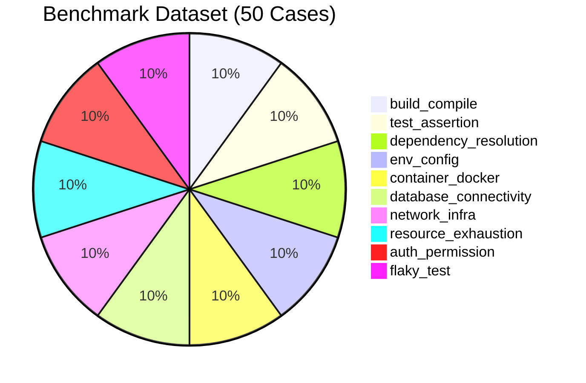

# HOPPER PHASE 16 — AI DIAGNOSTIC EVALUATION BENCHMARK DATASET

## Executive Summary

To systematically evaluate the Hopper AI Diagnosis Engine without relying on synthetic vanity metrics or subjective claims, Phase 16 established an empirical 50-case benchmark dataset located at [`backend/src/lib/ai/evaluation/dataset.ts`](file:///home/ashutoshsahoo/Downloads/Hopper/backend/src/lib/ai/evaluation/dataset.ts).

This dataset spans 10 distinct failure categories, incorporating varied programming languages, build tools, package managers, database systems, container engines, and cloud platforms.

---

## 1. Benchmark Dataset Design Principles

1. **Realistic CI Artifacts:** Raw log snippets contain realistic ANSI formatting remnants, multi-line stack traces, timestamp headers, and compiler error diagnostics.
2. **Deterministic Ground Truth:** Every test case specifies:
   - Ground truth error category.
   - Ground truth root-cause explanation.
   - Specific keywords and line evidence tokens that must appear in evidence.
   - Expected local remediation commands.
   - Historical occurrence statistics and ground-truth flakiness score.
3. **Multi-Cause & Ambiguity Levels:** Cases include standard (clean single-cause), ambiguous (misleading runner wrapper), and multi-cause (cascading failure) difficulty classifications.
4. **Reproducible Test Runner:** The dataset is coupled with [`evaluator.ts`](file:///home/ashutoshsahoo/Downloads/Hopper/backend/src/lib/ai/evaluation/evaluator.ts) and executable via `npx tsx backend/src/lib/ai/evaluation/run-baseline.ts`.

---

## 2. Dataset Distribution by Category



---

## 3. Detailed Case Inventory

### Category 1: Compilation and Build Failures (`build_compile`)
| Case ID | Scenario Name | Runner / Tool | Exit Code | Ground Truth Root Cause |
| :--- | :--- | :--- | :--- | :--- |
| `CASE-01` | TypeScript Strict Type Mismatch | `tsc -b && vite build` | 2 | `Type 'string \| undefined' is not assignable to type 'string' (TS2322)` |
| `CASE-02` | Rust Missing Trait Implementation | `cargo test --no-run` | 101 | `Trait 'std::fmt::Display' is not implemented for struct 'JobPayload' (E0277)` |
| `CASE-03` | Go Syntax Error in Handler | `go test ./...` | 2 | `syntax error: unexpected comma at end of statement in auth_handler.go:34` |
| `CASE-04` | Missing Imported Module | `npm run build (webpack)` | 1 | `Module not found: Can't resolve './components/AuthModal' in 'src/App.tsx'` |
| `CASE-05` | Vite CSS Preprocessor Missing | `vite build` | 1 | `Pre-processor dependency 'sass' not found; install sass to compile .scss files` |

### Category 2: Unit and Integration Test Failures (`test_assertion`)
| Case ID | Scenario Name | Runner / Tool | Exit Code | Ground Truth Root Cause |
| :--- | :--- | :--- | :--- | :--- |
| `CASE-06` | Jest Deep Equality Assertion | `npm test (jest)` | 1 | `Expected status 200 but received 403 Forbidden in user-auth.test.ts` |
| `CASE-07` | Vitest Unhandled Promise Rejection | `vitest run` | 1 | `AssertionError: expected 'active' to deeply equal 'pending'` |
| `CASE-08` | Pytest Fixture Value Mismatch | `pytest tests/` | 1 | `AssertionError: assert calculate_discount(100, 0.2) == 80.0 (got 75.0)` |
| `CASE-09` | Go Table-Driven Test Panic | `go test -v ./pkg/queue` | 1 | `TestWorkerPool/JobDispatch failed: got error 'queue closed', want nil` |
| `CASE-10` | JUnit Mockito Missing Stub | `mvn test` | 1 | `ArgumentsAreDifferent: userRepository.findById("usr-123") wanted but not invoked` |

### Category 3: Dependency Resolution Failures (`dependency_resolution`)
| Case ID | Scenario Name | Runner / Tool | Exit Code | Ground Truth Root Cause |
| :--- | :--- | :--- | :--- | :--- |
| `CASE-11` | npm Peer Dependency Conflict | `npm ci` | 1 | `npm ERR! code ERESOLVE: Could not resolve dependency react@18 vs react@19` |
| `CASE-12` | Python pip Incompatible Packages | `pip install -r requirements.txt` | 1 | `ERROR: Cannot install pydantic>=2.0 and langchain-core==0.1.2 because of version conflict` |
| `CASE-13` | Yarn Lockfile Inconsistency | `yarn install --immutable` | 1 | `YN0028: The lockfile would have been modified by this install, which is forbidden` |
| `CASE-14` | Cargo Duplicate Dependency Key | `cargo check` | 101 | `failed to select a version for the requirement 'tokio = "^1.28"'` |
| `CASE-15` | Missing Private npm Registry Token | `npm ci` | 1 | `npm ERR! code E404: 404 Not Found - GET https://npm.pkg.github.com/@hopper/enterprise` |

### Category 4: Environment & Configuration Failures (`env_config`)
| Case ID | Scenario Name | Runner / Tool | Exit Code | Ground Truth Root Cause |
| :--- | :--- | :--- | :--- | :--- |
| `CASE-16` | Missing Database URL Env Var | `npm start` | 1 | `Error: Missing required environment variable: DATABASE_URL` |
| `CASE-17` | Node Version Engine Mismatch | `npm install` | 1 | `npm ERR! EBADENGINE Unsupported engine for node 18.12.0; required >=20.0.0` |
| `CASE-18` | CLI Executable Missing in PATH | `bash ci.sh` | 127 | `sh: line 1: vitest: command not found` |
| `CASE-19` | Invalid Configuration JSON Syntax | `node load-config.js` | 1 | `SyntaxError: Unexpected token '}' at config/ci.json:14` |
| `CASE-20` | Incorrect Working Directory Path | `bash test.sh` | 1 | `cd: frontend/client: No such file or directory` |

### Category 5: Docker & Container Failures (`container_docker`)
| Case ID | Scenario Name | Runner / Tool | Exit Code | Ground Truth Root Cause |
| :--- | :--- | :--- | :--- | :--- |
| `CASE-21` | Docker Daemon Socket Unreachable | `docker compose up` | 1 | `Cannot connect to the Docker daemon at unix:///var/run/docker.sock. Is the docker daemon running?` |
| `CASE-22` | Dockerfile RUN Step Non-Zero Exit | `docker build .` | 1 | `The command '/bin/sh -c npm run build' returned a non-zero code: 1` |
| `CASE-23` | Docker Image Registry Rate Limit | `docker pull` | 1 | `toomanyrequests: You have reached your pull rate limit. Please purchase a pro account.` |
| `CASE-24` | Missing Base Image Manifest | `docker build` | 1 | `manifest for node:99-alpine not found: manifest unknown` |
| `CASE-25` | Port Already Allocated in Compose | `docker compose up` | 1 | `Bind for 0.0.0.0:5432 failed: port is already allocated` |

### Category 6: Database Connectivity Failures (`database_connectivity`)
| Case ID | Scenario Name | Runner / Tool | Exit Code | Ground Truth Root Cause |
| :--- | :--- | :--- | :--- | :--- |
| `CASE-26` | Postgres Connection Refused | `npm test` | 1 | `ConnectionRefusedError: connect ECONNREFUSED 127.0.0.1:5432` |
| `CASE-27` | Postgres Password Auth Failed | `prisma migrate deploy` | 1 | `P1001: Authentication failed against database server at 'localhost:5432' for user 'postgres'` |
| `CASE-28` | Relation Does Not Exist | `npm run test:e2e` | 1 | `error: relation "user_workspaces" does not exist in query` |
| `CASE-29` | Prisma Migration Drift Detected | `prisma migrate check` | 1 | `Database schema is out of sync with migration history. Pending migration: 20261106_add_tokens` |
| `CASE-30` | Connection Pool Exhaustion | `npm test` | 1 | `TimeoutError: ResourceRequest timed out after 10000ms from pool 'default'` |

### Category 7: Network & Infrastructure Failures (`network_infra`)
| Case ID | Scenario Name | Runner / Tool | Exit Code | Ground Truth Root Cause |
| :--- | :--- | :--- | :--- | :--- |
| `CASE-31` | DNS Resolution Timeout | `curl api.internal` | 28 | `curl: (28) Resolving timed out after 5000 milliseconds for auth.hopper.internal` |
| `CASE-32` | Upstream Gateway 502 Bad Gateway | `npm test` | 1 | `FetchError: request to https://api.stripe.com/v1/charges failed, reason: 502 Bad Gateway` |
| `CASE-33` | Socket Hang Up / ECONNRESET | `node fetch-sync.js` | 1 | `Error: read ECONNRESET at TLSWrap.onStreamRead` |
| `CASE-34` | TLS Certificate Verification Failed | `git clone` | 128 | `fatal: unable to access 'https://github.com/...': SSL certificate problem: self signed certificate` |
| `CASE-35` | HTTP 504 Gateway Timeout | `npm run seed` | 1 | `AxiosError: Request failed with status code 504: Gateway Time-out` |

### Category 8: Resource Exhaustion (`resource_exhaustion`)
| Case ID | Scenario Name | Runner / Tool | Exit Code | Ground Truth Root Cause |
| :--- | :--- | :--- | :--- | :--- |
| `CASE-36` | Linux Kernel OOM Killed (Exit 137) | `npm run test:e2e` | 137 | `Process terminated with signal SIGKILL (exit code 137: Out of Memory)` |
| `CASE-37` | V8 JavaScript Heap Out of Memory | `npm run build` | 134 | `FATAL ERROR: Ineffective mark-compacts near heap limit Allocation failed - JavaScript heap out of memory` |
| `CASE-38` | Disk Space Exhausted (ENOSPC) | `npm install` | 1 | `npm ERR! code ENOSPC: no space left on device, write` |
| `CASE-39` | Linux Maximum Open Files (EMFILE) | `node server.js` | 1 | `Error: EMFILE: too many open files, watch '/var/log'` |
| `CASE-40` | Process Fork Resource Unavailable | `make test` | 2 | `fork: Resource temporarily unavailable (pthread_create failed: EAGAIN)` |

### Category 9: Authentication & Permission Failures (`auth_permission`)
| Case ID | Scenario Name | Runner / Tool | Exit Code | Ground Truth Root Cause |
| :--- | :--- | :--- | :--- | :--- |
| `CASE-41` | Linux Filesystem Permission Denied | `bash deploy.sh` | 1 | `EACCES: permission denied, open '/var/run/hopper/server.pid'` |
| `CASE-42` | AWS S3 PutObject AccessDenied | `aws s3 cp` | 1 | `An error occurred (AccessDenied) when calling the PutObject operation on bucket 'hopper-artifacts'` |
| `CASE-43` | GitHub Actions Token 403 Forbidden | `gh release create` | 1 | `GraphQL: Resource not accessible by integration (HTTP 403: write permissions required)` |
| `CASE-44` | Git SSH Public Key Denied | `git push` | 128 | `git@github.com: Permission denied (publickey). fatal: Could not read from remote repository.` |
| `CASE-45` | Docker Registry Unauthorized (401) | `docker push` | 1 | `denied: requested access to the resource is denied (401 Unauthorized)` |

### Category 10: Flaky Tests & Intermittent Failures (`flaky_test`)
| Case ID | Scenario Name | Runner / Tool | Exit Code | Ground Truth Root Cause |
| :--- | :--- | :--- | :--- | :--- |
| `CASE-46` | Async Race Condition / Timeout | `playwright test` | 1 | `Timeout 5000ms exceeded waiting for locator('#submit-btn') to become visible` |
| `CASE-47` | Unmocked System Clock Drift | `vitest run` | 1 | `AssertionError: expected '2026-11-06T12:00:00.000Z' to equal '2026-11-06T12:00:00.005Z'` |
| `CASE-48` | Order-Dependent Database State | `npm test` | 1 | `UniqueConstraintViolation: Key (email)=(test@hopper.dev) already exists from prior test` |
| `CASE-49` | Intermittent Webhook Socket Delay | `npm test` | 1 | `TimeoutError: done() callback wasn't called within 2000 ms in WebhookListener` |
| `CASE-50` | Port Bind Race Condition in Parallel Tests | `vitest run --threads` | 1 | `Error: listen EADDRINUSE: address already in use :::3000` |

---

## 4. Verification and Evaluation CLI Runner

The dataset is verified by executing:
```bash
npx tsx backend/src/lib/ai/evaluation/run-baseline.ts
```
This runner executes all 50 cases through the Hopper diagnostic synthesizer and computes standard NLP/ML evaluation metrics.
