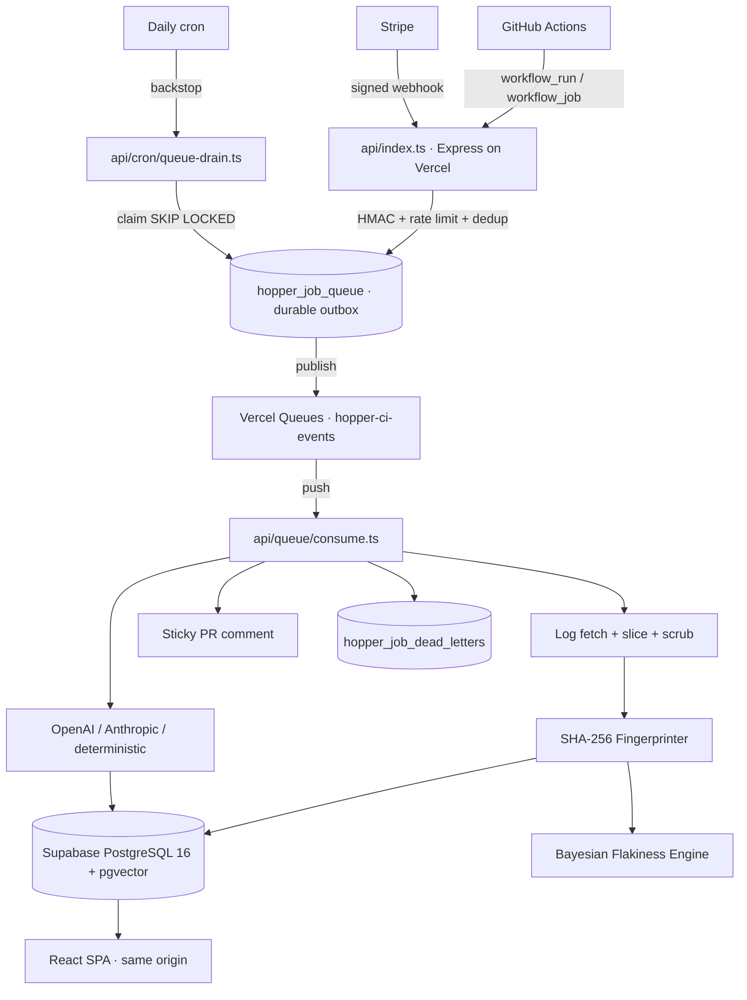

# Hopper ⚡

**CI/CD failure diagnosis and SDLC lifecycle engine.** Hopper ingests failed
GitHub Actions runs, slices and scrubs the logs, fingerprints the failure, scores
its flakiness across runs, and produces a structured diagnosis as a sticky
pull-request comment.

> Named after Rear Admiral Grace Hopper — compiler pioneer and finder of the first
> literal computer bug.

**Platform:** Vercel (serverless functions + static SPA) · Supabase PostgreSQL +
pgvector + Auth · Vercel Queues with a PostgreSQL durable outbox · OpenAI /
Anthropic / deterministic fallback · Stripe.
**No Cloudflare, no Wrangler, no Redis.**

---

## Contents

- [What it does](#what-it-does)
- [Architecture](#architecture)
- [Requirements](#requirements)
- [Quick start](#quick-start)
- [Local development](#local-development)
- [Scripts](#scripts)
- [Environment variables](#environment-variables)
- [API endpoints](#api-endpoints)
- [GitHub webhook setup](#github-webhook-setup)
- [Project structure](#project-structure)
- [Testing](#testing)
- [Security model](#security-model)
- [Deployment](#deployment)
- [Pricing tiers](#pricing-tiers)
- [Known limitations](#known-limitations)
- [License](#license)

---

## What it does

1. **Webhook ingress** — verifies `X-Hub-Signature-256` with a constant-time HMAC
   comparison, applies a per-tenant PostgreSQL rate limit, claims the delivery for
   deduplication, and persists the event to a durable outbox before acknowledging.
2. **Durable queue** — the PostgreSQL outbox is the system of record; the event is
   also published to Vercel Queues for immediate push delivery. A daily cron drain
   reaps anything a crashed consumer left behind.
3. **Log processing** — fetches the failed job log, caps extraction at 300 KB,
   strips ANSI codes and runner noise, and redacts secrets.
4. **Fingerprinting** — normalizes volatile tokens (UUIDs, SHAs, line/column
   numbers, durations, ports) and hashes the result with SHA-256 so repeat
   failures collapse into one signature.
5. **Flakiness scoring** — scores signatures from same-SHA retry passes, cross-PR
   spread, default-branch frequency and transient timeout patterns.
6. **LLM diagnosis** — asks Anthropic or OpenAI for a Zod-validated JSON diagnosis
   (deterministic `mock` provider by default).
7. **PR reporting** — posts or updates a single sticky comment on the pull
   request, including a gated historical/flakiness teaser.

---

## Architecture



Delivery guarantees: at-least-once, with four independent idempotency layers
(GitHub delivery id, outbox idempotency key, queue idempotency key, processed-event
ledger). Vercel Queues has no dead-letter queue, so terminal failures are recorded
in `hopper_job_dead_letters`.

See `docs/architecture/VERCEL_TARGET_ARCHITECTURE.md` for decisions and trade-offs.

---

## Requirements

| Requirement | Version / notes |
|---|---|
| Node.js | 20+ (`engines: >=20`) |
| Docker | For local PostgreSQL 16 + pgvector (`npm run infra:up`) |
| PostgreSQL | 16 with the `pgvector` extension (Supabase in production) |
| GitHub App | Webhook secret + private key; `workflow_run` and `workflow_job` events |
| Stripe | Optional — only for Pro/Team checkout and billing webhooks |
| AI provider | Optional — defaults to `AI_PROVIDER=mock` |

No Redis. No Cloudflare account. No Wrangler.

---

## Quick start

```bash
git clone https://github.com/johan-droid/Hopper.git
cd Hopper
npm install
cp .env.example backend/.env      # fill in GitHub App + database + optional AI/Stripe
npm run doctor                    # preflight checks
npm run dev                       # PostgreSQL + migrations + API + worker + SPA
```

- Frontend → <http://localhost:5173>
- API → <http://localhost:3000/api/health>
- Stop everything Hopper started → `npm run stop`

`npm run dev` detects port conflicts, waits for PostgreSQL to become healthy,
applies pending migrations, starts the API, the local queue worker and Vite, and
cleans up its own processes if startup fails.

---

## Local development

```bash
npm run dev            # full stack (recommended)
npm run dev:backend    # API only
npm run dev:frontend   # Vite only
npm run status         # what is running, on which ports
npm run doctor         # environment preflight
npm run start:local    # production-mode local run (built assets)
```

Local runtime uses `QUEUE_STORE=postgres`, `COORDINATION_BACKEND=postgres` and
`QUEUE_TRANSPORT=off` — events persist to the outbox and are consumed by the local
polling worker instead of Vercel Queues. The in-memory adapters exist for tests
only and throw when `NODE_ENV=production`.

---

## Scripts

| Script | Purpose |
|---|---|
| `npm run dev` | Orchestrated full-stack development |
| `npm run dev:frontend` / `dev:backend` | Run one side only |
| `npm run build` | Backend (`tsup`) + frontend (`vite`) production build |
| `npm run start:local` | Serve built artifacts locally |
| `npm run stop` | Stop Hopper-owned processes only |
| `npm run infra:up` / `infra:down` | Start/stop the PostgreSQL+pgvector container |
| `npm run status` | Process, port and dependency status |
| `npm run doctor` | Node, env, migrations, retired-artifact checks |
| `npm run migrate` | Apply `backend/supabase/migrations/*.sql` |
| `npm run lint` | `tsc --noEmit` for backend and frontend |
| `npm test` / `npm run test:frontend` | Test suites |
| `npm run simulate -- -s timeout` | Offline diagnosis demo |
| `npm run lifecycle` | Full 8-stage SDLC pipeline |

---

## Environment variables

Authoritative register: `docs/deployment/VERCEL_ENVIRONMENT_VARIABLES.md`.
Templates: `.env.example`, `backend/.env.example`, `frontend/.env.example` (no real
values).

Core set:

| Variable | Purpose |
|---|---|
| `DATABASE_URL` / `DIRECT_URL` | Pooled runtime URL / direct URL for migrations |
| `SUPABASE_URL` / `SUPABASE_JWT_SECRET` | Auth issuer + JWT verification |
| `VITE_SUPABASE_URL` / `VITE_SUPABASE_ANON_KEY` | Browser Supabase client |
| `GITHUB_APP_ID`, `GITHUB_APP_CLIENT_ID`, `GITHUB_APP_CLIENT_SECRET` | GitHub App identity |
| `GITHUB_APP_WEBHOOK_SECRET`, `GITHUB_APP_PRIVATE_KEY` | HMAC verification + installation tokens |
| `QUEUE_STORE`, `QUEUE_TRANSPORT`, `COORDINATION_BACKEND` | Queue/coordination adapters |
| `AI_PROVIDER`, `AI_MODEL`, `OPENAI_API_KEY` / `ANTHROPIC_API_KEY` | Diagnosis provider |
| `STRIPE_SECRET_KEY`, `STRIPE_WEBHOOK_SECRET`, `STRIPE_PRICE_ID_*` | Billing (optional) |
| `CORS_ALLOWED_ORIGINS` | Required in production; wildcard refused |
| `CRON_SECRET` | Bearer token for the queue-drain cron endpoint |

Never prefix a secret with `VITE_` — Vite inlines those into the browser bundle.

---

## API endpoints

All routes are mounted under `/api` on one Express app, served by a single Vercel
function (`api/index.ts`). `auth` = Supabase JWT required.

| Endpoint | Method | Auth | Description |
|---|---|---|---|
| `/api/health` | GET | none | Status plus database, coordination and queue health |
| `/api/webhooks/github` | POST | HMAC-SHA256 | GitHub webhook ingress |
| `/api/webhooks/stripe` | POST | Stripe signature | Subscription lifecycle events |
| `/api/billing/checkout` | POST | none | Create a Stripe Checkout session |
| `/api/diagnose/adhoc` | POST | none | Diagnose a raw log without a GitHub run |
| `/api/diagnose/history` | GET | yes | Recent diagnoses for the caller |
| `/api/dashboard/:orgSlug` | GET | yes | Usage, leaderboard, flaky tests |
| `/api/signatures/:id` | GET | yes | Signature timeline and occurrences |
| `/api/repositories` | GET | yes | Connected repositories |
| `/api/repositories/:repoId/failures` | GET | yes | Recent failure feed |
| `/api/repositories/:repoId/link-workspace` | POST | yes | Link a repo to a workspace |
| `/api/workspaces` | GET/POST | yes | Workspace list/create |
| `/api/workspaces/:id` | GET/PATCH/DELETE | yes | Workspace detail and lifecycle |
| `/api/user/profile` | GET/PUT | yes | Profile |
| `/api/user/profile/workspace` | PATCH | yes | Active workspace |

Ad-hoc diagnosis:

```bash
curl -X POST http://localhost:3000/api/diagnose/adhoc \
  -H 'Content-Type: application/json' \
  -d '{"rawLog":"...failed CI log...","jobName":"test","stepName":"execute-tests","modifiedFiles":["src/auth/jwt.ts"]}'
```

---

## GitHub webhook setup

1. Create a GitHub App and install it on the repositories Hopper should watch.
2. Webhook URL: `https://<your-domain>/api/webhooks/github`.
3. Subscribe to **Workflow run** and **Workflow job**.
4. Set the same secret in `GITHUB_APP_WEBHOOK_SECRET`.
5. Provide the App ID and private key so Hopper can mint installation tokens and
   post PR comments.

Only `completed` `workflow_run` / `workflow_job` events with a `failure` or
`success` conclusion are processed; everything else is acknowledged and ignored.
Add `?sync=true` to process an event inline instead of enqueuing it.

Acknowledgement contract: `202` is returned only after the event is durably
persisted. If neither queue publication nor the bounded inline drain succeeds, the
endpoint returns `503` so GitHub retries.

---

## Project structure

```
Hopper/
├── api/                              # Vercel function entrypoints
│   ├── index.ts                      # Express app (all /api routes)
│   ├── queue/consume.ts              # Vercel Queues push consumer
│   └── cron/queue-drain.ts           # daily backstop drain (CRON_SECRET)
├── backend/
│   ├── src/
│   │   ├── server/
│   │   │   ├── app.ts                # createApp() + validateRuntimeConfig()
│   │   │   ├── index.ts              # local HTTP bootstrap only
│   │   │   ├── routes/               # health, webhooks, dashboard, workspaces, …
│   │   │   └── middleware/           # auth, rate limit, security headers, errors
│   │   ├── queue/                    # types, job-store, coordination, transport,
│   │   │                             # consumer, ci-queue
│   │   ├── workers/                  # local polling adapters (not needed on Vercel)
│   │   ├── lib/                      # parser, flakiness engine, ai, billing, github
│   │   ├── db/                       # pool, migrator, repositories
│   │   └── cli/                      # doctor | migrate | simulate | serve | lifecycle
│   ├── supabase/migrations/          # forward-only DDL + queue/coordination functions
│   ├── tests/                        # 29 Vitest suites
│   └── Dockerfile
├── frontend/                         # Vite + React + TypeScript SPA
│   ├── src/{api,components,store,styles}
│   └── vercel.json
├── scripts/local/                    # dev orchestrator, doctor, infra, status, stop
├── docs/
│   ├── architecture/VERCEL_TARGET_ARCHITECTURE.md
│   ├── deployment/                   # runbooks, env register, cost, migration ledger
│   └── security/                     # exposure audit, rotation runbook
├── vercel.json                       # rewrites, headers, functions, queue trigger, cron
├── docker-compose.yml                # PostgreSQL 16 + pgvector only
└── VERCEL_MIGRATION_FINAL_REPORT.md
```

---

## Testing

```bash
npm run lint           # tsc --noEmit (backend + frontend)
npm test               # backend Vitest — 29 files / 183 tests
npm run test:frontend  # frontend Vitest — 9 tests
npm run build          # backend + frontend production builds
npm run lifecycle      # typecheck + tests + build + synthetic diagnosis
```

CI (`.github/workflows/ci.yml`) runs against a real PostgreSQL 16 + pgvector
service: typechecks, both test suites, migration safety, Vercel configuration
validity and a guard that fails if any Cloudflare artefact reappears.
`.github/workflows/security.yml` adds gitleaks, a high-severity dependency audit
and a tracked-env-file guard.

---

## Security model

- **Webhook authenticity** — HMAC-SHA256 with `crypto.timingSafeEqual` for GitHub;
  Stripe signatures verified with the SDK's constant-time comparison. Webhooks
  never use session auth.
- **Rate limiting and deduplication** — atomic PostgreSQL functions
  (`hopper_consume_rate_limit`, `hopper_claim_webhook_delivery`), cluster-wide and
  idempotent. In-memory adapters are refused in production.
- **Secret redaction** — regex scrubbing of AWS keys, GitHub tokens, database URIs,
  bearer tokens, PEM blocks and API keys before any log is stored or sent to a
  model.
- **Prompt injection** — log content is wrapped in `<UNTRUSTED_CI_LOG>` markers and
  the model response is schema-validated with Zod.
- **Fetch hardening** — log extraction is capped at the tail 300 KB.
- **Tenant isolation** — every record links through `organizations` →
  `repositories`; repositories use RLS with tenant context set transaction-locally
  so it cannot leak across pooled connections.
- **Configuration** — validated fail-closed at boot; no `process.exit()` in
  serverless paths; no secret is ever logged or shipped to the client.

See `docs/security/SECRET_EXPOSURE_AUDIT.md` and
`docs/security/CREDENTIAL_ROTATION_RUNBOOK.md`.

---

## Deployment

```bash
npx vercel login
npx vercel link
npx vercel pull --yes --environment=preview
npx vercel build
npx vercel deploy --prebuilt
```

`vercel.json` already defines the SPA output, `/api/(.*)` rewrite, security
headers, immutable asset caching, the `hopper-ci-events` queue trigger, and a
daily cron. GitHub App → Vercel Git integration handles preview and production
promotion; GitHub Actions only verifies.

- Deployment runbook: `docs/deployment/VERCEL_DEPLOYMENT_RUNBOOK.md`
- Rollback: `docs/deployment/VERCEL_ROLLBACK_RUNBOOK.md`
- Setup from zero: `docs/deployment/VERCEL_SETUP.md`
- Cost and Hobby limits: `docs/deployment/VERCEL_COST_AND_LIMITS.md`
- Migration ledger: `docs/deployment/VERCEL_MIGRATION_EXECUTION.md`

**Hobby note:** Vercel Hobby is for non-commercial personal use, crons run at most
once per day, and queues are in public beta with 1,000,000 operations/month
included. Commercial operation requires Vercel Pro.

---

## Pricing tiers

| Tier | Price | Runs/mo | History | Flaky matrix | Slack/Discord | Auto-retry |
|------|-------|---------|---------|--------------|---------------|------------|
| Free | $0 | 30 | 24 hours | Blurred teaser | No | No |
| Pro Developer | $9/mo | 250 | 30 days | Full | No | No |
| Small Team | $29/mo | 1,000 | 90 days | Full | Yes | >80% confidence |

Tier limits live in `src/lib/billing/quota-guard.ts` and
`organizations.monthly_run_limit`.

---

## Known limitations

- **Hobby cron is daily.** Queue push delivery is the primary path; the cron drain
  is a backstop, so a crashed consumer can take up to 24 hours to be swept without
  a Vercel Queues retry.
- **Vercel Queues is in public beta**, and it has no dead-letter queue — Hopper
  keeps its own in PostgreSQL.
- **Mock AI by default.** `AI_PROVIDER=mock` returns deterministic diagnoses;
  telemetry marks them as fallback and they are never reported as live model
  output.
- **Live integration tests are unverified here.** GitHub App, Stripe and AI
  provider calls require credentials that are not present in this environment.
- **No `LICENSE` file.** The package declares Apache-2.0 but the license text is
  not yet in the repository.

---

## License

Apache License 2.0 — declared in `package.json` (`"license": "Apache-2.0"`). Add
the standard `LICENSE` text before distributing.

---

**⚡ Hopper — turn failing CI into an actionable diagnosis.**
