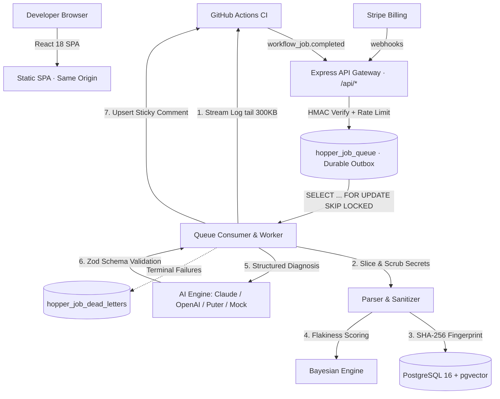

# Hopper ⚡

**Next-Generation CI/CD Failure Diagnosis Engine & SDLC Lifecycle Runner.**  
Hopper ingests failing continuous integration runs, slices and sanitizes raw terminal logs, fingerprints error patterns into a historical cloud moat, scores flakiness across runs, and delivers structured root-cause diagnoses directly to pull requests.

> Named after **Rear Admiral Grace Hopper** — compiler pioneer, programming languages visionary, and finder of the first literal computer bug.

---

## Highlights

- ⚡ **Zero-YAML Setup:** Connects in seconds via GitHub App installation without modifying existing workflow configurations.
- ⏱️ **Sub-15-Second Diagnosis:** Slices 50MB+ CI logs, strips ANSI noise, redacts secrets, and computes root-cause diagnoses before developers context-switch.
- 🛡️ **The Failure Signature Moat:** Hashes normalized stack traces (SHA-256) and clusters them in PostgreSQL with `pgvector` to collapse repeat occurrences and track historical recurrence.
- 🎯 **Bayesian Flakiness Engine:** Differentiates genuine code breakages from non-deterministic flaky test failures across retries, PRs, and branches.
- 🤖 **Zero-Cost & Low-Cost AI Intelligence:** Multi-provider reasoning supporting Anthropic Claude, OpenAI, and zero-API-key client-side execution via **Puter.js** (DeepSeek V3, Qwen 2.5 Coder) alongside deterministic offline mocks.
- 💬 **Sticky Pull-Request Comments:** Continuously updates a single clean comment on GitHub PRs with diagnostic explanations, code fixes, and diffs.
- 🔒 **Zero-Leakage Multi-Tenancy:** Hardened Row-Level Security (RLS) in PostgreSQL 16 enforced under a dedicated unprivileged runtime role.

---

## Architecture at a Glance



> **Platform:** Node.js 20+ · Express 4 · Next.js 14 (App Router) + React 18 · Supabase PostgreSQL 16 + `pgvector` · Vercel Multi-Service Ingress · Multi-Provider AI (Claude, OpenAI, Puter.js, Mock).  
> **No Redis. No Cloudflare. No BullMQ.**

---

## Quick Start

### Prerequisites
- **Node.js** `>= 20.0.0`
- **Docker** & **Docker Compose** (for local PostgreSQL 16 + `pgvector`)
- **npm** `>= 9.0.0`

### 1. Clone & Install
```bash
git clone https://github.com/johan-droid/Hopper.git
cd Hopper
npm install
```

### 2. Configure Environment
```bash
cp .env.example backend/.env
cp frontend/.env.example frontend/.env
```
*(Default settings run offline with local PostgreSQL and deterministic Mock AI).*

### 3. Start Database & Run Preflight Checks
```bash
npm run infra:up    # Starts PostgreSQL 16 + pgvector container
npm run doctor      # Verifies dependencies, node version, and config
npm run migrate     # Applies forward-only SQL migrations (0001-0013)
```

### 4. Launch Full Development Stack
```bash
npm run dev
```

- **Frontend App:** <http://localhost:5173>
- **API Gateway:** <http://localhost:3000>
- **Health Check:** <http://localhost:3000/api/health>
- **Puter.js Serverless Edition:** <http://localhost:5173/puter/>

---

## Developer Scripts

| Command | Description |
|---|---|
| `npm run dev` | Full-stack development orchestrator (API + worker + Next.js frontend) |
| `npm run dev:backend` | Starts only the Express backend API (`tsx watch`) |
| `npm run dev:frontend` | Starts only the Next.js frontend (`next dev`) |
| `npm run dev:worker` | Starts only the local durable queue worker |
| `npm run status` | Inspects running processes and port allocations |
| `npm run stop` | Cleanly terminates all Hopper-owned child processes |
| `npm run doctor` | Comprehensive environment and configuration health audit |
| `npm run migrate` | Applies pending database migrations |
| `npm run lint` | Strict TypeScript compilation check across all workspaces |
| `npm test` | Executes backend Vitest suites (33 test files / 226 tests) |
| `npm run test:frontend` | Executes frontend Vitest suites (4 test files / 34 tests) |
| `npm run build` | Compiles production backend (`tsup`) and frontend (`next build`) |
| `npm run simulate -- -s timeout`| Simulates an offline CI failure diagnosis (timeout, assertion, oom) |
| `npm run lifecycle` | Executes full 8-stage automated SDLC build and test lifecycle |

---

## Authoritative Documentation

Detailed technical documentation is organized in the [`docs/`](file:///home/ashutoshsahoo/Downloads/Hopper/docs/README.md) directory:

- 📖 **[Product Vision & Philosophy](file:///home/ashutoshsahoo/Downloads/Hopper/docs/product/VISION.md):** Mission, value prop, target users, pricing tiers, and non-goals.
- 🏛️ **[System Architecture](file:///home/ashutoshsahoo/Downloads/Hopper/docs/architecture/SYSTEM_OVERVIEW.md):** System topology, event lifecycle, and delivery guarantees.
- ⚙️ **[Subsystems & Engine](file:///home/ashutoshsahoo/Downloads/Hopper/docs/architecture/ARCHITECTURE.md):** Deep dive into backend API, queue worker, and parser pipelines.
- 🗄️ **[Database Architecture & ERD](file:///home/ashutoshsahoo/Downloads/Hopper/docs/architecture/DATA_MODEL.md):** Entity models, migrations 0001-0013, RLS policies, and SQL functions.
- 🔌 **[External Integrations](file:///home/ashutoshsahoo/Downloads/Hopper/docs/architecture/INTEGRATIONS.md):** GitHub App, Stripe, Puter.js, Vercel, and AI providers.
- 🚀 **[Getting Started](file:///home/ashutoshsahoo/Downloads/Hopper/docs/development/GETTING_STARTED.md):** Complete developer onboarding and local setup guide.
- 📏 **[Development Guidelines](file:///home/ashutoshsahoo/Downloads/Hopper/docs/development/DEVELOPMENT_GUIDELINES.md):** Coding conventions, API standards, and migration policies.
- 🧪 **[Testing Strategy](file:///home/ashutoshsahoo/Downloads/Hopper/docs/development/TESTING.md):** Test suites, adversarial tests, E2E flows, and simulations.
- 🤝 **[Contributing](file:///home/ashutoshsahoo/Downloads/Hopper/docs/development/CONTRIBUTING.md):** Branching model, PR checklists, and commit standards.
- 📊 **[Current State Baseline](file:///home/ashutoshsahoo/Downloads/Hopper/docs/project/CURRENT_STATE.md):** Verified capabilities, test metrics, and launch blockers.
- 🗺️ **[Phased Roadmap](file:///home/ashutoshsahoo/Downloads/Hopper/docs/project/ROADMAP.md):** Completed milestones and future roadmap.
- 📋 **[Tasks & Gap Register](file:///home/ashutoshsahoo/Downloads/Hopper/docs/project/TASKS_AND_GAPS.md):** Actionable unfinished tasks and acceptance criteria.
- ⚠️ **[Known Issues](file:///home/ashutoshsahoo/Downloads/Hopper/docs/project/KNOWN_ISSUES.md):** Issue tracking register and architectural limitations.
- 🔒 **[Security Architecture](file:///home/ashutoshsahoo/Downloads/Hopper/docs/security/SECURITY_OVERVIEW.md):** Threat model, secret scrubbing, and tenant isolation.
- 📑 **[ADR Index](file:///home/ashutoshsahoo/Downloads/Hopper/docs/decisions/ADR_INDEX.md):** Architecture Decision Records (ADR-001 through ADR-007).
- 🤖 **[Agent Operating Manual (AGENTS.md)](file:///home/ashutoshsahoo/Downloads/Hopper/AGENTS.md):** Mandatory single-agent governance manual.

---

## License

Hopper is licensed under the Apache License, Version 2.0 (declared in [`package.json`](file:///home/ashutoshsahoo/Downloads/Hopper/package.json)).

