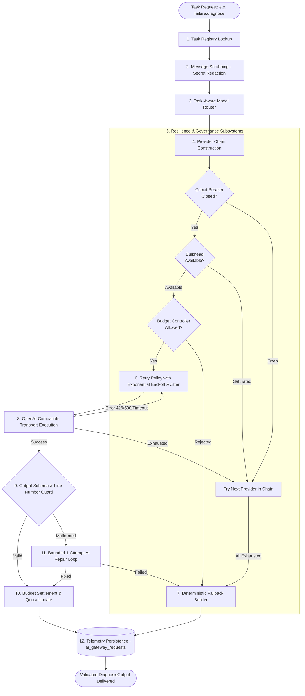

# Hopper — Multi-Provider Agentic AI Gateway Architecture (docs/architecture/AI_GATEWAY.md)

> **Mandatory Reference:** This document details Hopper's provider-independent AI gateway, model routing algorithms, resilience policies, bounded agentic orchestrator, and telemetry persistence layer.

---

## 1. System Mission & Core Architectural Invariants

The Hopper AI Gateway (`backend/src/lib/ai/gateway/`) is the single unified entry point for all artificial intelligence tasks across the platform.

### Architectural Invariants
1. **Zero Direct Provider Calls:** Application services, API route handlers, and queue consumers never import or invoke provider SDKs or endpoints directly. Every AI interaction must pass through:
   ```typescript
   aiGateway.execute<Input, Output>(taskName, input, context, fallbackBuilder);
   ```
2. **Provider Independence & Multi-Tier Failover:** Providers are swappable abstractions conforming to `ProviderAdapter`. If the primary provider experiences rate limits, network timeouts, or server outages, the gateway automatically falls back across the provider chain without application-level failures.
3. **No Automatic Paid Fallbacks:** To protect customer and organization budgets, paid commercial providers (Anthropic Claude, OpenAI) are strictly opt-in (`AI_ENABLE_PAID_FALLBACK=false` by default). The gateway will never silently incur external charges when free providers fail.
4. **Guaranteed Deterministic Fallback:** When all external AI providers fail or when operating completely offline without API credentials, the gateway invokes the local 10-category deterministic heuristic synthesizer (`synthesizeDeterministicDiagnosis`). An unhandled model outage never crashes a CI/CD failure analysis job.
5. **Fail-Closed Spend & Admission Control:** Every AI invocation reserves quota against the organization's monthly ceiling (`AiBudgetController`). If budget limits are exceeded or the reservation cannot be acquired, execution immediately diverts to the deterministic fallback.
6. **Strict Evidence Grounding & Verification:** All model completions are parsed via JSON mode, validated against authoritative Zod schemas (`DiagnosisOutputSchema`), verified against actual cited log line numbers, and bounded by a 1-attempt repair loop.
7. **Complete Rejection of Puter.js:** Puter.js has been permanently removed from Hopper. Client-side, untrusted, or ungrounded script-based AI execution is strictly prohibited.

---

## 2. Gateway Pipeline & Execution Lifecycle

Every model execution traverses a rigorous multi-stage pipeline:



---

## 3. Supported Providers & Model Catalog

### 3.1 Primary Provider: Groq Cloud API
- **Endpoint:** `https://api.groq.com/openai/v1/chat/completions` (OpenAI-compatible)
- **Credential:** `GROQ_API_KEY` (configured in `backend/.env` or Vercel Project Settings)
- **Authentication:** `Authorization: Bearer <GROQ_API_KEY>`
- **Hardware Acceleration:** Groq LPU (Language Processing Unit) tensor processors for low-latency inference.
- **Production Models:**
  - `openai/gpt-oss-120b` (Primary heavy diagnosis model; 131k context window; structured JSON mode; verified tool calling; `reasoning_effort` support).
  - `openai/gpt-oss-20b` (High-speed classification model; 131k context window; JSON mode; verified tool calling).
- **Preview Models:**
  - `qwen/qwen3.8-27b` (Preview tier; tool-calling and JSON mode).
  - `minimaxai/minimax-m2.7` (Enterprise preview tier; 196k context window).

### 3.2 Secondary Provider: NVIDIA NIM API Catalog
- **Endpoint:** `https://integrate.api.nvidia.com/v1/chat/completions` (OpenAI-compatible)
- **Credential:** `NVIDIA_NIM_API_KEY`
- **Authentication:** `Authorization: Bearer <NVIDIA_NIM_API_KEY>`
- **Catalog Models:**
  - `nvidia/nemotron-3-super-120b-a12b` (Deep reasoning & synthesis).
  - `nvidia/nemotron-3.5-lightning-30b-a3b` (Fast triage & log classification).
  - `qwen/qwen3-next-80b-a3b-instruct` (High-capacity reasoning).
  - `meta/llama-3.3-70b-instruct` (Deep reasoning & hypothesis generation).

> [!WARNING]
> **NVIDIA Licensing Notice:** Free catalog access in the NVIDIA Developer API Catalog is granted for prototyping, evaluation, and research purposes. NVIDIA catalog endpoints do not guarantee enterprise SLA uptime or high-throughput concurrency. In production deployments, Groq serves as the primary engine, and NVIDIA NIM serves as an evaluation-tier secondary failover behind Groq, with Hopper's deterministic heuristic engine providing guaranteed recovery.

### 3.3 Optional Paid Providers (Opt-In Only)
- **Anthropic:** Claude 3.5 Haiku (`ANTHROPIC_API_KEY`).
- **OpenAI:** GPT-4o-mini (`OPENAI_API_KEY`).
- **Activation Policy:** Only included in failover chains when `AI_ENABLE_PAID_FALLBACK=true` is explicitly set in environment variables.

---

## 4. Resilience Subsystems

The gateway incorporates 5 defensive architectural subsystems to guarantee fault tolerance under production loads:

| Subsystem | File Location | Purpose & Guarantees |
|---|---|---|
| **Circuit Breaker** | `src/lib/ai/gateway/resilience/circuit-breaker.ts` | Closed/Open/Half-Open state machine per provider. Trips after 3 consecutive failures. Fast-fails requests during 30s cooldown before probing with a canary request. |
| **Bulkhead** | `src/lib/ai/gateway/resilience/bulkhead.ts` | Concurrency isolation limiter (default 8 concurrent executions per provider). Prevents runaway model requests from exhausting database connection pools or socket file descriptors. |
| **Retry Policy** | `src/lib/ai/gateway/resilience/retry.ts` | Exponential backoff with jitter (`initialDelayMs: 250`, `maxRetries: 2`). Enforces standard HTTP `Retry-After` headers on 429 rate limit responses. Fails immediately on 401/404 permanent errors. |
| **Timeout Policy** | `src/lib/ai/gateway/resilience/timeout-policy.ts` | Enforces total task deadline (`AI_REQUEST_TIMEOUT_MS: 30000`) across all retry attempts using linked `AbortSignal` instances. |
| **Provider Health** | `src/lib/ai/gateway/resilience/provider-health.ts` | Tracks live success rates, failure classes, and latency percentiles per provider for introspection and dynamic model ranking. |

---

## 5. Bounded Agentic Diagnostic Orchestrator

Hopper's diagnostic intelligence does not execute as an unconstrained autonomous loop. It runs under strict resource ceilings managed by `AgentOrchestrator` (`src/lib/ai/gateway/orchestration/agent-orchestrator.ts`):

### 5.1 The 6 Diagnostic Stages
1. **Stage 1 (Failure Understanding):** Extracts verified workflow metadata, failing step name, commit SHA, and exit codes into a verified observations ledger.
2. **Stage 2 (Evidence Analysis):** Invokes safe read-only tool `get_sanitized_log_excerpt` to isolate the 40 lines surrounding the failure stack trace.
3. **Stage 3 (Historical Intelligence):** Invokes `get_historical_occurrences` and `get_flakiness_statistics` to correlate with cross-run repository trends.
4. **Stage 4 (Diagnosis Synthesis):** Calls `failure.diagnose` through the central AI Gateway with evidence-grounded system prompts.
5. **Stage 5 (Output Verification):** Passes model JSON through `OutputValidator`. Validates schema compliance, checks that cited log line numbers actually exist in the log snippet, and triggers a 1-attempt repair loop if formatting errors occurred.
6. **Stage 6 (Persistence Preparation):** Records structured telemetry into `ai_gateway_requests` and emits clean Markdown comments for pull request delivery.

### 5.2 Hard Governance Ceilings
- **Max Model Calls:** 5 per diagnostic workflow run.
- **Max Orchestration Iterations:** 4 iterations.
- **Max Token Budget:** 16,000 total tokens per task.
- **Max Wall-Clock Duration:** 60 seconds.
- **Max Tool Calls:** 8 tool executions.
- **Tool Sandbox:** All diagnostic tools in `ToolRegistry` are read-only in-memory queries over sanitized log state. No tools are permitted to execute shell commands, make outbound HTTP requests, or modify database state.

---

## 6. Database Schema & Migration (0014)

Gateway telemetry and circuit breaker state are durably persisted in PostgreSQL 16 via migration `0014_ai_gateway_and_circuit_breakers.sql`:

```sql
-- Gateway request telemetry ledger
CREATE TABLE IF NOT EXISTS ai_gateway_requests (
  id UUID PRIMARY KEY DEFAULT gen_random_uuid(),
  request_id UUID NOT NULL,
  task_id TEXT NOT NULL,
  task_type TEXT NOT NULL,
  provider_id TEXT NOT NULL,
  model_id TEXT NOT NULL,
  status TEXT NOT NULL, -- success, rate_limited, server_error, exhausted, timeout
  latency_ms INTEGER NOT NULL,
  prompt_tokens INTEGER,
  completion_tokens INTEGER,
  estimated_cost_usd NUMERIC(10, 6) DEFAULT 0,
  attempts INTEGER NOT NULL DEFAULT 1,
  failover_path TEXT[] DEFAULT '{}',
  error_kind TEXT,
  created_at TIMESTAMPTZ NOT NULL DEFAULT NOW()
);

-- Distributed circuit breaker state
CREATE TABLE IF NOT EXISTS ai_circuit_breakers (
  provider_id TEXT PRIMARY KEY,
  state TEXT NOT NULL DEFAULT 'closed',
  consecutive_failures INTEGER NOT NULL DEFAULT 0,
  opened_at TIMESTAMPTZ,
  last_probed_at TIMESTAMPTZ,
  updated_at TIMESTAMPTZ NOT NULL DEFAULT NOW()
);
```

---

## 7. Configuration Reference

```bash
# --- AI Provider Selection ---
AI_PROVIDER=groq                     # groq (default) | nvidia-nim | mock | anthropic | openai
AI_ROUTING_MODE=failover             # failover (chain through eligible providers) | single

# --- Provider Credentials ---
GROQ_API_KEY=gsk_...                 # Required for live Groq inference
NVIDIA_NIM_API_KEY=nvapi-...         # Required for live NVIDIA NIM failover
OPENAI_API_KEY=sk-...                # Optional (embeddings + opt-in diagnosis)
ANTHROPIC_API_KEY=sk-ant-...         # Optional (opt-in diagnosis)

# --- Gateway Policy Flags ---
AI_ENABLE_GROQ=true
AI_ENABLE_NVIDIA_NIM=true
AI_ENABLE_PAID_FALLBACK=false        # Paid providers strictly disabled by default
AI_MAX_RETRIES=2
AI_REQUEST_TIMEOUT_MS=30000
AI_RETRY_INITIAL_DELAY_MS=250
AI_MAX_CONCURRENT_REQUESTS=8
```
