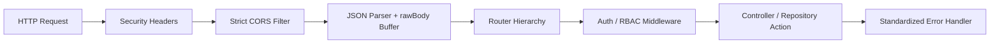
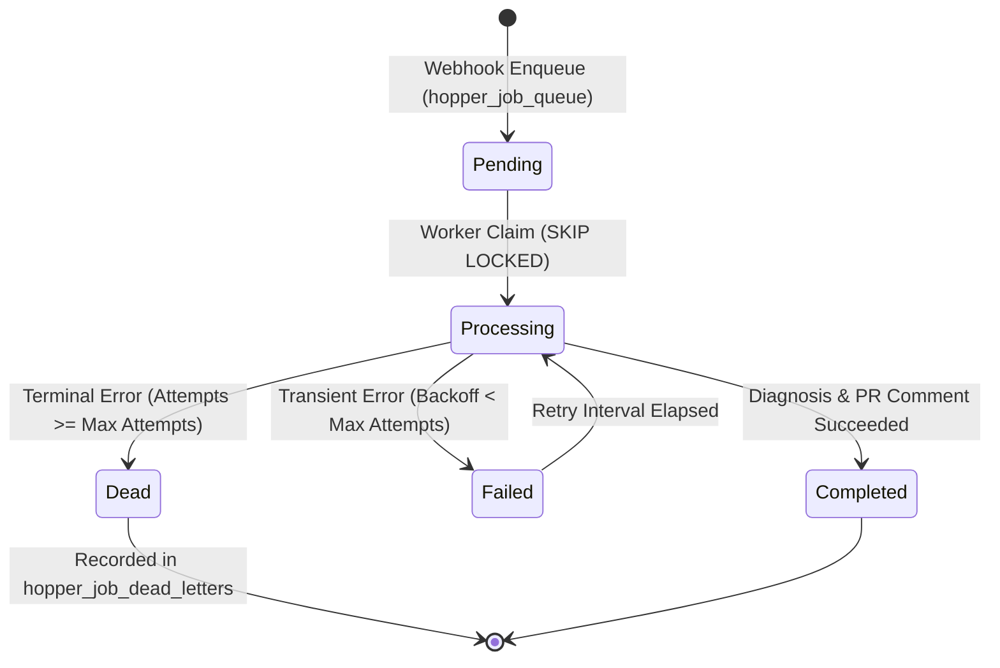
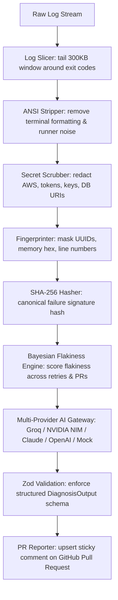

# Hopper — Application Architecture & Subsystems (ARCHITECTURE.md)

---

## 1. Monorepo Structural Organization

Hopper is architected as an npm workspace monorepo separating frontend presentation, backend business logic, and serverless edge configurations:

```text
Hopper/
├── backend/                          # Express 4 API Gateway & Diagnostic Engine
│   ├── src/
│   │   ├── cli/                      # CLI tools: doctor, migrate, simulate, lifecycle
│   │   ├── db/                       # PostgreSQL client, pool, migrator, repositories
│   │   ├── engine/                   # SDLC lifecycle engine & task state machines
│   │   ├── lib/                      # Pure functional subsystems:
│   │   │   ├── ai/                   # Multi-provider LLM diagnosis, embeddings, budget control
│   │   │   ├── billing/              # Stripe webhook processor, quota guard
│   │   │   ├── github/               # App auth, Octokit client, log fetcher, PR reporter, sync
│   │   │   ├── moat/                 # Bayesian flakiness engine
│   │   │   └── parser/               # ANSI strip, log slicer, secret scrubber, fingerprinter
│   │   ├── queue/                    # PostgreSQL outbox, consumer, coordination, transport
│   │   ├── server/                   # Express application factory, routes, and middleware
│   │   └── workers/                  # Queue processors (workflow-job, slack-alert)
│   ├── supabase/migrations/          # Idempotent forward-only SQL migrations (0001 to 0013)
│   └── tests/                        # 33 Vitest suites covering all subsystems (226 tests)
├── frontend/                         # Next.js 14 App Router + React 18 Application
│   ├── app/                          # Next.js App Router (layout, providers, 20 routes)
│   ├── src/
│   │   ├── api/                      # TanStack Query hooks, API client, Zod schemas
│   │   ├── app/                      # Legacy App component & RequireAuth guard
│   │   ├── components/               # UI design system primitives & layout shells
│   │   ├── features/                 # Domain pages: overview, failures, diagnoses, trends,
│   │   │                             # investigations, repositories, settings, auth, marketing
│   │   ├── lib/                      # Route helpers, formatters, filters, auth clients
│   │   └── store/                    # Zustand client application store (useAppStore.ts)
│   └── tests/                        # Vitest & Playwright E2E suites (34 tests)
├── scripts/                          # Local orchestration, doctor, infra, recovery scripts
├── docs/                             # Authoritative technical documentation
├── vercel.json                       # Multi-service routing configuration
└── docker-compose.yml                # PostgreSQL 16 + pgvector container definition
```

---

## 2. Backend Subsystem Architecture

### 2.1 Express Application Factory (`createApp`)
The backend avoids global side effects by exporting `createApp()` from `backend/src/server/app.ts`. This allows the exact same application instance to be executed in local HTTP development (`src/server/index.ts`), inside Vercel serverless functions, or within supertest integration tests without port collisions or process leaks.



### 2.2 Middleware Pipeline
1. **Security Headers (`security.ts`):** Enforces OWASP-recommended headers:
   - `X-Content-Type-Options: nosniff`
   - `X-Frame-Options: DENY`
   - `X-XSS-Protection: 0`
   - `Referrer-Policy: strict-origin-when-cross-origin`
2. **CORS Middleware:** Allows matching origins configured in `CORS_ALLOWED_ORIGINS`. In production, wildcard `*` is strictly refused. Exposes `x-request-id` for correlation.
3. **Bounded Request Body (`express.json`):** Limits incoming payloads to `1mb` (configurable via `MAX_REQUEST_BODY`) and preserves the raw unparsed buffer in `req.rawBody` for constant-time cryptographic HMAC verification.
4. **Authentication (`auth.ts`):** Validates Bearer JWTs minted during GitHub OAuth or Supabase Auth. Supports HS256, RS256, and ES256 algorithms with strict validation. Fails closed in production if JWT secrets are missing.
5. **Role-Based Access Control (`rbac.ts`):** Enforces organization and workspace roles (`owner`, `admin`, `developer`, `viewer`).
6. **Error Handler (`error-handler.ts`):** Intercepts exceptions and wraps them in a uniform envelope:
   ```json
   {
     "success": false,
     "error": {
       "code": "BAD_REQUEST",
       "message": "Validation failed",
       "details": []
     },
     "requestId": "hopper-1731570000000-xyz123"
   }
   ```

### 2.3 Router Hierarchy
All routes are mounted under `/api` in `backend/src/server/app.ts`:

| Route Prefix | Controller / Handler | Responsibilities |
|---|---|---|
| `/api/health` | Inline Health Check | Deep check: DB pool, pgvector extension, coordination locks, queue health |
| `/api/auth` | `createAuthRouter` | GitHub OAuth initiation, callback, token exchange, user/repo synchronization |
| `/api/webhooks` | `createWebhooksRouter` | GitHub HMAC-SHA256 ingress, Stripe signature verification, durable enqueuing |
| `/api/billing` | `createBillingRouter` | Stripe Checkout sessions, portal redirect, customer usage tracking |
| `/api/diagnose` | `createDiagnoseRouter` | Ad-hoc log diagnosis submission, diagnostic history, user runs |
| `/api/dashboard` | `createDashboardRouter` | Aggregated failure trends, flakiness distributions, top failing test signatures |
| `/api/signatures` | `createSignaturesRouter` | Signature details, historical occurrences, PR distribution, cached root cause |
| `/api/repositories`| `createRepositoriesRouter`| Connected repository listing, failure feed, workspace repository linking |
| `/api/workspaces` | `createWorkspaceRouter` | Workspace CRUD, member invitations, active workspace selection |
| `/api/user` | `createUserRouter` | User profile retrieval, settings, active workspace persistence |
| `/api/cron` | `createCronRouter` | Daily queue-drain backstop, stale lock reaping (`CRON_SECRET` authorized) |

---

## 3. Background Processing & Durable Queue Engine

Hopper completely avoids Redis and BullMQ dependencies by implementing a high-throughput, at-least-once durable queue directly in PostgreSQL (`backend/src/queue/`).



### 3.1 Queue Components
1. **Durable Job Store (`job-store.ts`):** Interacts with table `hopper_job_queue`. Manages job creation with unique idempotency keys, atomic state transitions, and automatic backoff increments.
2. **Coordination Store (`coordination.ts`):** Provides distributed concurrency primitives in SQL:
   - `claimWebhookDelivery`: Replay protection for GitHub and Stripe deliveries.
   - `consumeRateLimit`: Fixed-window token bucket rate limiter per tenant.
   - `acquireDiagnosisLock` / `releaseDiagnosisLock`: Mutex preventing duplicate concurrent diagnoses for identical failure signatures.
3. **Queue Transport (`transport.ts`):** Supports three operating modes:
   - `off` (default in local dev): Direct PostgreSQL outbox polling by local worker.
   - `vercel`: Publishes job notifications to `@vercel/queue` for instantaneous serverless push invocations.
   - `auto`: Uses Vercel Queues when running in production, falls back to PostgreSQL outbox locally.
4. **Queue Consumer (`consumer.ts`):** Processes `ci-events` jobs. Wraps execution in lease heartbeat renewals and dispatches jobs to `WorkflowJobProcessor`.

---

## 4. Diagnostic Pipeline & Algorithmic Moat

The diagnostic pipeline (`backend/src/workers/processors/workflow-job.processor.ts` and `backend/src/lib/parser/`) is composed of sequential deterministic stages:



### 4.1 Parser Subsystems
- **Log Slicer (`log-slicer.ts`):** CI logs frequently exceed 50 MB. The slicer streams only the tail 300 KB, scans bottom-up for stack traces, compiler errors, or panic markers, and isolates a 40-line sliding window containing the critical failure context.
- **Secret Scrubber (`secret-scrubber.ts`):** Applies comprehensive regular expressions to redact credentials before log persistence or AI prompting:
  - AWS Access Key IDs (`AKIA[0-9A-Z]{16}`) and Secret Keys.
  - GitHub Personal Access Tokens and OAuth Bearer tokens.
  - Database connection strings (`postgres://...`).
  - Private SSH and RSA PEM blocks.
- **Fingerprinter (`fingerprinter.ts`):** Masks dynamic tokens that vary across runs without changing the underlying error:
  - UUIDs (`[0-9a-f]{8}-[0-9a-f]{4}-...` -> `[UUID]`)
  - Hexadecimal memory addresses (`0x[0-9a-fA-F]+` -> `[HEX]`)
  - Line and column coordinates (`:124:18` -> `:[LINE]:[COL]`)
  - Timestamps and durations (`14.23s` -> `[TIME]`)
  - Computes `signature_hash = SHA256(job_name + step_name + normalized_template)`.

### 4.2 Flakiness Scoring Formula
The Bayesian flakiness engine (`flakiness-engine.ts`) calculates a score $F \in [0, 100]$:

$$F = w_1 \cdot S_{\text{retry}} + w_2 \cdot S_{\text{cross-pr}} + w_3 \cdot S_{\text{main}} + w_4 \cdot S_{\text{category}}$$

Where:
- $S_{\text{retry}}$: Ratio of same-SHA retry passes (immediate retry passed without code change).
- $S_{\text{cross-pr}}$: Failure spread across unrelated pull requests.
- $S_{\text{main}}$: Occurrence frequency on the default protected branch.
- $S_{\text{category}}$: Empirical category weight (e.g. `timeout` and `network` failures carry high flakiness priors).

---

## 5. Frontend Architecture

The frontend is a modern web application built with Next.js 14 (App Router), React 18, Tailwind CSS, TanStack Query v5, Zustand, and Lucide React.

### 5.1 Directory Structure
- `app/`: Next.js 14 App Router layout, providers, and route endpoints (20 prerendered static/dynamic routes).
- `src/lib/router-compat.tsx`: Next.js navigation compatibility adapter providing native `next/link` and `next/navigation` hooks.
- `src/features/`: Feature modules:
  - `overview/`: Failure metrics, flakiness leaderboards, health telemetry.
  - `failures/`: Individual CI run execution view with log viewer.
  - `investigations/`: Interactive sandbox supporting ad-hoc log diagnosis, sample replay, and real-time structured analysis inspection.
  - `diagnoses/`: Historical diagnostic report feed.
  - `trends/`: Time-series failure volume and flakiness trends.
  - `repositories/`: Connected repositories and failure feeds.
  - `settings/`: Workspace settings, team member roles, and billing plans.
  - `marketing/`: Public-facing product landing page.
- `src/components/ui/`: Custom design system primitives (`Dialog`, `LogViewer`, `WorkflowVisualizer`, `DataTable`, `Chart`, `CommandPalette`).
- `src/store/`: Global UI state managed by Zustand (`useAppStore.ts`), tracking active workspace, session user, navigation, and theme.
- `src/api/`: Typed API client (`client.ts`), React Query hooks (`hooks.ts`), and Zod validation schemas (`schema.ts`).
