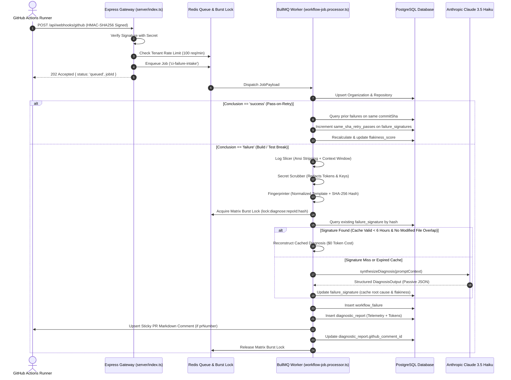

# Hopper — Database Architecture & End-to-End Dataflow

**Document Status:** Approved Architecture Baseline (Phase A)  
**Author:** Principal Systems Architect & Lead Software Engineer  
**Date:** November 6, 2026  
**Target Repository:** [`/home/ashutoshsahoo/Downloads/Hopper`](file:///home/ashutoshsahoo/Downloads/Hopper)

---

## 1. Entity-Relationship Model (ERD)

Hopper's persistent data layer is implemented in PostgreSQL with `pgvector` extension for semantic embedding lookups.

```mermaid
erDiagram
    organizations ||--o{ repositories : "owns"
    organizations ||--o{ workspaces : "linked via organization_id"
    workspaces ||--o{ workspace_members : "contains"
    user_profiles ||--o{ workspace_members : "participates in"
    user_profiles ||--o{ workspaces : "owns (owner_id)"
    
    repositories ||--o{ workflow_failures : "records"
    repositories ||--o{ failure_signatures : "clusters"
    
    failure_signatures ||--o{ workflow_failures : "classifies"
    workflow_failures ||--|| diagnostic_reports : "diagnosed by"

    organizations {
        uuid id PK
        bigint github_installation_id UK
        text github_account_login UK
        text github_account_type
        text plan
        text stripe_customer_id
        text stripe_subscription_id
        integer monthly_run_limit
        integer runs_used_this_period
        timestamptz billing_period_reset_at
        text slack_webhook_url
        text discord_webhook_url
        boolean auto_retry_policy
        timestamptz created_at
        timestamptz updated_at
    }

    repositories {
        uuid id PK
        uuid org_id FK
        bigint github_repo_id UK
        text full_name
        text default_branch
        boolean is_active
        timestamptz created_at
    }

    workspaces {
        uuid id PK
        text name
        text type
        uuid owner_id FK
        uuid parent_workspace_id FK
        text description
        boolean is_public
        timestamptz created_at
        timestamptz updated_at
    }

    user_profiles {
        uuid id PK
        uuid user_id UK
        text username UK
        text full_name
        text avatar_url
        text bio
        text role
        uuid current_workspace_id FK
        timestamptz created_at
        timestamptz updated_at
    }

    workspace_members {
        uuid id PK
        uuid workspace_id FK
        uuid user_id FK
        text role
        timestamptz joined_at
    }

    failure_signatures {
        uuid id PK
        uuid repo_id FK
        text signature_hash UK
        text normalized_template
        text test_identifier
        text error_category
        vector embedding
        numeric flakiness_score
        text cached_root_cause
        text cached_next_check
        integer total_occurrences
        integer main_branch_occurrences
        integer unique_prs_affected
        integer same_sha_retry_passes
        timestamptz first_seen_at
        timestamptz last_seen_at
    }

    workflow_failures {
        uuid id PK
        uuid repo_id FK
        uuid signature_id FK
        bigint github_run_id
        bigint github_jobId
        integer github_run_attempt
        text workflow_name
        text job_name
        text failed_step_name
        text commit_sha
        text branch
        integer pr_number
        text actor_login
        integer exit_code
        text sanitized_log_snippet
        timestamptz created_at
    }

    diagnostic_reports {
        uuid id PK
        uuid failure_id FK,UK
        text root_cause_clues
        text likely_flaky_test
        numeric flaky_confidence
        jsonb relevant_log_lines
        text suggested_next_check
        text local_repro_command
        text[] correlating_commit_files
        text llm_model_used
        integer prompt_tokens
        integer completion_tokens
        bigint github_comment_id
        timestamptz created_at
    }
```



---

## 2. Ingestion to Diagnosis Dataflow Lifecycle



---

## 3. The Dual-Tenant Model Disconnect (Critical Finding)

During Phase A inspection, a fundamental architectural disconnect was identified between two parallel tenant models:

```
+--------------------------------------------------------------------------------------------------+
|                                    DUAL-TENANT MODEL DISCONNECT                                  |
+------------------------------------+-------------------------------------------------------------+
| Model 1: GitHub / Pipeline Domain  | Model 2: User Identity & Workspace RBAC Domain              |
+------------------------------------+-------------------------------------------------------------+
| Anchor: `organizations`            | Anchor: `workspaces`                                        |
| Created via: GitHub App Install    | Created via: User Signup in Supabase                        |
| Owns: `repositories`               | Owns: `workspace_members`, `user_profiles`                  |
| Linked to: `workflow_failures`,    | Enforces: RBAC (`owner`, `admin`, `member`, `viewer`),      |
|   `failure_signatures`, `reports`  |   Supabase RLS policies                                     |
+------------------------------------+-------------------------------------------------------------+
```

### Problem Statement
Currently, [`backend/supabase/migrations/0004_workspace_tables.sql`](file:///home/ashutoshsahoo/Downloads/Hopper/backend/supabase/migrations/0004_workspace_tables.sql) established `workspaces` and `workspace_members` with Row-Level Security, but **`repositories` still points to `organizations(id)` via `org_id`**!
There is no direct foreign key between `workspaces` and `repositories` or `organizations`.
As a result:
- When a user logs in via Supabase, their user profile selects a `current_workspace_id`.
- But the dashboard endpoint `/api/dashboard/:orgSlug` queries `organizations WHERE github_account_login = $1`!
- An authenticated user in Workspace A could query any public or private organization's dashboard if they know the `orgSlug`.

### Phase B Bridge Strategy
1. Add an optional `workspace_id UUID REFERENCES workspaces(id) ON DELETE SET NULL` column to `organizations` (or `repositories`).
2. Allow a workspace owner to link their GitHub organization installation to their Hopper workspace.
3. Update the authorization middleware and RLS policies so that access to failure telemetry requires membership in the workspace that owns the linked GitHub organization.

---

## 4. Database Migrations & Integrity Ledger

| Migration File | Primary Responsibility | Reversibility / Rollback Assessment |
| :--- | :--- | :--- |
| `0001_initial_schema.sql` | Base schema (`organizations`, `repositories`, `failure_signatures`, `workflow_failures`, `diagnostic_reports`, indexes). | Drops tables in reverse foreign-key order. |
| `0002_hnsw_index.sql` | `pgvector` HNSW vector index for cosine distance similarity. | Drops index `idx_failure_signatures_embedding`. |
| `0004_workspace_tables.sql` | Multi-tenant auth stubs (`user_profiles`, `workspaces`, `workspace_members`). | Drops foreign keys and workspace tables. |
| `0005_rls_policies.sql` | Supabase Row-Level Security policies on user profiles and workspaces. | Disables RLS and drops policies. |
| `0006_fix_rls_security_definer.sql` | Fixes infinite recursion in RLS policies by using `SECURITY DEFINER` helper functions (`is_workspace_member`, `get_user_workspace_role`). | Replaces helper functions. |

*All migrations execute deterministically and pass automated verification in [`backend/tests/migrations.test.ts`](file:///home/ashutoshsahoo/Downloads/Hopper/backend/tests/migrations.test.ts).*

