# Hopper — Database Architecture & Data Model (DATA_MODEL.md)

---

## 1. Entity-Relationship Model (ERD)

Hopper's persistent data layer is implemented in PostgreSQL 16 with the `pgvector` extension for semantic embedding lookups.

```mermaid
erDiagram
    organizations ||--o{ repositories : "owns"
    organizations ||--o{ workspaces : "linked via organization_id"
    workspaces ||--o{ workspace_members : "contains"
    user_profiles ||--o{ workspace_members : "participates in"
    user_profiles ||--o{ workspaces : "owns (owner_id)"
    
    repositories ||--o{ workflow_failures : "records"
    repositories ||--o{ failure_signatures : "clusters"
    
    failure_signatures ||--o{ workflow_failures : "classifies"
    workflow_failures ||--|| diagnostic_reports : "diagnosed by"

    organizations {
        uuid id PK
        bigint github_installation_id UK
        text github_account_login UK
        text github_account_type
        text plan
        text stripe_customer_id
        text stripe_subscription_id
        integer monthly_run_limit
        integer runs_used_this_period
        timestamptz billing_period_reset_at
        text slack_webhook_url
        text discord_webhook_url
        boolean auto_retry_policy
        timestamptz created_at
        timestamptz updated_at
    }

    repositories {
        uuid id PK
        uuid org_id FK
        bigint github_repo_id UK
        text full_name
        text default_branch
        boolean is_active
        timestamptz created_at
    }

    workspaces {
        uuid id PK
        text name
        text type
        uuid owner_id FK
        uuid organization_id FK
        text description
        boolean is_public
        timestamptz created_at
        timestamptz updated_at
    }

    user_profiles {
        uuid id PK
        uuid user_id UK
        text username UK
        text full_name
        text avatar_url
        text bio
        text role
        uuid current_workspace_id FK
        timestamptz created_at
        timestamptz updated_at
    }

    workspace_members {
        uuid id PK
        uuid workspace_id FK
        uuid user_id FK
        text role
        timestamptz joined_at
    }

    failure_signatures {
        uuid id PK
        uuid repo_id FK
        uuid workspace_id FK
        char signature_hash UK
        text normalized_template
        text test_identifier
        text error_category
        vector embedding
        integer total_occurrences
        integer main_branch_occurrences
        integer unique_prs_affected
        integer same_sha_retry_passes
        numeric flakiness_score
        text cached_root_cause
        text cached_next_check
        timestamptz first_seen_at
        timestamptz last_seen_at
    }

    workflow_failures {
        uuid id PK
        uuid repo_id FK
        uuid signature_id FK
        uuid workspace_id FK
        bigint github_run_id
        bigint github_job_id UK
        integer github_run_attempt
        text workflow_name
        text job_name
        text failed_step_name
        char commit_sha
        text branch
        integer pr_number
        text actor_login
        integer exit_code
        integer duration_ms
        text sanitized_log_snippet
        timestamptz failed_at
    }

    diagnostic_reports {
        uuid id PK
        uuid failure_id FK
        uuid workspace_id FK
        text root_cause_analysis
        text suggested_fix_diff
        numeric confidence_score
        text error_category
        text[] prevention_checklist
        text ai_model_used
        integer prompt_tokens
        integer completion_tokens
        integer latency_ms
        boolean was_cached_result
        timestamptz created_at
    }
```

---

## 2. Table Specifications & Migration History

The schema is managed through forward-only, idempotent migrations in `backend/supabase/migrations/`:

| Migration | File | Core Tables / Capabilities Added |
|---|---|---|
| **0001** | `0001_initial_schema.sql` | `organizations`, `repositories`, `failure_signatures`, `workflow_failures`, `diagnostic_reports` |
| **0002** | `0002_hnsw_index.sql` | `pgvector` HNSW index on `failure_signatures(embedding vector_cosine_ops)` |
| **0003** | `0003_gap_reconciliation.sql` | Cascading foreign keys, composite index reconciliations |
| **0004** | `0004_workspace_tables.sql` | `workspaces`, `workspace_members`, `user_profiles`, `workspace_invites` |
| **0005** | `0005_rls_policies.sql` | Initial Row-Level Security (RLS) policies for multi-tenant isolation |
| **0006** | `0006_fix_rls_security_definer.sql` | `SECURITY DEFINER` helper functions preventing recursive RLS evaluation |
| **0007** | `0007_link_workspace_organizations.sql` | Bi-directional organization-workspace linking (`organization_id` foreign key) |
| **0008** | `0008_dedicated_runtime_role_and_rls_hardening.sql` | `hopper_app` runtime role, forced RLS execution, privilege hardening |
| **0009** | `0009_ai_budget_controller_ledger.sql` | `ai_budget_ledger`, `ai_budget_limits` ($500/mo admission control) |
| **0010** | `0010_durable_queue_and_coordination.sql` | Durable outbox: `hopper_job_queue`, `hopper_job_dead_letters`, `hopper_webhook_deliveries`, `hopper_rate_limits`, `hopper_diagnosis_locks`, `hopper_processed_events` |
| **0011** | `0011_denormalize_workspace_id_and_leaf_rls.sql` | Denormalized `workspace_id` on leaf tables (`failure_signatures`, `workflow_failures`, `diagnostic_reports`) for direct RLS enforcement |
| **0012** | `0012_organization_ai_budget_ledgers.sql` | Per-tenant and per-workspace AI expenditure tracking |
| **0013** | `0013_github_integration_and_rate_limiting.sql` | GitHub installation sync metadata and per-installation rate limiting |

---

## 3. Durable Queue & Coordination Tables

Migration `0010_durable_queue_and_coordination.sql` replaces Redis and BullMQ with native PostgreSQL structures:

### `hopper_job_queue`
Durable at-least-once outbox for async background jobs.
- `id` (UUID, PK): Unique job identifier.
- `queue_name` (TEXT, default `'ci-events'`): Partition namespace.
- `job_type` (TEXT): E.g. `'workflow_job'`, `'slack_alert'`.
- `idempotency_key` (TEXT): Unique key (`(queue_name, idempotency_key)` UNIQUE constraint) preventing duplicate enqueues.
- `payload` (JSONB): Execution context and event payload.
- `status` (TEXT): `'pending'`, `'processing'`, `'completed'`, `'failed'`, `'dead'`.
- `attempts` / `max_attempts` (INT): Current retry count and ceiling (default 5).
- `available_at` (TIMESTAMPTZ): Scheduled visibility time (supports exponential backoff).
- `locked_at` / `locked_by` / `lock_expires_at` (TIMESTAMPTZ): Distributed lease lock metadata.

### `hopper_job_dead_letters`
Application-level dead-letter queue (DLQ) preserving terminal job failures:
- `id` (UUID, PK)
- `job_id` (UUID): Reference to the original job.
- `queue_name` / `job_type` / `idempotency_key`: Job identification.
- `payload` (JSONB): Complete payload for offline replay or analysis.
- `attempts` (INT): Attempts exhausted before DLQ transition.
- `last_error` (TEXT): Final exception stack trace or message.

### Distributed Coordination Primitives
- `hopper_webhook_deliveries`: Tracks incoming `delivery_id` from GitHub/Stripe to guarantee replay protection within a 24-hour window.
- `hopper_rate_limits`: Atomic fixed-window rate limiter tracking request counts per tenant key per minute.
- `hopper_diagnosis_locks`: Mutex lock preventing concurrent duplicate diagnoses on identical failure signatures during matrix CI bursts.
- `hopper_processed_events`: Final business-level event ledger ensuring at-most-once execution of side effects.

---

## 4. Stored Procedures & Functions

High-concurrency coordination logic is executed atomically inside PostgreSQL via dedicated stored functions:

1. `hopper_claim_next_job(p_queue_name, p_worker_id, p_lock_duration_seconds)`:
   - Uses `SELECT ... FOR UPDATE SKIP LOCKED` to safely claim the highest-priority pending or failed job without contention.
   - Sets `status = 'processing'`, `locked_by = p_worker_id`, and `lock_expires_at = NOW() + INTERVAL`.
2. `hopper_complete_job(p_job_id, p_result)`:
   - Sets `status = 'completed'`, stores the result JSONB, and clears lock fields.
3. `hopper_fail_job(p_job_id, p_error, p_backoff_seconds)`:
   - Increments `attempts`. If `attempts >= max_attempts`, transitions to `'dead'` and inserts into `hopper_job_dead_letters`. Otherwise, resets to `'failed'` with exponential `available_at` backoff.
4. `hopper_reap_expired_job_locks(p_queue_name)`:
   - Unlocks abandoned jobs where `lock_expires_at < NOW()` due to worker crashes.
5. `hopper_claim_webhook_delivery(p_delivery_id, p_source)`:
   - Atomically attempts to insert into `hopper_webhook_deliveries`. Returns `TRUE` if claimed, or `FALSE` if already received (duplicate replay).
6. `hopper_consume_rate_limit(p_key, p_limit, p_window_seconds)`:
   - Increments the request count within the current time bucket; returns boolean allowance without race conditions.

---

## 5. Row-Level Security (RLS) & Multi-Tenant Isolation

Hopper implements strict Row-Level Security:

1. **FORCE ROW LEVEL SECURITY:** Enabled on all core tenant and leaf tables: `organizations`, `repositories`, `failure_signatures`, `workflow_failures`, `diagnostic_reports`, `workspaces`, `workspace_members`, `user_profiles`.
2. **Workspace-Scoped Policies:** Users can only query rows belonging to workspaces where they hold an active membership in `workspace_members`.
3. **Denormalized Leaf RLS:** Migration `0011` denormalized `workspace_id` onto `failure_signatures`, `workflow_failures`, and `diagnostic_reports` so queries filter directly on `workspace_id = current_setting('app.current_workspace_id', true)::uuid` without requiring expensive multi-table joins.
4. **Dedicated Runtime Role:** Migration `0008` established `hopper_app`, a dedicated non-superuser PostgreSQL role. Connections set transaction-local context (`SET LOCAL app.current_user_id` and `SET LOCAL app.current_workspace_id`), preventing tenant context leakage across pooled database connections.
