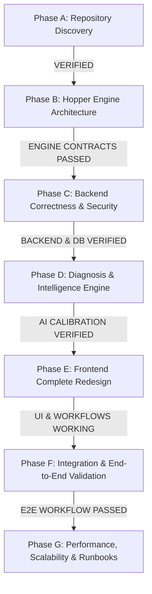

# Hopper — Autonomous Engineering Implementation Roadmap

**Document Status:** Approved Autonomous Engineering Master Plan  
**Author:** Principal Systems Architect & Lead Software Engineer  
**Date:** November 6, 2026  
**Execution Model:** Phase-Wise Controlled Autonomous Execution  
**Repository Reference:** [`/home/ashutoshsahoo/Downloads/Hopper`](file:///home/ashutoshsahoo/Downloads/Hopper)

---

## 1. Master Phase Sequence & Acceptance Gates

---

## 2. Phase-by-Phase Execution Plan

### Phase A — Complete Repository and Architecture Discovery (COMPLETED)
- **Scope:** Read-only inspection of backend, frontend, database, queue, AI, and test infrastructure.
- **Deliverables:**
  - `docs/architecture/BACKEND_DEPENDENCY_MAP.md`
  - `docs/architecture/DATABASE_AND_DATAFLOW.md`
  - `docs/architecture/API_AND_EVENT_CONTRACTS.md`
  - `docs/architecture/TECHNICAL_DEBT_REGISTER.md`
  - `docs/architecture/IMPLEMENTATION_ROADMAP.md` (this file)
  - `docs/engineering/HOPPER_AUTONOMOUS_EXECUTION_LOG.md`
- **Gate Verdict:** **PASSED.** Baseline established, 147 backend tests and 8 frontend tests verified.

---

### Phase B — Establish the Hopper Engine Architecture
- **Objective:** Organize Hopper around a modular central orchestration layer (`backend/src/engine/`) deconstructing the monolithic `server/index.ts` and `workflow-job.processor.ts`.
- **Sub-Engines:**
  1. **B1. Ingestion Engine:** Webhook signature verification, replay protection, token-bucket tenant rate limiting, payload validation.
  2. **B2. Normalization Engine:** Canonical internal event generation, ANSI stripping, secret scrubbing, log window slicing.
  3. **B3. Context Engine:** Repository metadata lookup, commit file correlation, prior failure retrieval, permission-scoped context isolation.
  4. **B4. Diagnosis Engine:** Failure category classification, deterministic regex patterns, evidence citation extraction, AI single-provider synthesis, passive remediation generation.
  5. **B5. Intelligence Engine:** Cloud Moat flakiness calculation, pass-on-retry tracking, failure signature deduplication, vector similarity search.
  6. **B6. Workflow Engine:** BullMQ coordination, matrix burst locking, job state transitions, bounded exponential retries.
  7. **B7. Integration Engine:** GitHub App installation token generation, log streaming, sticky PR comment markdown rendering, Slack alerting.
  8. **B8. Observability Engine:** Request correlation IDs, structured logging, latency & token usage telemetry, health check diagnostics.
  9. **B9. Platform Foundation:** Clear separation of authentication, configuration, and database client layers from business intelligence.
- **Acceptance Criteria:**
  - Code refactored into modular `engine/` packages.
  - Zero regression: All 147 backend tests pass.
  - No duplicate slicing or flakiness code across server, worker, and CLI.

---

### Phase C — Backend Correctness, Data Model & Security
- **Objective:** Eliminate technical debt, bridge the dual-tenant model, harden Supabase JWT authentication and RBAC, and execute security audits.
- **Key Modules:**
  1. **Dual-Tenant Bridging Migration:** Link `organizations` to `workspaces` via `workspace_id` foreign key. Ensure workspace members can access repositories owned by the organization.
  2. **API Layer Decoupling:** Extract controllers from `server/index.ts` into modular route files (`routes/ingestion.ts`, `routes/dashboard.ts`, `routes/signatures.ts`, `routes/repositories.ts`).
  3. **Security Hardening:** Test OWASP Top 10 vulnerabilities (IDOR, SQL injection, SSRF, replay attacks, prompt injection).
  4. **Billing Prototype Isolation:** Isolate inactive Stripe code and relax startup environment validation so Hopper boots cleanly without dummy Stripe credentials.
- **Acceptance Criteria:**
  - Database schema migration applies cleanly.
  - RBAC authorization verified across all roles (`owner`, `admin`, `member`, `viewer`).
  - Zero unauthenticated cross-tenant data leakage.

---

### Phase D — Production-Quality Diagnosis & Intelligence
- **Objective:** Maximize diagnostic accuracy, evidence grounding, and honest uncertainty communication.
- **Key Modules:**
  1. **Evidence-First Structuring:** Ensure every diagnosis strictly separates confirmed observations, root-cause hypotheses, log citations, verification steps, and advisory remediation.
  2. **Single-Provider Resilience:** Verify 15-second overall deadline, permanent error aborts, and exponential backoff with jitter in `synthesizeDiagnosis()`.
  3. **Prompt Engineering & Caching:** Modularize prompts, structure ephemeral cache headers for Anthropic Claude 3.5 Haiku, and evaluate token reduction.
  4. **Benchmark Verification:** Run 50-case evaluation suite, reporting category accuracy, evidence precision, and zero-hallucination compliance.
- **Acceptance Criteria:**
  - 100% adherence to passive-data recommendation constraints.
  - Zero autonomous shell execution or code mutation capabilities.
  - Documented evaluation benchmark results with verified token usage.

---

### Phase E — Complete Frontend Redesign (Engineering Workspace)
- **Objective:** Redesign Hopper's frontend into a world-class, professional engineering investigation workspace.
- **Information Architecture:**
  1. **Engineering Overview:** Real pipeline activity, recent failures, flakiness trends, workspace shortcuts.
  2. **Repositories:** Connected repositories, health metrics, failure frequency, integration status.
  3. **Pipeline Activity:** Live event stream, recent CI runs, webhook ingress status.
  4. **Failure Investigations (Core Workspace):** Deep investigation view with raw log viewer, syntax-highlighted stack traces, verified evidence citations, root-cause hypothesis, local repro command, and flakiness score.
  5. **Diagnosis History:** Cross-run signature timeline, search, filter by failure category, 30/90-day occurrence graphs.
  6. **Failure Trends:** Cross-repo flakiness matrix, recurring failure clusters, MTTR trends.
  7. **Integrations:** GitHub App status, webhook health, Slack/Discord notification settings.
  8. **Workspace & Team Settings:** Workspace members, RBAC roles, invite member dialog, user profile.
- **Design System & UX Standards:**
  - Coherent engineering aesthetics (Tailwind dark palette, accessible contrast, Lucide icons, responsive navigation).
  - Zero inert buttons, zero simulated/fake data, full error boundaries, and loading states.
- **Acceptance Criteria:**
  - Frontend builds with 0 errors (`npm --prefix frontend run build`).
  - All interactive flows (workspace switching, failure inspection, log viewer, tab navigation) genuinely functional.
  - Frontend component tests passing.

---

### Phase F — Integration & End-to-End Validation
- **Objective:** Verify the entire system end-to-end under realistic failure conditions.
- **Workflow Sequence:**
  1. Repository linked to workspace.
  2. Real/simulated GitHub failure event ingested.
  3. HMAC verified, event queued in BullMQ.
  4. Worker slices logs, scrubs credentials, hashes signature, acquires burst lock.
  5. Single AI provider synthesizes evidence-grounded diagnosis.
  6. Diagnostic report persisted in PostgreSQL.
  7. Sticky PR comment rendered.
  8. Frontend displays diagnosis with log citations and local repro commands.
- **Acceptance Criteria:**
  - End-to-end integration test passes in local test harness.
  - Graceful degradation verified on AI timeouts, duplicate webhooks, and worker restarts.

---

### Phase G — Performance, Scale & Operational Runbook
- **Objective:** Measure real throughput limits and document operational runbooks.
- **Key Modules:**
  - Measure API gateway requests/sec, database query latency, and BullMQ worker throughput.
  - Operational runbook: Service startup, failure recovery, log scrubbing verification, disaster recovery.
  - Final project completion report.

