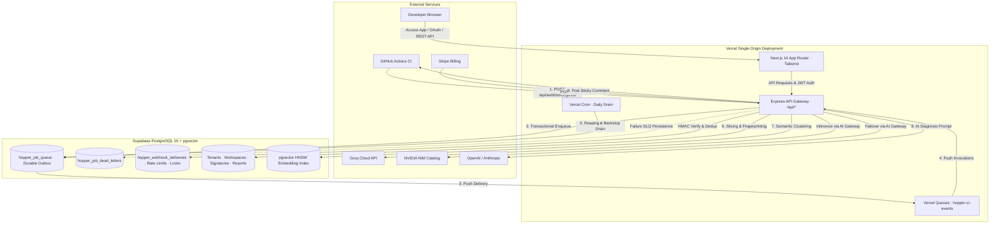
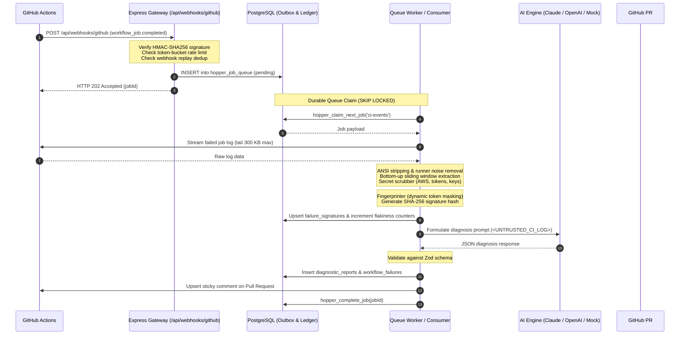

# Hopper — System Architecture & Topology Overview (SYSTEM_OVERVIEW.md)

---

## 1. High-Level System Architecture

Hopper is a cloud-native CI/CD failure diagnosis platform designed for multi-tenant scalability, rapid webhook ingress, durable background processing, and zero-leakage tenant isolation.

The platform is deployed as a consolidated multi-service architecture on **Vercel** backed by **Supabase PostgreSQL 16 + pgvector**:

---

## 2. End-to-End Event Ingress & Diagnostic Dataflow

The primary diagnostic workflow progresses through five stages:

---

## 3. Delivery Guarantees & Durable Outbox Pattern

Hopper enforces strict **at-least-once delivery** with defense-in-depth idempotency layers:

1. **Transactional Durability:** Webhook ingress does not return `HTTP 202 Accepted` to GitHub until the event is durably committed to `hopper_job_queue` in PostgreSQL. If the database is unreachable, it returns `HTTP 503` so GitHub's retry schedule handles delivery.
2. **Replay Protection:** `hopper_webhook_deliveries` tracks `X-GitHub-Delivery` IDs with atomic insert checks (`hopper_claim_webhook_delivery`), discarding replays within a 24-hour window.
3. **Queue Processing Idempotency:** The outbox enforces a unique constraint on `(queue_name, idempotency_key)`. Concurrent deliveries for the same run or job are deduplicated at the database constraint layer.
4. **Worker Concurrency Control:** Workers use `SELECT ... FOR UPDATE SKIP LOCKED` (`hopper_claim_next_job`) to prevent duplicate execution across distributed containers or serverless function invocations.
5. **Dead-Letter Handling:** After reaching `max_attempts` (default 5) with exponential backoff, failed jobs are transitioned to `hopper_job_dead_letters` for offline investigation without blocking the queue.
6. **Reaping Backstop:** The daily cron endpoint (`/api/cron/queue-drain`) unlocks jobs whose leases expired due to worker process crashes (`hopper_reap_expired_job_locks`).

---

## 4. Subsystem Status & Architectural Boundaries

| Subsystem | Architectural Role | Implementation Status | Evidence in Codebase |
|---|---|---|---|
| **Webhook Ingress** | Verifies HMAC, applies rate limits, enqueues to outbox | **Implemented** | `backend/src/server/routes/webhooks.ts`, `backend/tests/webhook.test.ts` |
| **Durable Queue** | PostgreSQL outbox + Vercel Queues push adapter | **Implemented** | `backend/src/queue/job-store.ts`, `0010_durable_queue_and_coordination.sql` |
| **Log Parser & Slicer** | ANSI strip, sliding window, secret scrubber | **Implemented** | `backend/src/lib/parser/`, `backend/tests/parser.test.ts`, `scrubber.test.ts` |
| **Fingerprinter & Moat** | Token normalization, SHA-256 hash, pgvector | **Implemented** | `backend/src/lib/parser/fingerprinter.ts`, `0002_hnsw_index.sql` |
| **Flakiness Engine** | Bayesian heuristics across retries and branches | **Implemented** | `backend/src/lib/moat/flakiness-engine.ts`, `backend/tests/flakiness.test.ts` |
| **AI Diagnosis Engine** | Multi-provider LLM caller + Zod schema validation | **Implemented** | `backend/src/lib/ai/diagnose.ts`, `backend/tests/ai.test.ts` |
| **Agentic AI Gateway** | Groq & NVIDIA NIM multi-provider gateway + failover | **Implemented** | `backend/src/lib/ai/gateway/`, `backend/tests/ai-gateway.test.ts` |
| **Agent Orchestrator** | 6-stage bounded diagnostic workflow with safe tools | **Implemented** | `backend/src/lib/ai/gateway/orchestration/` |
| **PR Reporter** | Sticky GitHub PR comment upsert with tier gating | **Implemented** | `backend/src/lib/github/pr-reporter.ts`, `backend/tests/pr-reporter.test.ts` |
| **Workspace & RLS** | Multi-tenant organization & workspace hierarchy | **Implemented** | `backend/src/server/routes/workspaces.ts`, `0005_rls_policies.sql`, `0011_*.sql` |
| **Stripe Billing** | Checkout session & subscription lifecycle webhooks | **Implemented** | `backend/src/server/routes/billing.ts`, `backend/tests/stripe-billing.test.ts` |
| **Single Primary Agent** | Single-agent repository governance | **Enforced** | `AGENTS.md` |
| **Production SaaS Setup** | Live Supabase, GitHub App, Stripe accounts | **Blocked on Credentials** | Documented in `docs/project/CURRENT_STATE.md` & `KNOWN_ISSUES.md` |
| **Redis / BullMQ** | Legacy queue and caching infrastructure | **DEPRECATED & REMOVED** | Replaced by PostgreSQL outbox in Migration `0010` |
| **Cloudflare Edge** | Legacy Edge worker and Cloudflare AI bindings | **DEPRECATED & REMOVED** | Replaced by Vercel Function & Express Gateway |
