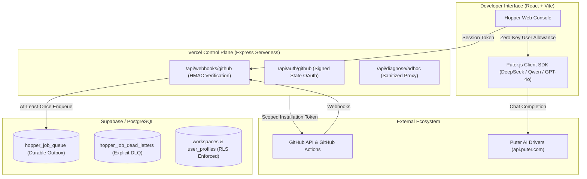

# Hopper: Target Architecture & Boundary Specification

*Version: 2.0 (Free-Tier & Autonomous Engineering Architecture)*  
*Ref: `main`*  
*Role: Principal Software Architect*

---

## 1. System Overview

Hopper is a developer reliability and autonomous engineering platform designed to turn failing CI/CD runs into evidence-grounded diagnoses, verified remediation patches, and human-approved pull requests.

---

## 2. Core Architectural Pillars

### A. Strict Identity & Authorization Boundaries
1. **GitHub Sign-In Identity**: Single authoritative user session minted by `createSessionToken()` and verified via `requireAuth()`.
2. **Stateless Signed OAuth State**: `${nonce}.${timestamp}.${hmac}` parameter eliminates serverless cross-instance failures without requiring in-memory state.
3. **Fail-Closed Production Configuration**: `JWT_SECRET` and `GITHUB_APP_PRIVATE_KEY` strictly fail closed in production; synthetic mock tokens are forbidden.
4. **Decoupled AI Credentials**: Puter.js operates under its user-pays allowance; no GitHub tokens or control-plane database keys are ever forwarded to AI providers.

### B. Durable State Machine & Outbox
- **Queue Source of Truth**: PostgreSQL `hopper_job_queue` with `FOR UPDATE SKIP LOCKED`.
- **Deduplication**: SHA-256 idempotency keys (`gh:job:<id>:run:<attempt>`) prevent duplicate processing.
- **Lock Reaping**: Expired function locks (`lock_expires_at < NOW()`) are automatically claimed and re-queued.

### C. Puter.js AI Integration Model
- **Interactive AI**: Browser-initiated via `diagnoseWithPuterAi()` in `InvestigationPage.tsx`, utilizing top catalog models (`deepseek-chat`, `qwen-2.5-coder-32b-instruct`, `gpt-4o-mini`, `gemini-1.5-flash`).
- **Unattended / Background Processing**: Webhook processing runs deterministically on the control plane, with optional server Puter driver completions when `PUTER_AUTH_TOKEN` is configured.
- **Passive Data Tagging**: All untrusted logs are strictly bounded and wrapped in `<UNTRUSTED_CI_LOG>` tags.

### D. Task Lifecycle & Safe Execution Sandbox
- **State Machine**:
  `submitted → authorized → inspected → planned → awaiting_execution → executing → verifying → repairing → ready_for_review → pull_request_opened`
- **Terminal States**: `completed`, `needs_approval`, `blocked`, `cancelled`, `failed`.
- **No Untrusted Execution in Control Plane**: Untrusted repository build scripts are prohibited from running inside Vercel API functions.
- **Human Approval Gate**: Merging is always a human decision. Pull request creation requires explicit authorization. Auto-merge is strictly disabled.

