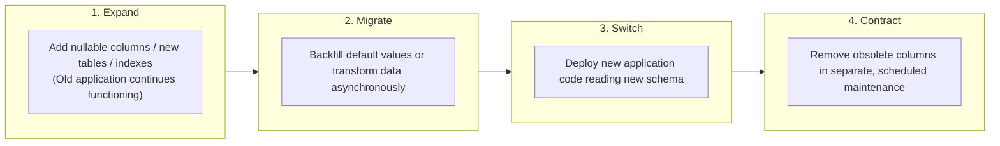

# Hopper Database Migration Governance & Expand-Contract Policy

## 1. Core Migration Philosophy

Hopper's persistence tier (PostgreSQL 16 with `pgvector`) enforces the **Expand-and-Contract** pattern for all schema modifications. Destructive schema operations (`DROP TABLE`, `DROP COLUMN`, `TRUNCATE`) are strictly forbidden during automated deployments.



---

## 2. Migration File Conventions & Ordering

All migration files are stored in `backend/supabase/migrations/` and must adhere to the naming format:
```
<4-digit-sequence>_<descriptive_snake_case_title>.sql
```

### Applied Migration Register
1. `0001_initial_schema.sql`: Base tables (users, orgs, repos, failures, reports).
2. `0002_add_pgvector.sql`: pgvector extension and failure embedding vectors.
3. `0003_add_flakiness_and_indexes.sql`: Flakiness scores and query indexes.
4. `0004_workspace_tables.sql`: Workspaces, members, invitations.
5. `0005_rls_policies.sql`: Initial Row Level Security rules.
6. `0006_fix_rls_security_definer.sql`: Helper functions with `SECURITY DEFINER`.
7. `0007_link_workspace_organizations.sql`: Workspace-to-organization relationships.
8. `0008_dedicated_runtime_role_and_rls_hardening.sql`: Unprivileged `hopper_app` role (`NOSUPERUSER, NOBYPASSRLS`) and `FORCE ROW LEVEL SECURITY` across all 11 tables.
9. `0009_ai_budget_controller_ledger.sql`: ACID tables for $500 monthly AI budget accounting.

---

## 3. Privilege Separation Architecture

Hopper enforces strict privilege separation between migration execution and application runtime:

| Database Persona | PostgreSQL Role | Privileges | Scope of Use |
|---|---|---|---|
| **Migration Runner** | `postgres` (or dedicated `hopper_migrator`) | `SUPERUSER` or `CREATEROLE`, `CREATE`, `ALTER` | Executed exclusively by CI/CD migration runners during schema deployment |
| **Application Runtime** | `hopper_app` | `NOSUPERUSER`, `NOBYPASSRLS`, `NOCREATEDB`, `NOCREATEROLE`, `NOINHERIT` | Used by Node.js API server and BullMQ background workers; subject to 100% RLS enforcement |

---

## 4. Migration Rules & Quality Gates

Every migration pull request must pass the automated checks in `.github/workflows/database-migrations.yml`:

1. **Syntax & Order:** Executed sequentially via `psql -v ON_ERROR_STOP=1`.
2. **RLS Verification:** Must execute `ALTER TABLE ... FORCE ROW LEVEL SECURITY` on any newly introduced tables.
3. **Idempotency:** Re-running the migration must not throw an unhandled error (`CREATE TABLE IF NOT EXISTS`, `CREATE INDEX IF NOT EXISTS`).
4. **Locking Impact:** DDL operations that acquire table locks (`ACCESS EXCLUSIVE`) must be analyzed and approved by codeowners. Heavy indexes must use `CREATE INDEX CONCURRENTLY` where applicable.
5. **No Automatic Rollback Script:** Rollbacks must never drop columns automatically. If an issue occurs, the application code is rolled back while the database schema remains in the backward-compatible expanded state.
