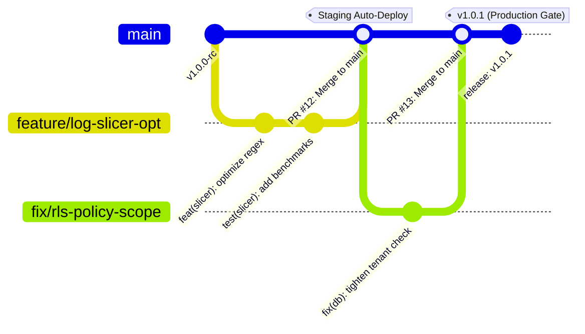
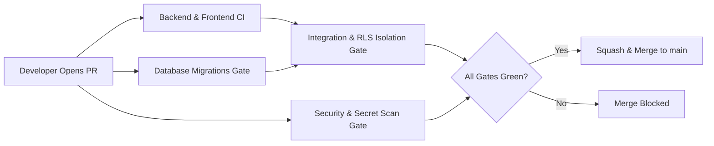

# Hopper GitHub Engineering Governance & Branch Strategy

## 1. Executive Summary & Philosophy

Hopper uses a lightweight, trunk-based branching model optimized for velocity, developer autonomy, and high-assurance engineering governance. All code changes flow through structured pull requests subjected to automated quality gates before integration into the protected `main` branch.

---

## 2. Branch Hierarchy & Naming Conventions

| Branch Pattern | Purpose | Source Branch | Target Branch | Merging Strategy |
|---|---|---|---|---|
| `main` | Production-ready canonical source branch | — | — | Protected; Squash & Merge only |
| `feature/*` | New capabilities, user-facing features, or architectural enhancements | `main` | `main` | Pull Request with passing CI gates |
| `fix/*` | Defect corrections and non-critical bug fixes | `main` | `main` | Pull Request with passing CI gates |
| `hotfix/*` | Urgent production fixes addressing active incidents | `main` | `main` | Expedited PR; requires passing CI gates |
| `chore/*` | Dependency bumps, CI/CD workflow updates, dev tooling | `main` | `main` | Pull Request with passing CI gates |

### Commit Message Conventions
Hopper adheres to the **Conventional Commits** specification:
- `feat(scope): ...` — New feature or capability.
- `fix(scope): ...` — Bug fix or error correction.
- `refactor(scope): ...` — Code restructuring without external behavior change.
- `perf(scope): ...` — Performance optimization.
- `test(scope): ...` — Addition or correction of tests.
- `chore(scope): ...` — Tooling, dependency updates, or configuration.
- `docs(scope): ...` — Documentation updates.

---

## 3. Pull Request Quality Gates & Review Policy

Every pull request must pass the automated gate suite configured in `.github/workflows/pull-request.yml`:

### Mandatory CI Checks
1. **`backend-ci.yml`**: TypeScript typecheck (`tsc --noEmit`), backend linting, fast unit tests, and multi-stage Dockerfile build verification.
2. **`frontend-ci.yml`**: React 18 typecheck, API client contract validation, production bundle build, and asset integrity checks.
3. **`database-migrations.yml`**: PostgreSQL 16 migration syntax validation, ordered application, unprivileged role (`hopper_app`) verification, table `FORCE ROW LEVEL SECURITY` checks, and idempotency tests.
4. **`integration-tests.yml`**: Real PostgreSQL + Redis service containers, full backend integration suite (178 tests), kernel RLS isolation proofs, AI budget controller tests, and the 50-case AI baseline benchmark.
5. **`security.yml`**: Automated secret scanning (`verify-no-committed-secrets.py`) and dependency vulnerability audit (`npm audit`).

---

## 4. Code Ownership & Review Governance

Code ownership is enforced via `.github/CODEOWNERS`:
- **Global Owner:** `@johan-droid`
- Changes to database migrations (`/backend/supabase/migrations/`), security middleware (`/backend/src/server/middleware/`), or GitHub Actions workflows (`/.github/workflows/`) require explicit codeowner sign-off.

---

## 5. Security & Secret Defense Standards

1. **Token Least Privilege:** Every GitHub Actions workflow explicitly specifies top-level `permissions: contents: read`. Write permissions are restricted exclusively to workflows requiring them (e.g. `release.yml` with `contents: write`).
2. **Action Pinning to Full Commit SHAs:** All third-party GitHub Actions are pinned to full 40-character commit hashes with inline version comments (e.g. `actions/checkout@11bd71901bbe5b1630ceea73d27597364c9af683 # v4.2.2`), eliminating supply-chain tampering.
3. **Zero Secret Printing:** Workflows strictly forbid `echo` or debug printing of environment variables.
4. **Automated Secret Scanner:** `scripts/ci/verify-no-committed-secrets.py` runs on every PR, blocking commits containing high-entropy keys, AWS tokens, GitHub PATs, private keys, or `.env` files.
