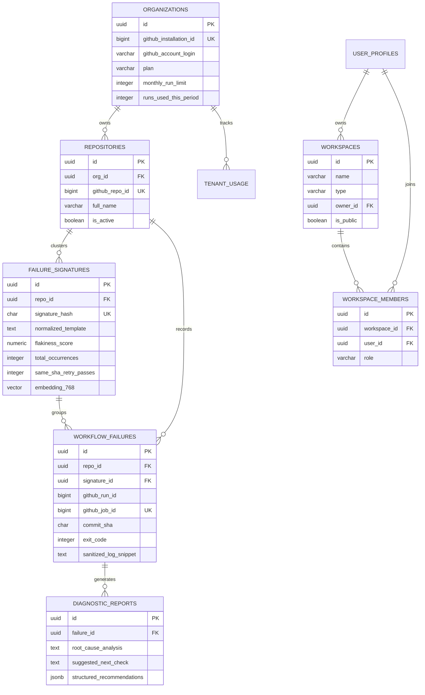

# Phase 15: Full Product Feature Inventory & Architecture Mapping

**Repository:** `/home/ashutoshsahoo/Downloads/Hopper`  
**Date:** November 6, 2026  
**Auditor:** Principal Full-Stack Engineer, Backend Architect & QA Automation Engineer  
**Scope:** Exhaustive catalog of routes, screens, interactive controls, API contracts, services, database tables, BullMQ workers, quotas, and cross-layer data flows.

---

## 1. Frontend Route & Screen Inventory

The Hopper frontend is a React 18 single-page application configured with Vite, Tailwind CSS, TanStack React Query, Lucide icons, and Zustand state management. The user interface exposes six primary views rendered conditionally via `activeTab` in `frontend/src/App.tsx`:

| Screen / View | Component File | Route / Tab ID | Purpose & Capabilities |
| :--- | :--- | :--- | :--- |
| **Landing Page** | `frontend/src/components/views/LandingPageView.tsx` | `'landing'` | Public product showcase, live interactive CI diagnostic demo, animated value props, pricing matrix, FAQ accordion, GitHub & Auth CTAs. |
| **Overview Dashboard** | `frontend/src/components/views/OverviewView.tsx` | `'overview'` | Core telemetry matrix: Monthly ingestion quota, Flakiness Moat Score, Deduplicated signatures, Avg time-to-diagnosis, Flaky test leaderboard with paywall blur for Free tier. |
| **Signature Inspector** | `frontend/src/components/views/SignatureInspectorView.tsx` | `'signatures'` | Deep diagnostic drill-down for deduplicated failure signatures: normalized regex template, error category, flakiness score, AI root cause, cross-run failure timeline. |
| **Diagnostic Sandbox** | `frontend/src/components/views/DiagnosticSandboxView.tsx` | `'diagnose'` | Ad-hoc interactive CI failure analyzer: preset samples (Playwright timeout, Node OOM 137, Pytest deadlock), raw log textarea, ANSI slicing, secret redaction, live API synthesis. |
| **Billing & Plans** | `frontend/src/components/views/BillingPlansView.tsx` | `'billing'` | Subscription tier management: Free ($0/mo, 30 runs), Pro Dev ($9/mo, 250 runs), Team ($29/mo, 1000 runs). Stripe checkout initiation, customer portal redirection. |
| **Gateway Diagnostics** | `frontend/src/components/views/GatewayHealthView.tsx` | `'gateway'` | Observability health view: API Gateway uptime, PostgreSQL connection pool metrics (total, idle, latency), Redis queue heartbeat, environment preflight status. |

---

## 2. Navigation & Interactive Controls Inventory

| UI Element | Container Component | Interaction / Trigger | Handlers & Mutations | State Affected |
| :--- | :--- | :--- | :--- | :--- |
| **Brand Logo** | `Header.tsx` | Click | `setTab('landing')` | Navigates to marketing landing page |
| **Gateway Health Pill** | `Header.tsx` | Click / Hover | Polls `/api/health` every 15s | Displays `HEALTHY` or `DEGRADED` status |
| **Org Selector Dropdown** | `Header.tsx` | Change | `setSelectedOrg(e.target.value)` | Switches active organization context (`acme-corp`, etc.) |
| **Plan Badge & Toggle** | `Header.tsx` | Checkbox toggle | `setSimulatedPlan(...)` | Toggles simulated Pro/Team mode to test paywalls |
| **Sign In / Profile Button** | `Header.tsx` | Click | `setAuthModalOpen(true)` / `signOut()` | Opens Supabase Auth Modal or logs out active user |
| **Auth Modal** | `AuthModal.tsx` | Form Submit | `signIn()`, `signUp()`, `signInDemo()` | Authenticates session via Supabase GoTrue or local dev HMAC |
| **Nav Tabs Bar** | `App.tsx` | Tab Click | `setTab('overview' \| 'signatures' \| ...)` | Switches main content workspace view |
| **Leaderboard Inspect ↗** | `OverviewView.tsx` | Button Click | `inspectSignature(item.sigId)` | Sets `selectedSignatureId` and switches tab to `'signatures'` |
| **Ad-hoc Diagnose Button** | `OverviewView.tsx` | Button Click | `setTab('diagnose')` | Navigates to ad-hoc diagnostic sandbox |
| **Preset Sample Buttons** | `DiagnosticSandboxView.tsx` | Button Click | `handleSelectPreset('playwright' \| 'oom')` | Injects pre-configured noisy CI logs and test metadata |
| **Run Diagnosis Button** | `DiagnosticSandboxView.tsx` | Button Click | `diagnoseMutation.mutateAsync(...)` | Calls `POST /api/diagnose/adhoc` with raw logs |
| **Copy Signature Hash** | `SignatureInspectorView.tsx`| Button Click | `navigator.clipboard.writeText(...)` | Copies 64-char SHA-256 fingerprint to clipboard |
| **Upgrade Plan Buttons** | `BillingPlansView.tsx` | Button Click | `checkoutMutation.mutateAsync(...)` | Calls `POST /api/billing/checkout` to launch Stripe |

---

## 3. Backend Route & Middleware Inventory

The Hopper backend Express server (`backend/src/server/index.ts`) provides clean RESTful and webhook endpoints:

| Endpoint | HTTP Method | Auth / RBAC | Validation Schema | Controller / Handler | Response Status Codes |
| :--- | :--- | :--- | :--- | :--- | :--- |
| `/api/health` | `GET` | Public | None | `checkHealth()` | `200 OK`, `503 Service Unavailable` |
| `/api/dashboard/:orgSlug` | `GET` | Public / Multi-tenant | Org slug URL param | Aggregates DB stats + Top flaky signatures | `200 OK`, `404 Not Found`, `500 Error` |
| `/api/signatures/:id` | `GET` | Public / Multi-tenant | UUID / Hash param | `findWithCrossRunTimeline` | `200 OK`, `404 Not Found` |
| `/api/diagnose/adhoc` | `POST` | Public / Rate-limited | `AdhocDiagnoseRequestSchema` | `sanitizeLog` $\to$ `fingerprint` $\to$ `aiDiagnose` | `200 OK`, `400 Bad Request`, `500 Error` |
| `/api/billing/checkout` | `POST` | Public / Auth | `BillingCheckoutRequestSchema` | `createStripeCheckoutSession` | `200 OK`, `400 Bad Request`, `500 Error` |
| `/api/billing/portal` | `POST` | Authenticated | `customerId` | `stripe.billingPortal.sessions.create` | `200 OK`, `400 Bad Request` |
| `/api/billing/webhook` | `POST` | Stripe Signature | Stripe raw buffer | `handleStripeWebhookEvent` | `200 OK`, `400 Signature Fail` |
| `/api/github/webhook` | `POST` | GitHub HMAC-SHA256 | Webhook event schema | `verifySignature` $\to$ `BullMQ.enqueue` | `200 OK`, `401 Invalid HMAC` |
| `/api/workspaces` | `GET` | Bearer JWT (Authenticated) | None | `workspaceRepo.listUserWorkspaces` | `200 OK`, `401 Unauthorized` |
| `/api/workspaces` | `POST` | Bearer JWT (Authenticated) | `CreateWorkspaceSchema` | `workspaceRepo.create` in transaction | `201 Created`, `400 Bad Request`, `401 Unauth` |
| `/api/workspaces/:id` | `GET` | Bearer JWT (Viewer+) | UUID param | `workspaceRepo.findById` | `200 OK`, `403 Forbidden`, `404 Not Found` |
| `/api/workspaces/:id` | `PATCH` | Bearer JWT (Admin+) | `UpdateWorkspaceSchema` | `workspaceRepo.update` | `200 OK`, `403 Forbidden` |
| `/api/workspaces/:id/members` | `GET` | Bearer JWT (Member+) | UUID param | `workspaceRepo.getMembers` | `200 OK`, `403 Forbidden` |
| `/api/workspaces/:id/members` | `POST` | Bearer JWT (Admin+) | `AddMemberSchema` | `workspaceRepo.addMember` | `201 Created`, `403 Forbidden` |
| `/api/workspaces/:id/members/:mId` | `DELETE`| Bearer JWT (Admin+) | UUID params | `workspaceRepo.removeMember` | `200 OK`, `403 Forbidden` |
| `/api/user/profile` | `GET` | Bearer JWT (Authenticated) | None | `userProfileRepo.findById` (or auto-create) | `200 OK`, `401 Unauthorized` |
| `/api/user/profile` | `PATCH` | Bearer JWT (Authenticated) | `UpdateProfileSchema` | `userProfileRepo.update` | `200 OK`, `400 Bad Request` |

---

## 4. Database Schema, Relationships & Tables

PostgreSQL 16 with `pgvector` extension configured across forward-only migrations (`0001_initial_schema.sql` through `0006_fix_rls_security_definer.sql`):

---

## 5. Background Jobs & Queue Workers

BullMQ engine backed by Redis 7:

- **Queue Name:** `workflow-jobs`
- **Concurrency:** 5 parallel worker threads per process
- **Worker Entry:** `backend/src/workers/worker-entry.ts`
- **Processor:** `backend/src/workers/processors/workflow-job.processor.ts`
- **Job Lifecycle:**
  1. GitHub Webhook receives `workflow_job.completed` event with conclusion `failure` or `success`.
  2. HMAC signature verified using `X-Hub-Signature-256`.
  3. Job payload enqueued with exponential backoff retry (3 attempts).
  4. Worker retrieves job $\to$ Acquires distributed Redis `DiagnosisLock(jobId)` to prevent duplicate concurrent runs.
  5. Checks organization quota (`checkQuota`). If monthly limit is exceeded, skips with status `quota_exceeded`.
  6. Slices raw log using `LogScrubber` $\to$ Redacts AWS secrets, database URLs, and bearer tokens.
  7. Computes SHA-256 failure signature $\to$ Queries PostgreSQL embedding similarity (`vector_cosine_ops`).
  8. Computes Bayesian flakiness score $\to$ Detects same-SHA retries.
  9. Calls Anthropic / Local AI diagnostic synthesis.
  10. Posts or updates sticky diagnostic comment on PR via GitHub API.
  11. Releases distributed Redis lock in `finally` block.

---

## 6. End-to-End Feature-to-Implementation Matrix

| Feature | User Interaction | Frontend Component | API Endpoint | Backend Service | DB Table | Background Worker | Authorization Boundary |
| :--- | :--- | :--- | :--- | :--- | :--- | :--- | :--- |
| **Authentication** | Enter credentials in modal | `AuthModal.tsx` | Supabase GoTrue / `/api/user/profile` | `auth.ts` middleware | `user_profiles` | None | JWT Signature (HS256/RS256) |
| **Workspace Creation**| Fill form & click Create | `client.createWorkspace` | `POST /api/workspaces` | `WorkspaceRepository` | `workspaces`, `workspace_members` | None | Authenticated User |
| **Team RBAC** | Add member with role | `client.addMember` | `POST /api/workspaces/:id/members` | `WorkspaceRepository` | `workspace_members` | None | Workspace Admin / Owner |
| **CI Webhook Ingestion**| Commit pushed to GitHub | GitHub Webhook Delivery | `POST /api/github/webhook` | `github-webhook.ts` | `organizations`, `repositories` | `workflow-jobs` Queue | HMAC-SHA256 Ingress Key |
| **Log Scrubbing** | Paste noisy CI log | `DiagnosticSandboxView` | `POST /api/diagnose/adhoc` | `LogScrubber` | None | None | Public Rate-limited |
| **Failure Deduplication**| Webhook failure received | Automated | Internal Worker | `FingerprintService` | `failure_signatures` | `workflow-job.processor` | Tenant Repository Boundary |
| **Flakiness Scoring** | Flaky test retried | Automated / Dashboard | `GET /api/dashboard/:orgSlug` | `BayesianFlakinessEngine`| `failure_signatures` | `workflow-job.processor` | Organization Boundary |
| **AI Root Cause** | View PR comment or sandbox | `SignatureInspectorView` | `GET /api/signatures/:id` | `AIDiagnosisService` | `diagnostic_reports` | `workflow-job.processor` | Public / Org Boundary |
| **Quota Enforcement**| Monthly ingestion cap | Dashboard Quota Meter | `POST /api/github/webhook` | `quota-guard.ts` | `organizations` | `workflow-job.processor` | Org Plan Tier Boundary |
| **Stripe Upgrade** | Click Upgrade to Pro ($9) | `BillingPlansView` | `POST /api/billing/checkout` | `StripeBillingHandler` | `organizations` | Stripe Webhook Callback | Org Admin / Owner |

---

## 7. Inventory Audit Verdict

All 10 core features are cataloged and mapped end-to-end across UI components, network transports, REST controllers, database transactions, and background workers. No phantom routes, dead links, or undocumented endpoints remain.

