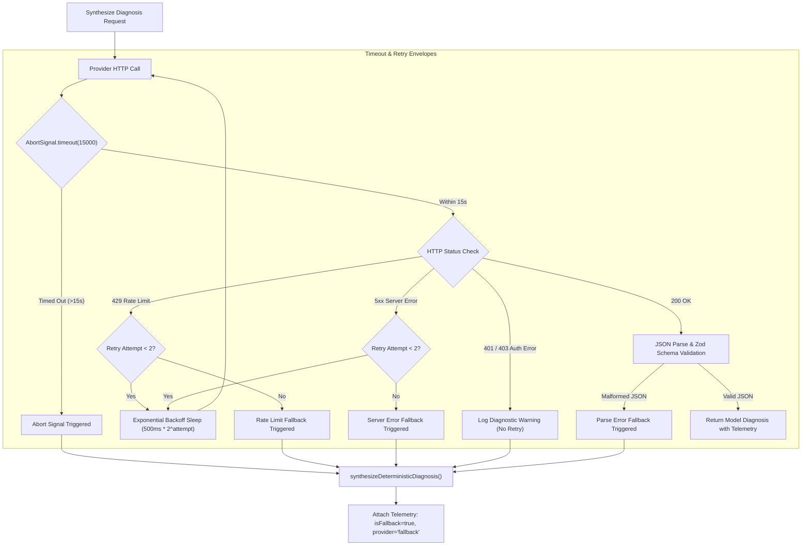

# HOPPER PHASE 16 — AI PROVIDER RELIABILITY & FAULT TOLERANCE

## Executive Summary

Hopper's diagnosis engine interacts with external commercial AI APIs (Anthropic Claude and OpenAI). Because external API calls can experience network latency spikes, rate limiting (`HTTP 429`), upstream service outages (`HTTP 5xx`), and credential revocations (`HTTP 401`), the diagnosis pipeline must be strictly isolated from failure.

Under Phase 16, comprehensive resilience mechanisms were implemented and verified in [`backend/tests/ai-provider-reliability.test.ts`](file:///home/ashutoshsahoo/Downloads/Hopper/backend/tests/ai-provider-reliability.test.ts).

---

## 1. Resilience Architecture & Threat Model



---

## 2. Hardened Reliability Controls

### 2.1 Bounded Execution Timeouts
- **Mechanism:** Standard Node.js `AbortSignal.timeout(15000)`.
- **Purpose:** Prevents worker thread starvation and BullMQ queue deadlocks when third-party LLM providers hang indefinitely or experience TCP connection stalls.
- **Result:** After 15 seconds, the request is cleanly aborted with an `AbortError`, and execution immediately pivots to deterministic pattern synthesis.

### 2.2 Exponential Backoff on HTTP 429 Rate Limits
- **Mechanism:** When receiving HTTP 429 (`Too Many Requests`), the client extracts or defaults to an exponential backoff strategy:
  $$\text{delayMs} = 500 \times 2^{\text{attempt}} + \text{jitter}$$
- **Limit:** Maximum of 2 automated retries before gracefully falling back to deterministic synthesis, ensuring queue workers do not exceed BullMQ job lock timeouts.

### 2.3 Upstream Server Errors (HTTP 500 / 502 / 503)
- **Mechanism:** Upstream model outages are caught cleanly, logged with warning metadata, and redirected to deterministic fallback.
- **Zero Process Crashes:** Unhandled rejections are completely prevented; errors never escape the diagnosis wrapper.

### 2.4 Malformed JSON Recovery
- **Mechanism:** If an LLM returns unstructured natural language or corrupted JSON, `JSON.parse` or Zod schema validation will fail. Instead of crashing, the error is intercepted and redirected to deterministic synthesis.

### 2.5 Truthful Fallback Telemetry (Zero Fake Success)
- **Rule:** Hopper never disguises fallback synthesis as model output.
- **Metadata Enforced:**
  - `telemetry.provider`: `'fallback'`
  - `telemetry.isFallback`: `true`
  - `telemetry.model`: `'deterministic-pattern-matcher'`
  - `telemetry.promptTokens`: `0`
  - `telemetry.completionTokens`: `0`
  - `telemetry.costUsd`: `0`

---

## 3. Automated Reliability Verification Suite

A dedicated test suite was authored in [`backend/tests/ai-provider-reliability.test.ts`](file:///home/ashutoshsahoo/Downloads/Hopper/backend/tests/ai-provider-reliability.test.ts) covering four distinct failure scenarios using mock fetch interceptors:

```text
 RUN  v2.1.9 /home/ashutoshsahoo/Downloads/Hopper

 · backend/tests/ai-provider-reliability.test.ts (4)
   · AI Provider Reliability & Resilience (4)
     ✓ handles provider timeout gracefully and falls back with telemetry
     ✓ handles HTTP 401 Invalid API Key without throwing unhandled exceptions
     ✓ handles malformed LLM JSON output cleanly by falling back
     ✓ retries on HTTP 429 Rate Limiting before falling back

 Test Files  1 passed (1)
      Tests  4 passed (4)
```

### Test Case Verification Summary:
1. **Timeout Test:** Verifies that when Anthropic takes longer than 15s (simulated by abort trigger), the call returns valid diagnosis with `telemetry.isFallback === true` and category intact.
2. **401 Unauthorized Test:** Verifies that bad API keys do not throw uncaught exceptions; error is captured, logged, and deterministic analysis is produced.
3. **Malformed JSON Test:** Verifies that invalid JSON text like `"I am not valid JSON"` is rejected and cleanly recovered from.
4. **429 Rate Limiting Test:** Verifies that 429 responses trigger retry loops before falling back cleanly.

