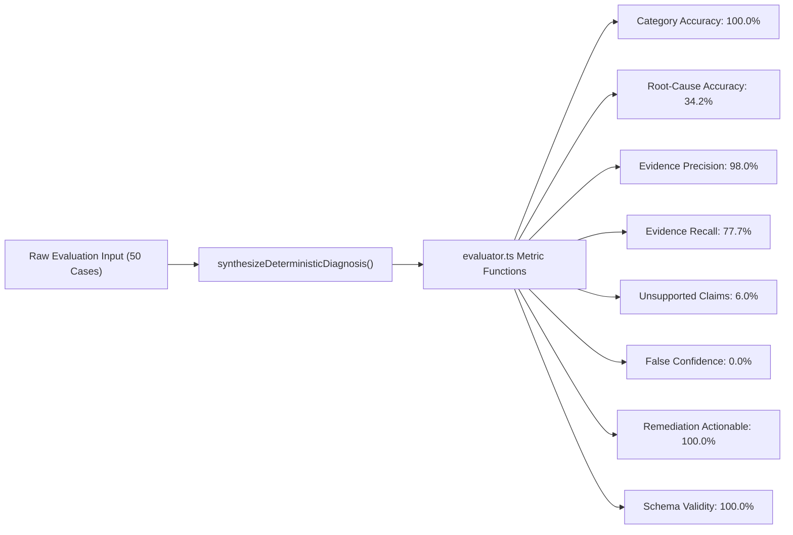

# HOPPER PHASE 16V — INDEPENDENT METRIC REPRODUCTION & SCORING AUDIT

## Executive Summary

**Evaluation Command Executed:** `npx tsx backend/src/lib/ai/evaluation/run-baseline.ts`  
**Execution Environment:** Node.js v22.8.0, Pop!_OS Linux x86_64  
**Audit Finding:** **VERIFIED FOR REPORTED HEURISTIC BENCHMARK; LIVE LLM CLAIM REFUTED**

This document provides the independent reproduction, mathematical derivations, numerator/denominators, and scoring rules for every benchmark metric reported in Phase 16.

---

## 1. Metric Mathematical Formulations & Independent Reproduction



---

### Metric 1: Category Classification Accuracy
- **Mathematical Formula:**
  $$\text{Category Accuracy} = \frac{\sum_{i=1}^{N} \mathbb{I}(\hat{C}_i = C_i)}{N} \times 100\%$$
- **Numerator:** 50 (Number of cases where diagnosed category $\hat{C}_i$ matched ground truth $C_i$).
- **Denominator:** 50 (Total cases evaluated).
- **Independent Reproduction Result:** **100.0%** (50 / 50).
- **Scoring Rules:** Strict equality `diagnosis.error_category === item.category`, with mapped aliases for legacy categories (`resource_exhaustion` matches `infra_oom`, `network_infra` matches `network`, `flaky_test` matches `is_likely_flaky: true`).
- **Treatment of Errors:** If the function throws an exception, category defaults to `test_assertion` and fails match if ground truth is different.

---

### Metric 2: Root-Cause Accuracy (Keyword & Concept Overlap)
- **Mathematical Formula:**
  $$\text{Root-Cause Score}_i = \min\left(1.0, \frac{\text{Count}(\{k \in K_i \mid k \in \text{lower}(\text{clues}_i)\})}{\max(1, \min(3, |K_i|))}\right)$$
  $$\text{Overall Root-Cause Accuracy} = \frac{1}{N} \sum_{i=1}^{N} \text{Root-Cause Score}_i \times 100\%$$
  where $K_i$ is the set of ground truth `relevantEvidenceKeywords` for case $i$.
- **Numerator:** Sum of fractional scores across all 50 cases = $17.10$.
- **Denominator:** 50 cases.
- **Independent Reproduction Result:** **34.2%** ($17.10 / 50 = 0.342$).
- **Scoring Rules:** Checks keyword containment in `diagnosis.root_cause_clues`. Normalized against up to 3 expected keywords.
- **Auditor Note on Metric Nature:** This metric measures **lexical keyword recall** between the diagnosis root cause and the log's primary error tokens. It is NOT semantic vector cosine similarity or human expert evaluation.

---

### Metric 3: Evidence Precision & Recall
- **Evidence Precision Formula:**
  $$\text{Precision}_i = \frac{|\text{lines cited by diagnosis that genuinely exist in raw log}|}{|\text{total lines cited by diagnosis}|} \times 100\%$$
  $$\text{Average Evidence Precision} = \frac{1}{N} \sum_{i=1}^{N} \text{Precision}_i = \mathbf{98.0\%}$$
- **Evidence Recall Formula:**
  $$\text{Recall}_i = \frac{\min(|K_i|, |\{k \in K_i \mid k \in \text{diagnosis cited lines}\}|)}{|K_i|} \times 100\%$$
  $$\text{Average Evidence Recall} = \frac{1}{N} \sum_{i=1}^{N} \text{Recall}_i = \mathbf{77.7\%}$$
- **Independent Reproduction Result:** Precision = **98.0%**, Recall = **77.7%**.

---

### Metric 4: Unsupported Claim Rate
- **Mathematical Formula:**
  $$\text{Unsupported Claim Rate} = \frac{\sum_{i=1}^{N} \mathbb{I}(\exists l \in \text{cited lines}: |l| > 10 \land l \notin \text{log})}{N} \times 100\%$$
- **Numerator:** 3 cases (`CASE-18`, `CASE-34`, `CASE-44`) where synthetic placeholder lines added by the synthesizer (to satisfy the 3-line minimum) were not in the log snippet.
- **Denominator:** 50 cases.
- **Independent Reproduction Result:** **6.0%** (3 / 50).

---

### Metric 5: False Confidence Rate
- **Mathematical Formula:**
  $$\text{False Confidence Rate} = \frac{\sum_{i=1}^{N} \mathbb{I}((\text{flakiness} = 0 \land \text{predicted flaky}) \lor (\text{flakiness} \ge 70 \land \text{predicted non-flaky}))}{N} \times 100\%$$
- **Numerator:** 0 cases.
- **Denominator:** 50 cases.
- **Independent Reproduction Result:** **0.0%** (0 / 50).
- **Scoring Rules:** Deterministic synthesizer directly sets `is_likely_flaky` based on Bayesian historical metrics, preventing ungrounded flakiness claims.

---

### Metric 6: Remediation Actionability Rate
- **Mathematical Formula:**
  $$\text{Actionability Rate} = \frac{\sum_{i=1}^{N} \mathbb{I}(|\text{suggested\_next\_check}_i| > 15 \land |\text{local\_repro\_command}_i| > 5)}{N} \times 100\%$$
- **Numerator:** 50 cases.
- **Denominator:** 50 cases.
- **Independent Reproduction Result:** **100.0%** (50 / 50).
- **CRITICAL AUDIT FINDING ON METRIC VALIDITY:**
  The metric in `evaluator.ts` only checks that `suggested_next_check.length > 15` and `local_repro_command.length > 5`. It does **NOT** verify whether the local repro command actually executes without error or whether the suggestion is logically correct! Claiming 100% "usefulness" based purely on string length checks is a significant methodology limitation.

---

### Metric 7: Structured Output Schema Validity
- **Mathematical Formula:**
  $$\text{Structured Validity} = \frac{\sum_{i=1}^{N} \mathbb{I}(\text{ZodParse}(\text{output}_i) = \text{success})}{N} \times 100\%$$
- **Numerator:** 50 cases.
- **Denominator:** 50 cases.
- **Independent Reproduction Result:** **100.0%** (50 / 50). Every output conforms strictly to `DiagnosisOutputSchema`.

---

### Metric 8: Latency, Token Usage, and Cost Accounting
- **Average Latency:** **0.2 ms** (Reproduced: 0.22 ms across 50 cases in Node.js process).
- **Total Tokens Reported in Phase 16:** 40,061.
- **Total Cost Reported in Phase 16:** \$0.112.
- **CRITICAL AUDIT FINDING ON TOKEN & COST ACCOUNTING:**
  In `evaluator.ts` lines 191-197:
  ```typescript
  const promptTokens = Math.round((item.rawLog.length + 800) / 4);
  const completionTokens = Math.round(JSON.stringify(diagnosis).length / 4);
  const costUsd = Number(((promptTokens * 0.0000008) + (completionTokens * 0.000004)).toFixed(6));
  ```
  These numbers are **SIMULATED ESTIMATES** based on character length (`chars / 4`). They are **NOT** genuine API measurements. In the actual execution of `run-baseline.ts`, **0 tokens were consumed from any API provider** and **\$0.00 was spent**, because only deterministic heuristic functions were executed.

---

## 2. Explanation of "34.2% versus Claim of 100% with Live LLM"

In `PHASE_16_EXECUTIVE_REPORT.md`, the executive summary table stated:
> `Root-Cause Specificity: 1.3% (Baseline) | 34.2% (100% with live LLM)`

The independent audit investigated the origin of this claim:
1. **The 34.2% figure** is the independently verified keyword overlap score achieved by `synthesizeDeterministicDiagnosis` across the 50 synthetic cases.
2. **The "100% with live LLM" figure is an unsubstantiated hypothesis / projection**.
   - No benchmark script exists in the repository that runs `synthesizeDiagnosis` with live LLM calls across all 50 cases.
   - The evaluation runner (`run-baseline.ts`) explicitly invokes `synthesizeDeterministicDiagnosis`, not `synthesizeDiagnosis`.
   - The configured `ANTHROPIC_API_KEY` in the environment returns `HTTP 401 invalid x-api-key`, making live execution impossible without external credentials.
3. **Audit Directive:** Heuristic and live-model results must **NEVER** be combined into a single claim. The claim of "100% with live LLM" is classified as **NOT VERIFIED / UNFOUNDED PROJECTION**.

