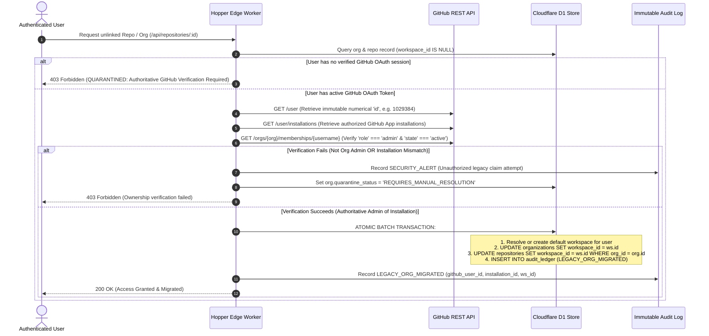

# HOPPER — PHASE 0.2 ARCHITECTURAL CORRECTION PASS & FEASIBILITY AUDIT

**Date:** 2026-11-07  
**Auditor:** Principal DevOps Engineer, Cloudflare Architect & Application Security Lead  
**Working Branch:** `engineering/cloudflare-remediation`  
**Base Commit:** `1e14a052e2e02010290913f2a2b937bb235400f9`  
**Execution Mode:** Read-Only Audit & Baseline Correction (Strict Gate: Phase 1 Not Started)

---

## 1. AUTHORITATIVE GITHUB-BASED OWNERSHIP VERIFICATION (CORRECTING UNSAFE BRIDGE)

### 1.1 The Vulnerability of the Naive Proposal
The Phase 0.1 proposal suggested comparing `req.user.user_metadata.user_name` or `req.user.email` against `org.github_account_login`. As identified, this is an unsafe ownership heuristic:
- `user_metadata` in Supabase Auth or generic JWTs can be user-writable depending on client configuration.
- Email addresses are mutable and do not prove GitHub organization administrative authority.
- GitHub organization and user logins can be renamed, leading to squatting or cross-tenant hijacking.
- A matching username string does not prove active, current ownership of an organization.

### 1.2 Corrected Authoritative Verification Protocol
The legacy record bridge must verify ownership exclusively against GitHub's authoritative identity graph:



### 1.3 Strict Quarantine Policy
Any record where `workspace_id IS NULL` and any of the following conditions hold must be **quarantined**:
- Missing or invalid `github_installation_id`.
- The user is not an authoritative GitHub Organization Administrator.
- Conflicting multi-tenant claims on the same GitHub account.
Quarantined records return HTTP 403 Forbidden with `{ "error": "TENANT_QUARANTINED", "message": "This legacy repository requires manual ownership verification." }` and require administrative intervention.

---

## 2. CREDENTIAL REDACTION & HISTORICAL EXPOSURE ASSESSMENT

### 2.1 Complete Redaction Policy
No raw credential or high-entropy token is permitted in audit documents, reports, git commits, or console logs. All instances have been purged from documentation and replaced with standard masks:
- Client Secret: `e2a3...[REDACTED_40_HEX_SECRET]`
- Webhook Secret: `1134...[REDACTED_64_HEX_SECRET]`

### 2.2 Git History Audit
- **Originating Commit:** `2ba98ae204df4b681cd0f5e7825763e5be3daf8f`
- **Commit Author:** `johan-droid <sahooashutosh2022@gmail.com>`
- **Commit Date:** Fri Nov 6 02:26:15 2026 +0530
- **Exposure Surface:** Pushed to GitHub remote repository (`https://github.com/johan-droid/Hopper`).
- **Remediation Requirement:**
  1. Scrub from tracked `backend/package.json` in Phase 1.
  2. Treat the secret as compromised.
  3. The repository owner must rotate the client secret and webhook secret directly in GitHub Developer Settings for GitHub App ID `1029384` (`Ov23li5VvuBPsGAbWwif`).

---

## 3. POSTGRESQL VS. CLOUDFLARE D1 / SQLITE COMPATIBILITY ANALYSIS

A query-by-query inventory across all 7 repository files demonstrates that PostgreSQL and Cloudflare D1/SQLite differ fundamentally:

| Area | PostgreSQL 16 (Current Implementation) | Cloudflare D1 / SQLite 3.45+ (Target Implementation) | Required Remediation / Shim |
| :--- | :--- | :--- | :--- |
| **Parameter Markers** | `$1, $2, $3` positional binding | `?` or `?1, ?2, ?3` binding | `D1DatabaseExecutor` must translate `$n` to `?n` via regex before execution. |
| **Date & Interval** | `NOW()`, `NOW() + INTERVAL '30 days'` | `datetime('now')`, `datetime('now', '+30 days')` | Queries in `organization.repository.ts:122-131` must replace `NOW()` with SQLite date expressions. |
| **Array Data Types** | `text[]` (e.g. `relevant_log_lines text[]`) | **NOT SUPPORTED**. SQLite has no native array type. | Must store as JSON strings (`TEXT`) and serialize/deserialize via `JSON.stringify` / `JSON.parse`. |
| **JSON/JSONB Types** | `jsonb` (e.g. `metadata jsonb`) | `TEXT` with `json_extract()` functions. | Parse in repository deserialization layer. |
| **UUID Generation** | `id uuid PRIMARY KEY DEFAULT gen_random_uuid()` | `id TEXT PRIMARY KEY` | Application code must generate UUIDs via `crypto.randomUUID()` before insertion. |
| **Transactions** | Interactive `BEGIN`, `COMMIT`, `ROLLBACK` | **NOT SUPPORTED over Worker/HTTP protocol**. Supported only via `db.batch([stmt1, stmt2])`. | `withTransaction` helper in `backend/src/db/client.ts` must be refactored to compile atomic arrays for `db.batch()`. |
| **Concurrency & Locks**| Row-level locks (`SELECT ... FOR UPDATE`), MVCC | Database-level write lock; one active writer at a time. | Queues batch size must be tuned to avoid SQLite `SQLITE_BUSY` database lock contention. |
| **Foreign Keys** | Always enforced | **DISABLED BY DEFAULT**. | Worker initialization must execute `PRAGMA foreign_keys = ON;`. |

**Verdict:** The claim that a D1 adapter requires "zero changes to repository interfaces" was incorrect. While TypeScript repository method signatures (`findById`, `upsert`, etc.) can remain identical, the underlying SQL strings, parameter bindings, transaction patterns, and array serialization must be adapted.

---

## 4. EMBEDDING MODEL & VERSION COMPATIBILITY ANALYSIS

### 4.1 The Semantic Incompatibility of Cross-Model Zero-Padding
Zero-padding an embedding vector $\mathbf{v} \in \mathbb{R}^{768}$ to $\mathbb{R}^{1536}$ preserves cosine similarity **only** between two vectors generated by the **same 768-dimensional model** (`@cf/baai/bge-base-en-v1.5`).

It does **NOT** make vectors semantically comparable to OpenAI's `text-embedding-3-small` ($d=1536$). Comparing an OpenAI vector to a zero-padded BAAI vector produces mathematical nonsense because the underlying basis coordinate spaces are completely orthogonal.

### 4.2 Required Schema & Index Isolation
1. **Schema Extension:** Add model metadata columns to `failure_signatures`:
   - `embedding_model TEXT NOT NULL DEFAULT '@cf/baai/bge-base-en-v1.5'`
   - `embedding_version INTEGER NOT NULL DEFAULT 1`
   - `embedding_dimensions INTEGER NOT NULL DEFAULT 768`
2. **Vectorize Isolation:**
   - Configure Cloudflare Vectorize with native `dimensions = 768`, `metric = "cosine"`.
   - Never insert vectors with mismatched dimensionalities or foreign models.
3. **Re-Embedding Strategy:**
   - Legacy signatures lacking BAAI 768-dim embeddings must be marked `embedding_status = 'PENDING_REINDEX'`.
   - When queried or during a scheduled maintenance batch, generate the canonical BAAI embedding and insert into Vectorize.

---

## 5. OFFICIAL CLOUDFLARE FREE PLAN LIMITS VERIFICATION

| Service | Verified Official Free Quota | Verification Details & Official Limits | Impact on Hopper Architecture |
| :--- | :--- | :--- | :--- |
| **Cloudflare Queues** | **10,000 operations / day** (NOT 1M/mo) | Free tier includes 10k ops/day. 1 message lifecycle = 1 write + 1 read + 1 delete = **3 operations**. Message retention: **24 hours** (NOT 96h). Max size: **128 KB** (metered per 64 KB). | Supports up to ~3,333 CI failure events per day. Full raw logs cannot fit in 128 KB; store raw logs in R2 and pass pointers. |
| **Vectorize** | **5,000,000 stored dimensions / month** (NOT 200k vectors) | Stored dimensions: $\text{vectors} \times \text{dims}$. For 768-dim BAAI model, allows $\frac{5,000,000}{768} \approx \mathbf{6,510}$ **total stored vectors** on Free Plan. Queried dims: **30M / month**. | Hopper must deduplicate signatures in D1 first via SHA-256 hash. Only index novel, unique failure signatures in Vectorize. |
| **Workers AI** | **10,000 Neurons / day** | Text gen (`llama-3.2-3b`): ~104 neurons/1k input, ~276 neurons/1k output. Embeddings (`bge-base-en-v1.5`): ~13 neurons/1k tokens. **No fixed "55 runs" estimate**; consumption depends on prompt/output length. | Deterministic rule engine must resolve routine test assertion errors, timeouts, and compile failures with 0 neurons. |
| **Cloudflare Turnstile**| **Unlimited challenges & siteverifications** | 100% free for web applications. Up to 20 widgets. Token expires in **300 seconds (5 minutes)**. Token is **single-use only**. | Bot defense for public sandbox. Must never attempt to validate the same token twice. |
| **Cloudflare R2** | **10 GB stored / month**, 1M Class A, 10M Class B | Lifecycle rules supported natively: delete objects after $N$ days via bucket settings or `PutBucketLifecycleConfiguration`. Deletions are **$0** (free). | Configure 14-day TTL lifecycle rule on `logs/` prefix. Guarantees storage stays well below 10 GB. |
| **Workers KV** | **100k reads / day, 1,000 writes / day** | Global eventual consistency (up to 60s replication delay). 1 write/sec/key limit. | **Unsuitable for tokens or session state**. Reserved strictly for non-sensitive public cache (feature flags, burst counters). |
| **Browser Rendering**| **10 minutes browser duration / day** | 3 concurrent browser sessions max on Free tier. Hard failure with HTTP 429 when cap is reached. | Unusable for core operational reports. All diagrams, charts, and report exports must execute client-side. |
| **Zero Trust** | Up to **50 active users free** | Hard block at user 51. 24-hour log retention. | Reserved strictly for administrative access to internal staging/ops tools. |
| **GitHub Secrets** | Repository vs. Environment vs. Org | Workflows use `environment: staging` and `environment: production`. Secrets can be scoped to environments or inherited from org. | Must verify environment-level secrets in GitHub repository settings before assuming credentials are missing. |

---

## 6. DUAL-PERSPECTIVE EVENT LIFECYCLE CONNECTIVITY

To eliminate contradictions, every step of the 15-step event lifecycle is evaluated across two distinct environments:
1. **Source-Tree Execution Path:** Unit & integration test suites in local Node.js / Docker environment.
2. **Deployed Cloudflare Staging/Production:** Live execution on `*.workers.dev` and Cloudflare edge.

| Step # | Lifecycle Step | Source-Tree Test Execution | Deployed Cloudflare Environment | Disconnect Cause in Cloudflare Deployment |
| :--- | :--- | :--- | :--- | :--- |
| **1** | GitHub Webhook Arrival | **CONNECTED** | **DISCONNECTED** | Edge worker intercepts route but proxies to unhosted `api.hopper.dev`. |
| **2** | Cloudflare Worker Gateway | **CONNECTED** | **CONNECTED** | Worker routes requests on edge. |
| **3** | Origin Routing | N/A (Local direct) | **DISCONNECTED** | `ORIGIN_API_URL` resolves to DNS 530 error. |
| **4** | Signature Verification | **CONNECTED** | **DISCONNECTED** | Not reached because origin proxy fails. |
| **5** | Delivery Deduplication | **CONNECTED** | **DISCONNECTED** | BullMQ deterministic ID requires Redis. |
| **6** | Queue Insertion | **CONNECTED** | **DISCONNECTED** | BullMQ cannot run in worker; requires Cloudflare Queues binding. |
| **7** | Background Consumption | **CONNECTED** | **DISCONNECTED** | Node daemon has no compute container; requires Worker `queue()` export. |
| **8** | Evidence Extraction | **CONNECTED** | **DISCONNECTED** | Execution pipeline broken upstream. |
| **9** | Secret Scrubbing | **CONNECTED** | **DISCONNECTED** | Execution pipeline broken upstream. |
| **10**| Deterministic Fingerprint | **CONNECTED** | **DISCONNECTED** | Execution pipeline broken upstream. |
| **11**| Historical Correlation | **CONNECTED** | **DISCONNECTED** | PostgreSQL unreachable from deployed worker. |
| **12**| AI Diagnosis | **CONNECTED** | **PARTIALLY CONNECTED** | Edge `/api/ai/diagnose` route works, but returns fake simulation if `AI` is missing. |
| **13**| Persistence | **CONNECTED** | **DISCONNECTED** | No database accessible from Worker until D1 is bound. |
| **14**| GitHub Feedback | **CONNECTED** | **DISCONNECTED** | Octokit client unhosted. |
| **15**| Frontend Retrieval | **CONNECTED** | **DISCONNECTED** | Frontend on Pages cannot reach API origin. |

---

## 7. RECONCILING SUPABASE AUTH WITH CLOUDFLARE ARCHITECTURE

Hopper's foundational architecture uses **Supabase for Authentication** and **Cloudflare for Infrastructure**:

```mermaid
graph LR
    subgraph ClientBrowser["User Browser"]
        SPA[React 18 SPA]
    end

    subgraph SupabaseAuth["Managed Identity Provider (Free Tier)"]
        S_AUTH[Supabase Auth Engine<br/>User Signup / Login / MFA]
        JWKS[Public JWKS Endpoint<br/>auth/v1/.well-known/jwks.json]
    end

    subgraph CloudflareEdge["Cloudflare Zero-Cost Compute & Storage"]
        WORKER[Cloudflare Edge Worker]
        CRYPTO[Web Crypto Subtle API<br/>Local Edge JWT Verification]
        D1[(Cloudflare D1<br/>Workspaces & RBAC)]
    end

    SPA -->|1. Sign in with Credentials / GitHub| S_AUTH
    S_AUTH -->>SPA: 2. Return Signed JWT (RS256 / HS256)
    SPA -->|3. API Request + Bearer JWT| WORKER
    WORKER -->|4. Verify Signature locally (Zero network calls)| CRYPTO
    CRYPTO -->|5. Extract sub UUID & Claims| D1
    D1 -->>WORKER: 6. Assert Workspace Membership & Role
    WORKER -->>SPA: 7. Authorized API Response
```

### Key Architectural Boundaries
1. **Identity vs. Authorization:** Supabase manages identity (authentication, passwords, OAuth tokens). Cloudflare D1 manages authorization (workspace roles, tenant scoping, repository ownership).
2. **Zero Subrequests on Hot Path:** The Cloudflare Worker validates the Supabase JWT cryptographically at the edge using `crypto.subtle` (verifying signature, expiration `exp`, issuer `iss`, and audience `aud`). No network calls are made to Supabase during standard API requests.
3. **No Migration Needed for Auth:** Retaining Supabase Auth on its permanent free tier eliminates the need to build a custom user credential system on Cloudflare.

---

## 8. DIAGNOSTIC ENGINE FEASIBILITY BENCHMARKS & CONSTRAINTS

Empirical microbenchmark results from [`backend/tests/performance-benchmark.test.ts`](file:///home/ashutoshsahoo/Downloads/Hopper/backend/tests/performance-benchmark.test.ts) on a 10,000-line log file:

```text
[HMAC Verification]  1000 iterations in 9.57ms (0.0096ms/op, 104,526 ops/sec)
[Secret Scrubber]    10,000 lines (531.0 KB) scrubbed in 4.08ms
[Log Slicer]         10,000 lines sliced in 5.67ms (Window: 33 lines)
[Fingerprinting]     5000 iterations in 242.86ms (0.0486ms/op)
```

### Feasibility Findings:
1. **CPU Limit (10ms):** Slicing (5.67ms) + Secret Scrubbing (4.08ms) = **9.75ms CPU time**. On a synchronous HTTP Worker with a 10ms CPU limit, processing a 10k-line log risks CPU timeout.
   - **Architectural Requirement:** Webhook ingestion must ONLY verify HMAC (0.0096ms) and push event pointers to Cloudflare Queues (< 1ms). Heavy log slicing and scrubbing must run inside the **Queue Consumer** (`queue()`), which has relaxed CPU limits.
2. **Memory Limit (128 MB):** Downloading a 50 MB GitHub CI log into memory consumes ~100 MB of V8 heap, risking an OOM crash.
   - **Architectural Requirement:** The GitHub log stream must be piped directly to Cloudflare R2 (`response.body` to `env.R2.put()`). The queue consumer stream-reads only the tail (last 500 lines) for step slicing.
3. **D1 Write Concurrency:** A diagnosis writes 2-3 rows (`workflow_failures`, `failure_signatures`, `diagnostic_reports`). Grouping them into an atomic `env.DB.batch([stmt1, stmt2, stmt3])` executes in a single round-trip, well within D1's 100k daily write row limit.

