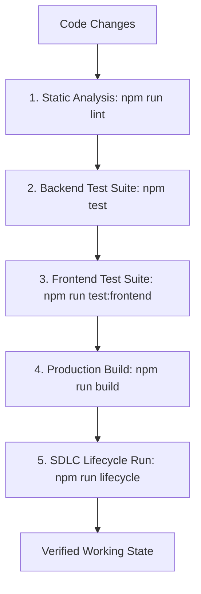

# Hopper — Testing Strategy & Verification Architecture (TESTING.md)

---

## 1. Testing Philosophy & Verification Ladder

Hopper enforces an **evidence-based quality model**. No feature or bugfix is marked complete without passing the progressive verification ladder:



---

## 2. Test Execution Commands

Execute tests across the repository using these commands:

| Command | Subsystem | Description | Target / Suite Count |
|---|---|---|---|
| `npm test` | Backend | Runs all Vitest backend suites | 33 test files / 226 tests |
| `npm run test:frontend` | Frontend | Runs all Vitest frontend unit tests | 4 test files / 34 tests |
| `npm run test:smoke` | Backend | Rapid smoke test for backend API | `tests/backend-smoke.test.ts` |
| `npm run test:e2e` (in `frontend/`) | Frontend | Playwright end-to-end browser tests | Browser user flows & visual regression |
| `npm run simulate -- -s <type>` | Engine | Offline synthetic diagnosis simulation | `-s timeout`, `-s assertion`, `-s oom` |
| `npm run lifecycle` | Full Monorepo | 8-stage automated SDLC pipeline | Compilation, tests, bundling, simulation |

---

## 3. Backend Test Architecture (`backend/tests/`)

Backend tests are implemented with **Vitest** in `backend/tests/`. All tests run in-process with minimal mocking to ensure genuine subsystem fidelity.

### 3.1 Suite Inventory & Categorization (33 Test Files / 226 Tests)

| Category | Test File | Test Count | Key Invariants Verified |
|---|---|:---:|---|
| **Core Parser** | `parser.test.ts`<br>`scrubber.test.ts`<br>`fingerprint.test.ts` | 12 | Bottom-up log slicing, AWS/GitHub secret redaction, UUID/hex token normalization |
| **Flakiness & Moat** | `flakiness.test.ts` | 5 | Bayesian scoring formula, same-SHA retry pass weighting, cross-PR spread |
| **Database & Migrations**| `database.test.ts`<br>`migrations.test.ts`<br>`workspace-repository.test.ts`<br>`repositories.test.ts` | 20 | Migration idempotency, connection pool health, CRUD operations, cascading deletes |
| **Queue & Outbox** | `queue.test.ts`<br>`task-lifecycle.test.ts`<br>`workflow-processor.test.ts` | 24 | PostgreSQL outbox enqueue, SKIP LOCKED claim, retry backoff, dead-letter transfer |
| **Security & Isolation**| `security-tenant-isolation.test.ts`<br>`phase14-adversarial.test.ts`<br>`auth-verification.test.ts`<br>`authorization-matrix.test.ts` | 58 | Cross-tenant RLS enforcement, JWT tampering rejection, expired tokens, RBAC roles |
| **GitHub Integration** | `webhook.test.ts`<br>`github-integration.test.ts`<br>`github-auth-sync.test.ts`<br>`github-rate-limiting.test.ts`<br>`pr-reporter.test.ts` | 38 | HMAC-SHA256 verification, replay dedup, token-bucket limits, sticky comment upsert |
| **AI Subsystem** | `ai.test.ts`<br>`ai-provider-reliability.test.ts`<br>`ai-budget-controller.test.ts`<br>`embeddings.test.ts` | 30 | Multi-provider fallback, Zod schema validation, $500 monthly budget cap, token counts |
| **Billing & Quota** | `stripe-billing.test.ts`<br>`quota-guard.test.ts` | 13 | Stripe webhook signature, checkout sessions, tier limit enforcement (30, 250, 1000) |
| **Workspace & Journey** | `workspace-api.test.ts`<br>`workspace-org-bridge.test.ts`<br>`user-journeys-e2e.test.ts`<br>`phase15-journeys-h-to-j.test.ts` | 16 | Multi-workspace invitations, user journeys from auth to diagnosis, bridge linking |
| **Smoke & Performance** | `backend-smoke.test.ts`<br>`performance-benchmark.test.ts`<br>`remediation-hardening.test.ts` | 10 | API boot health, sub-100ms endpoint response times, remediation regression guards |

---

## 4. Frontend Test Architecture (`frontend/`)

### 4.1 Vitest Unit Tests (4 Test Files / 34 Tests)
Located alongside source files in `frontend/src/`:
- `src/lib/filters.test.ts` (10 tests): Validates search, category filters, and flakiness threshold sorting.
- `src/lib/format.test.ts` (8 tests): Validates relative timestamp formatting, duration strings, and badge color mappings.
- `src/api/schema.test.ts` (10 tests): Validates Zod schema parsers for incoming API payloads (`DiagnosticReport`, `FailureSignature`, `AdhocDiagnoseResponse`).
- `src/features/auth/auth.test.ts` (6 tests): Validates session storage token persistence and auth state initialization.

### 4.2 Playwright E2E Tests
Located in `frontend/tests/`:
- Validates browser user journeys across the landing page, login redirect, dashboard overview, failure detail page, and ad-hoc investigation sandbox.
- Run with:
  ```bash
  npm --prefix frontend run test:e2e
  ```

---

## 5. Synthetic CI Failure Simulation

Hopper includes a built-in simulation runner (`npm run simulate`) to test the complete diagnostic engine offline without triggering real GitHub Actions jobs:

```bash
# Simulate a Jest assertion failure
npm run simulate -- -s assertion

# Simulate a Playwright test timeout
npm run simulate -- -s timeout

# Simulate a Node.js out-of-memory heap crash
npm run simulate -- -s oom
```

The simulation runner:
1. Generates synthetic 50MB+ simulated raw build logs.
2. Slices and sanitizes the log down to the failing execution window.
3. Generates the canonical failure signature hash.
4. Executes the diagnostic engine (mock or live provider).
5. Outputs the structured diagnosis and sticky PR comment preview to the console.

---

## 6. End-to-End SDLC Lifecycle Runner

Hopper features an automated 8-stage project verification runner:

```bash
npm run lifecycle
```

The lifecycle runner validates:
1. **System Doctor & Preflight:** Checks Node version, environment variables, and Docker status.
2. **SDLC Specification Verification:** Validates architecture contracts and component baselines.
3. **Database Migration & DDL Check:** Verifies all 13 migrations apply cleanly.
4. **Static Quality & Secret Audit:** Runs strict TypeScript compilation (`tsc --noEmit`).
5. **Automated Test Suite:** Executes backend and frontend Vitest suites.
6. **Production Compilation:** Builds production bundles for backend (`tsup`) and frontend (`vite`).
7. **Synthetic CI Failure Simulation:** Executes an end-to-end diagnosis simulation.
8. **Containerization Check:** Verifies Docker Compose configuration and health checks.
