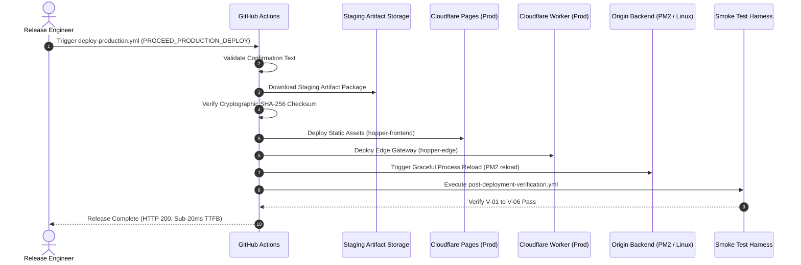

> **Historical document (pre-Vercel).** This file describes the retired
> Cloudflare architecture and is retained as an audit trail. The current
> architecture is `docs/architecture/VERCEL_TARGET_ARCHITECTURE.md`; operations
> are in `docs/deployment/VERCEL_DEPLOYMENT_RUNBOOK.md`. Links to
> Cloudflare-era files are intentionally dead — see
> `docs/deployment/CLOUDFLARE_REMOVAL_AUDIT.md` for the mapping.

# Hopper Production Deployment Runbook

## 1. Production Release Procedure

Production deployment is strictly gated and cannot be triggered automatically by branch pushes.

### Step 1: Verify Staging Acceptance
Confirm that the intended release commit has passed all staging gates:
1. Open GitHub Actions > **Deploy Staging**.
2. Verify the latest workflow run on `main` is completely green.
3. Note the **Commit SHA** and **Workflow Run ID**.

### Step 2: Trigger Protected Production Deployment
1. Navigate to GitHub Actions > **Deploy Production (Protected)**.
2. Click **Run workflow**.
3. Select branch: `main`.
4. (Optional) In `artifact_run_id`, specify the exact staging workflow run ID to promote.
5. In `confirmation`, type: `PROCEED_PRODUCTION_DEPLOY`.
6. Click **Run workflow**.



---

## 2. Post-Deployment Verification Gates

The automated verification suite (`scripts/ci/verify-deployment.sh`) executes immediately following asset deployment:

- **Gate V-01:** Frontend Root HTML delivery (`GET https://app.hopper.dev/`).
- **Gate V-02:** Deep SPA URL rewriting (`GET https://app.hopper.dev/workspaces`).
- **Gate V-03:** Edge security headers (HSTS, CSP, X-Frame-Options, X-Content-Type-Options).
- **Gate V-04:** Origin API Health probe (`GET https://api.hopper.dev/api/health`).
- **Gate V-05:** Edge telemetry validation (`X-Edge-Colo`, `X-Edge-Country`, `X-Edge-Latency-Ms`).
- **Gate V-06:** Bot challenge gate on public diagnostic sandbox (`POST /api/diagnose/sandbox`).

---

## 3. Emergency Incident Response & Immediate Rollback

If post-deployment verification fails, or if an operational alert fires within 15 minutes of rollout:

### Instant Frontend Rollback (5 Seconds)
```bash
# Rollback Cloudflare Pages production deployment
./scripts/recovery/rollback-frontend.sh production <previous-stable-deployment-id>
```

### Instant Edge Worker Rollback
```bash
# Rollback Cloudflare Worker gateway
./scripts/recovery/rollback-worker.sh production <previous-stable-version-id>
```

### Origin Backend Process Rollback
```bash
# On origin server: revert to previous build dist
pm2 reload hopper-api --update-env
```
