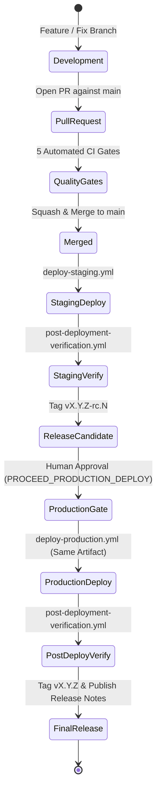

> **Historical document (pre-Vercel).** This file describes the retired
> Cloudflare architecture and is retained as an audit trail. The current
> architecture is `docs/architecture/VERCEL_TARGET_ARCHITECTURE.md`; operations
> are in `docs/deployment/VERCEL_DEPLOYMENT_RUNBOOK.md`. Links to
> Cloudflare-era files are intentionally dead — see
> `docs/deployment/CLOUDFLARE_REMOVAL_AUDIT.md` for the mapping.

# Hopper Release Management & Semantic Versioning

## 1. Release Lifecycle & Progression

Hopper releases follow a deterministic promotion pipeline:



---

## 2. Semantic Versioning Specification (SemVer 2.0.0)

Version numbers follow `MAJOR.MINOR.PATCH`:
- **MAJOR (v2.0.0):** Breaking architectural alterations (e.g. breaking API schema changes, mandatory non-backward-compatible database contracts).
- **MINOR (v1.1.0):** Backward-compatible feature additions (e.g. new failure category support, new dashboard metrics view, new export format).
- **PATCH (v1.0.1):** Backward-compatible bug fixes and security patches (e.g. log scrubber regex tuning, RLS policy optimization, budget controller timing adjustments).
- **PRE-RELEASE (`-rc.N`):** Release candidates deployed to staging for final end-to-end verification.

---

## 3. Provenance & Audit Traceability

Every production release artifact is immutably linked to the following cryptographic and metadata identifiers:

```json
{
  "commit_sha": "c51e1b1234567890abcdef1234567890abcdef12",
  "ref": "refs/tags/v1.0.0",
  "workflow_run_id": "4211388412",
  "workflow_run_number": "14",
  "build_timestamp": "2026-11-06T16:30:00Z",
  "artifact_checksum": "e3b0c44298fc1c149afbf4c8996fb92427ae41e4649b934ca495991b7852b855",
  "environment": "production",
  "deployment_target": "cloudflare-free"
}
```

---

## 4. Release Checklist Before Production Promotion

Before executing `deploy-production.yml`:

- [ ] All 5 PR quality gates passed on the target commit.
- [ ] Staging deployment succeeded with 100% green post-deployment smoke tests.
- [ ] Database migrations adhere to the Expand-and-Contract policy.
- [ ] Cryptographic checksum of the staging release package matches `RELEASE_CHECKSUMS.sha256`.
- [ ] Explicit confirmation text entered: `PROCEED_PRODUCTION_DEPLOY`.
- [ ] Rollback runbook reviewed and verified for active operators.
