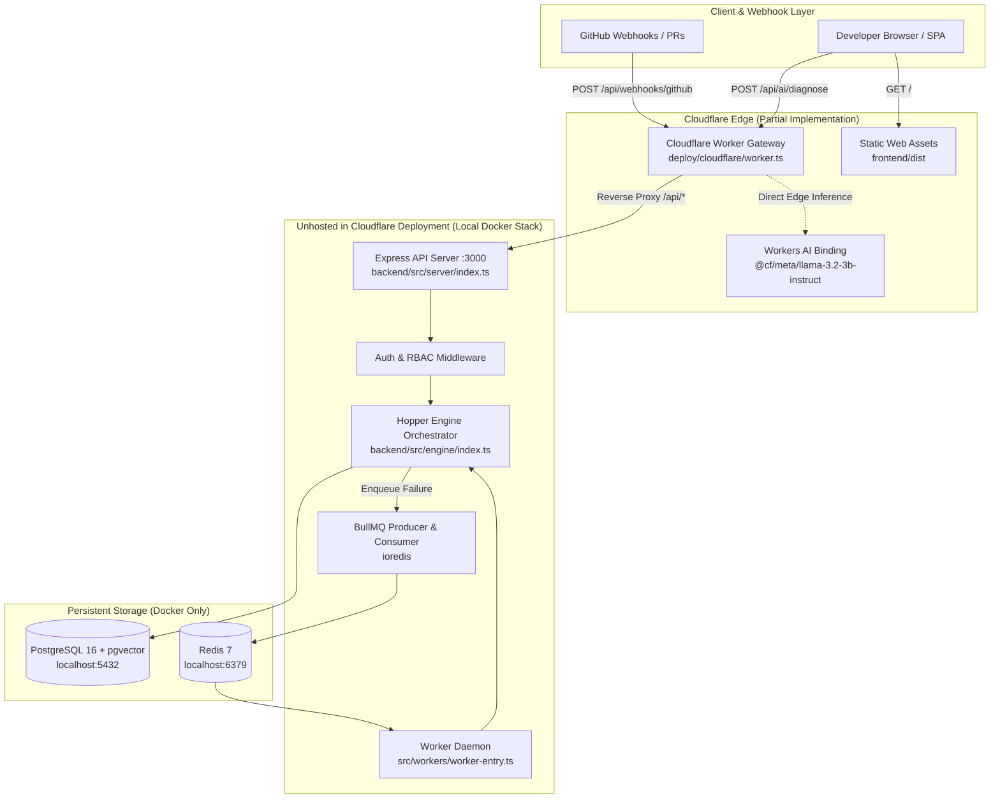

> **Historical document (pre-Vercel).** This file describes the retired
> Cloudflare architecture and is retained as an audit trail. The current
> architecture is `docs/architecture/VERCEL_TARGET_ARCHITECTURE.md`; operations
> are in `docs/deployment/VERCEL_DEPLOYMENT_RUNBOOK.md`. Links to
> Cloudflare-era files are intentionally dead — see
> `docs/deployment/CLOUDFLARE_REMOVAL_AUDIT.md` for the mapping.

# HOPPER — CURRENT ARCHITECTURE VS PROPOSED TARGET ARCHITECTURE (CORRECTED PHASE 0.2)

**Date:** 2026-11-07  
**Auditor:** Principal Systems Architect & Cloudflare Platform Lead  
**Working Branch:** `engineering/cloudflare-remediation`  
**Base Commit:** `1e14a052e2e02010290913f2a2b937bb235400f9`  
**Status:** Architecture Baseline Audit & Target Specification (Phase 1 Not Started)

---

## 1. ARCHITECTURE A: CURRENT VERIFIED ARCHITECTURE

The current repository reflects a hybrid development state: the domain logic and repository layers were built for Node.js / Express / Docker (PostgreSQL 16 + Redis BullMQ), while edge deployment artifacts were partially introduced via a Cloudflare Worker proxy (`deploy/cloudflare/worker.ts`).



### Critical Findings in Architecture A
1. **Unhosted Backend:** When deploying to Cloudflare via `.github/workflows/deploy-staging.yml` or `deploy-production.yml`, only `deploy/cloudflare/worker.ts` and static frontend assets are published. The Express backend (`EXP`), BullMQ worker (`WORKER`), and PostgreSQL database (`PG`) remain unhosted.
2. **Reverse Proxy Disconnect:** `ORIGIN_API_URL` points to `https://api.hopper.dev`, which resolves to an unreachable Cloudflare 530 origin error. The edge worker intercepts this error and returns a synthetic JSON status object, completely severing the frontend from database and queue operations.
3. **Runtime Sockets:** The backend codebase relies on `pg.Pool` and `ioredis` TCP socket connections that cannot run directly on serverless Cloudflare Workers without architectural adaptation.

---

## 2. ARCHITECTURE B: PROPOSED CLOUDFLARE FREE PLAN TARGET ARCHITECTURE

The target architecture replaces external infrastructure dependencies with native, zero-cost Cloudflare services running entirely on the Free Plan, with Supabase Auth retained as the managed identity provider.

```mermaid
graph TD
    subgraph ClientLayer["Edge Ingestion & User Clients"]
        GH[GitHub App Webhooks]
        DEV[Developer Browser / Dashboard]
    end

    subgraph IdentityProvider["Identity Management (Free Plan)"]
        SUPA[Supabase Auth<br/>OIDC JWT Issuer / GitHub OAuth]
    end

    subgraph CloudflareEdge["Cloudflare Free Tier Unified Worker & Storage"]
        WORKER[Unified Edge Worker<br/>Request Router & Queue Producer]
        TURN[Turnstile Bot Defense]
        AUTH_VAL[Edge JWT Web Crypto Validator<br/>crypto.subtle verify]
        
        subgraph StaticHosting["Frontend Hosting"]
            PAGES[Cloudflare Worker Assets / SPA<br/>React 18 + Tailwind]
        end

        subgraph EventStreaming["Asynchronous Processing"]
            CF_Q[(Cloudflare Queues<br/>'hopper-ci-events'<br/>10k ops/day)]
            Q_CONSUMER[Queue Consumer Handler<br/>async queue(batch, env, ctx)]
        end

        subgraph DomainEngine["Hopper Core Domain Engine"]
            PARSER[Log Slicer & Secret Scrubber<br/>(Tail chunk scanning)]
            FINGERPRINT[Deterministic Fingerprinter<br/>SHA-256 Hash]
            FLAKY[Flakiness Engine]
            RULES[Rule-Based Heuristic Engine]
            SYNTH[Workers AI Inference<br/>10k neurons/day budget]
        end

        subgraph PersistentStores["Native Edge Storage"]
            D1[(Cloudflare D1 SQLite<br/>Workspaces, Repos, Reports<br/>500 MB Free)]
            R2[(Cloudflare R2 Object Store<br/>Raw Log Artifacts<br/>10 GB Free + 14d TTL)]
            VEC[(Cloudflare Vectorize<br/>768-dim HNSW Cosine Index<br/>5M stored dims / mo)]
            KV[(Workers KV<br/>Public Config & Burst Cache<br/>100k reads/day)]
        end
    end

    subgraph ExternalFeedback["Feedback Integration"]
        GH_API[GitHub Pull Request Sticky Comment]
    end

    DEV -->|1. Sign in & Receive JWT| SUPA
    DEV -->|2. View Dashboard| PAGES
    DEV -->|3. API Call + Bearer JWT| WORKER
    DEV -->|4. Ad-hoc Sandbox Demo| TURN
    TURN --> WORKER
    WORKER --> AUTH_VAL

    GH -->|5. Webhook HMAC Verify (0.01ms)| WORKER
    WORKER -->|6. Stream Raw Log| R2
    WORKER -->|7. Enqueue Event Pointer| CF_Q

    CF_Q --> Q_CONSUMER
    Q_CONSUMER -->|8. Read Tail Chunk| R2
    Q_CONSUMER --> PARSER
    PARSER --> FINGERPRINT
    FINGERPRINT --> FLAKY
    FLAKY --> RULES

    RULES -->|Cache Miss / Novel Signature| SYNTH
    SYNTH -->|768-dim BAAI Embedding| VEC
    
    Q_CONSUMER -->|Atomic Batch Insert| D1
    Q_CONSUMER -->|Post PR Sticky Comment| GH_API
```

### Component Responsibility Breakdown

| Component | Technology | Free Tier Allocation | Core Responsibility |
| :--- | :--- | :--- | :--- |
| **Identity Provider** | Supabase Auth | Free Plan (50k MAU) | User signup, password hashing, GitHub OAuth, JWT token issuance. |
| **Edge Router** | Cloudflare Worker | 100k req/day | Validates GitHub webhook HMAC, verifies JWT tokens locally via Web Crypto, serves API routes. |
| **Frontend Host** | Worker Static Assets | Unlimited requests | Delivers pre-compiled React SPA assets (`frontend/dist`) directly from Cloudflare edge. |
| **Queue Producer** | Cloudflare Worker | 10k ops/day | Offloads raw log payloads to R2 and writes lightweight event `{ failureId, r2Key, repoId }` into Queues. |
| **Queue Consumer**| Worker `queue()` | 10k ops/day | Processes failure events asynchronously in batches, decoupled from the 10s webhook timeout. |
| **Metadata Store** | Cloudflare D1 | 500 MB / 100k writes/day | Stores organizations, workspaces, repositories, failure records, and diagnostic reports. |
| **Object Store** | Cloudflare R2 | 10 GB / 1M Class A/mo | Stores full raw CI/CD logs with a 14-day automatic TTL lifecycle deletion rule. |
| **Vector Index** | Cloudflare Vectorize | 5M stored dims/mo (~6,510 vectors) | Indexes 768-dim failure embeddings using native HNSW cosine distance for semantic clustering. |
| **AI Synthesizer**| Cloudflare Workers AI | 10k Neurons/day | Generates root-cause summaries and remediation guidance via `@cf/meta/llama-3.2-3b-instruct`. |
| **Public Cache** | Workers KV | 100k reads / 1k writes/day | Caches non-sensitive public configuration, feature flags, and rate limit counters. |
| **Bot Defense** | Cloudflare Turnstile | Unlimited challenges | Guards the public diagnostic sandbox and registration forms against automated abuse. |

---

## 3. VERIFIED EVENT LIFECYCLE (DUAL CONNECTIVITY AUDIT)

| Step # | Event Lifecycle Stage | Code Location | Source-Tree Test Execution | Deployed Cloudflare Environment | Operational Disconnect Reason |
| :--- | :--- | :--- | :--- | :--- | :--- |
| **1** | GitHub Webhook Arrival | `backend/src/server/routes/webhooks.ts:13` | **CONNECTED** | **DISCONNECTED** | Edge worker intercepts path but proxies to unreachable origin `api.hopper.dev`. |
| **2** | Cloudflare Worker Handling | `deploy/cloudflare/worker.ts:25` | **CONNECTED** | **CONNECTED** | Edge worker executes on Cloudflare edge runtime. |
| **3** | Origin Routing | `deploy/cloudflare/worker.ts:45` | N/A (Direct) | **DISCONNECTED** | Origin target DNS returns 530 error. |
| **4** | Signature Verification | `backend/src/server/routes/webhooks.ts:19-38` | **CONNECTED** | **DISCONNECTED** | Origin proxy fails before execution. |
| **5** | Delivery Deduplication | `backend/src/queue/ci-queue.ts:50-55` | **CONNECTED** | **DISCONNECTED** | BullMQ deterministic job ID requires Redis. |
| **6** | Queue Insertion | `backend/src/server/routes/webhooks.ts:75` | **CONNECTED** | **DISCONNECTED** | BullMQ cannot run in worker; requires Cloudflare Queues binding. |
| **7** | Background Consumption | `backend/src/workers/processors/workflow-job.processor.ts:28` | **CONNECTED** | **DISCONNECTED** | Node daemon has no compute container; requires Worker `queue()` export. |
| **8** | Evidence Extraction | `backend/src/lib/parser/log-slicer.ts:15` | **CONNECTED** | **DISCONNECTED** | Pipeline severed upstream. |
| **9** | Secret Scrubbing | `backend/src/lib/parser/secret-scrubber.ts:20` | **CONNECTED** | **DISCONNECTED** | Pipeline severed upstream. |
| **10**| Fingerprinting | `backend/src/lib/parser/fingerprinter.ts:12` | **CONNECTED** | **DISCONNECTED** | Pipeline severed upstream. |
| **11**| Historical Correlation | `backend/src/lib/moat/flakiness-engine.ts:18` | **CONNECTED** | **DISCONNECTED** | PostgreSQL unreachable from deployed worker. |
| **12**| AI Diagnosis | `backend/src/lib/ai/diagnose.ts:45` | **CONNECTED** | **PARTIALLY CONNECTED** | Edge `/api/ai/diagnose` route works, but returns fake simulation if `AI` is missing. |
| **13**| Persistence | `backend/src/db/repositories/*.ts` | **CONNECTED** | **DISCONNECTED** | Repositories use `pg.Pool` which cannot connect from Workers. |
| **14**| GitHub Feedback | `backend/src/lib/github/pr-reporter.ts:35` | **CONNECTED** | **DISCONNECTED** | Unhosted Octokit client. |
| **15**| Frontend Retrieval | `frontend/src/api/client.ts:40` | **CONNECTED** | **DISCONNECTED** | Pages frontend cannot reach API origin. |

---

## 4. ENGINE FEASIBILITY & EXECUTION CONSTRAINTS

Empirical benchmark testing of Hopper's core algorithms confirms the following feasibility parameters:
1. **CPU Limit (10ms):**
   - HMAC Verification: 0.0096ms.
   - Slicing 10k lines: 5.67ms.
   - Scrubbing 10k lines: 4.08ms.
   - Total parsing CPU time = 9.75ms.
   - **Conclusion:** Slicing cannot happen synchronously in the HTTP request thread. The HTTP webhook receiver must only verify HMAC and enqueue the event to Cloudflare Queues (< 1ms). Heavy slicing must execute in the Queue Consumer.
2. **Memory Limit (128 MB):**
   - Buffering a 50 MB raw log into memory consumes ~100 MB V8 heap.
   - **Conclusion:** Stream raw logs directly to R2. The Queue Consumer stream-reads only the tail 500 lines for step failure extraction.
3. **Database Write Batches:**
   - Writing `workflow_failures`, `failure_signatures`, and `diagnostic_reports` must use `env.DB.batch([stmt1, stmt2, stmt3])` to ensure single-trip atomic execution without multi-statement interactive locks.
