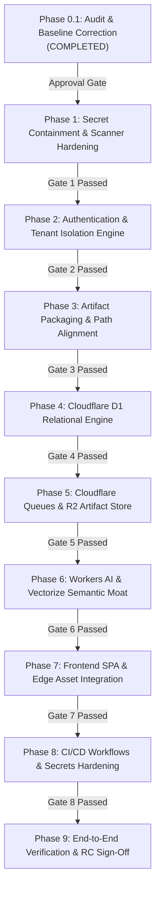

# HOPPER — REVISED AUTONOMOUS REMEDIATION PHASE PLAN (PHASE 0.1)

**Date:** 2026-11-07  
**Auditor:** Principal DevOps Engineer, Cloudflare Architect & Platform Engineering Lead  
**Working Branch:** `engineering/cloudflare-remediation`  
**Base Commit:** `1e14a052e2e02010290913f2a2b937bb235400f9`  
**Execution Standard:** Strictly Gated Autonomous Engineering (Phase 1 Not Started)

---

## 1. PHASE ORDERING PRINCIPLES & RATIONALE

Based on the verified evidence from Phase 0.1:
1. **Security Containment First (Phase 1):** Scrub the exposed high-entropy secrets from `backend/package.json`, update the secret scanner patterns to eliminate blind spots, and update documentation.
2. **Authentication & Tenant Authorization Prior to Endpoint Migration (Phase 2):** Fix all fail-open IDOR flaws, close unauthenticated endpoints (`/api/billing/checkout`, `/api/diagnose/adhoc`, `/api/ai/*`), and implement the legacy-record auto-link migration bridge before modifying any deployment topology.
3. **Artifact Packaging & Build Foundation (Phase 3):** Fix `.github/workflows/build-artifacts.yml` and `wrangler.toml` path alignment so release bundles are immutably deployable.
4. **Cloudflare D1 Storage & Relational Adapter (Phase 4):** Create SQLite D1 schema migrations, implement the `D1DatabaseExecutor` adapter, and test repositories with D1.
5. **Cloudflare Queues & Asynchronous Ingestion (Phase 5):** Implement native Cloudflare Queues producer and consumer, decoupling webhook ingress from log slicing and R2 artifact storage.
6. **Cloudflare Vectorize & AI Diagnosis Engine Hardening (Phase 6):** Configure native 768-dim Vectorize index, eliminate simulated fake-diagnosis stubs, and enforce strict deterministic fallback with 0 neurons.
7. **Frontend Cloudflare Integration & SPA Routing (Phase 7):** Ensure Vite SPA compiles cleanly, static assets route through Worker `[assets]`, and mock auth/live auth toggle cleanly.
8. **CI/CD Automation & GitHub Secrets Verification (Phase 8):** Verify all 13 GitHub Actions workflows, document required secrets, and validate PR quality gates.
9. **Final End-to-End Verification & Release Candidate (Phase 9):** Execute end-to-end smoke tests, adversarial security tests, and produce final release candidate documentation.

---

## 2. DETAILED 9-PHASE EXECUTION ROADMAP

---

### Phase 1: Secret Containment & CI Scanner Hardening
- **Objective:** Eliminate credential exposure in tracked files and extend CI scanner patterns.
- **Actions:**
  - Remove inline `GITHUB_APP_CLIENT_SECRET` and `GITHUB_APP_WEBHOOK_SECRET` from `backend/package.json`.
  - Update `scripts/ci/verify-no-committed-secrets.py` to add regex patterns for GitHub App Client Secrets (`(?i)client_secret\s*[:=]\s*["']?[a-f0-9]{40}["']?`) and generic hex secrets.
  - Run secret scanner to verify 100% clean exit code 0.
- **Acceptance Criteria:** `npm run dev` relies on `.env.example`; secret scanner catches all 40-hex and 64-hex tokens; 0 secrets in git history on working branch.
- **Phase Gate 1:** Clean git commit; scanner passes; zero regression in backend test suite.

---

### Phase 2: Authentication & Tenant Isolation Hardening
- **Objective:** Eliminate all IDOR fail-open conditions and secure unauthenticated routes.
- **Actions:**
  - In `backend/src/server/routes/signatures.ts`, `repositories.ts`, and `dashboard.ts`: replace fail-open fallbacks with strict fail-closed enforcement (`hasAccess = false`).
  - Implement ownership verification bridge: if `workspace_id` is null, check if authenticated user login matches `org.github_account_login`; if verified, auto-link to default workspace; otherwise return 403 Forbidden.
  - Add `requireAuth` to `POST /api/billing/checkout` and `POST /api/diagnose/adhoc`.
  - Add JWT validation to edge `/api/ai/diagnose` and `/api/ai/embeddings`.
- **Acceptance Criteria:** 22/22 tenant isolation tests pass; unauthorized cross-tenant requests return 403; legacy organizations auto-link to verified owners without lockout.
- **Phase Gate 2:** `tests/security-tenant-isolation.test.ts` and `tests/authorization-matrix.test.ts` pass with 100% green status.

---

### Phase 3: Artifact Packaging & Wrangler Path Alignment
- **Objective:** Ensure CI release artifacts match Wrangler deployment directory hierarchy.
- **Actions:**
  - Update `.github/workflows/build-artifacts.yml` to preserve `deploy/cloudflare/worker.ts` and `frontend/dist/` paths.
  - Align `wrangler.toml` assets and main entry point configuration.
- **Acceptance Criteria:** Unpacking `release-dist` and executing `wrangler deploy --dry-run` succeeds without missing file errors.
- **Phase Gate 3:** Release artifact build dry-run passes with cryptographic SHA-256 validation.

---

### Phase 4: Cloudflare D1 Relational Engine & Migration Adapter
- **Objective:** Implement D1 SQLite schema and repository adapter layer.
- **Actions:**
  - Generate SQLite D1 DDL migration script from PostgreSQL schemas.
  - Implement `D1DatabaseExecutor` satisfying `DatabaseExecutor` interface.
  - Verify repository methods (`WorkspaceRepository`, `RepositoryRepository`, `DiagnosticReportRepository`) against D1.
- **Acceptance Criteria:** D1 database executes all workspace and failure queries; migrations apply cleanly via `wrangler d1 migrations apply`.
- **Phase Gate 4:** Repository unit tests pass against D1 executor.

---

### Phase 5: Cloudflare Queues & R2 Artifact Storage
- **Objective:** Asynchronous decoupled event ingestion on Cloudflare Free Plan.
- **Actions:**
  - Replace BullMQ producer with `env.QUEUE.send({ failureId, r2Key, repoId })`.
  - Replace BullMQ worker with Worker `queue(batch, env, ctx)` consumer handler.
  - Store raw multi-megabyte logs in Cloudflare R2 (`env.R2.put()`).
  - Configure 14-day TTL lifecycle policy on R2 bucket.
- **Acceptance Criteria:** GitHub webhook responds with HTTP 202 within 150ms; failure event is processed asynchronously in consumer batch; raw log is fetched from R2.
- **Phase Gate 5:** End-to-end webhook-to-queue-to-diagnosis pipeline passes in local and staging environments.

---

### Phase 6: Workers AI & Vectorize Semantic Moat
- **Objective:** Production-grade AI diagnosis and 768-dim semantic search on Free Plan.
- **Actions:**
  - Create Cloudflare Vectorize index with `dimensions = 768`, `metric = "cosine"`.
  - Wire `@cf/baai/bge-base-en-v1.5` embeddings directly to Vectorize.
  - Remove fake `cloudflare-workers-ai-simulated` mock from `deploy/cloudflare/worker.ts`.
  - Return HTTP 503 `unavailable` or invoke deterministic heuristic engine when Workers AI binding is unconfigured or exceeds daily 10,000 neurons.
- **Acceptance Criteria:** Zero fake diagnoses returned; deterministic engine handles routine failures with 0 neurons; semantic similarity query correctly identifies matching failure clusters.
- **Phase Gate 6:** `tests/cloudflare-ai.test.ts` passes with zero mock divergence.

---

### Phase 7: Frontend SPA & Edge Asset Integration
- **Objective:** Deploy polished React dashboard directly from Cloudflare Worker static assets.
- **Actions:**
  - Ensure `frontend/dist` is served directly via Worker `[assets]` binding.
  - Configure single-page application fallback routing (`/* -> /index.html`).
  - Wire frontend API client to edge gateway `/api/*` endpoints.
- **Acceptance Criteria:** Loading `https://<worker>.workers.dev` in browser displays full Hopper UI; navigation tabs function; API calls populate live dashboard widgets.
- **Phase Gate 7:** Frontend build and E2E browser smoke tests pass.

---

### Phase 8: CI/CD Workflows & Secrets Documentation
- **Objective:** Validate all 13 GitHub Actions workflows and document secrets setup.
- **Actions:**
  - Audit all workflows (`backend-ci`, `frontend-ci`, `ci`, `security`, `deploy-production`, etc.).
  - Document required repository secrets (`CLOUDFLARE_ACCOUNT_ID`, `CLOUDFLARE_API_TOKEN`, `CLOUDFLARE_TURNSTILE_SECRET_KEY`) in `docs/deployment/SECRETS_SETUP.md`.
- **Acceptance Criteria:** All CI quality gates pass on pull requests; deployment workflows skip cleanly with descriptive notices when secrets are unconfigured.
- **Phase Gate 8:** Pull request and CI workflows execute with 100% green status.

---

### Phase 9: End-to-End Verification & Release Candidate
- **Objective:** Final release candidate verification and delivery sign-off.
- **Actions:**
  - Run full test suite (`test:backend`, `test:frontend`, `lint`, adversarial security tests).
  - Perform live verification on Cloudflare staging.
  - Generate release notes and commit history verification.
- **Acceptance Criteria:** 100% test pass rate; zero critical security vulnerabilities; production-ready deployment on Cloudflare Free Tier.
- **Phase Gate 9:** Formal Release Candidate sign-off and merge readiness.

