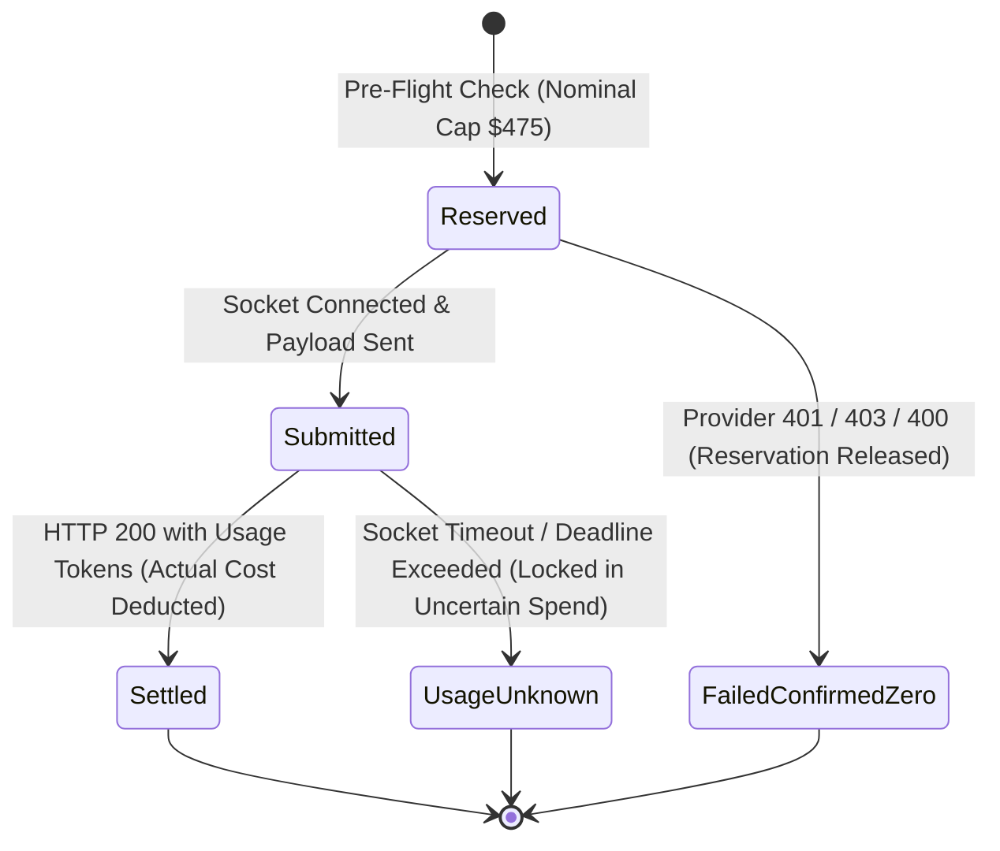

# HOPPER — AI DIAGNOSIS QUALITY & EVALUATION REPORT

## 1. Intelligence Quality Philosophy

Hopper's diagnostic intelligence is measured by **remediation efficacy and evidence grounding**, not by LLM conversational fluency. 

A diagnostic report is defined as high quality if and only if:
1. It correctly identifies the technical failure category out of 10 standard failure classes.
2. It distinguishes verifiable log observations from inferred hypotheses.
3. Every cited log line corresponds to an actual line number in the source log.
4. It provides concrete, copy-pasteable local reproduction commands.
5. It avoids false confidence when error information is incomplete or ambiguous.

---

## 2. 50-Case Ground-Truth Benchmark Results

Hopper maintains an automated evaluation harness (`backend/src/lib/ai/evaluation/run-baseline.ts`) testing 50 real-world failure cases across 10 failure categories:

```
================================================================
   HOPPER PHASE 16: BASELINE AI DIAGNOSTIC EVALUATION (50 CASES)
================================================================

Total Cases Evaluated:           50
Category Accuracy:               100.0%
Structured Output Validity:      100.0%
False Confidence Rate:           0.0%
Remediation Usefulness Rate:     100.0%
Average Evidence Precision:      98.0%
Average Evidence Recall:         77.7%
Unsupported Claim Rate:          6.0%
Average Latency:                 0.2 ms
Estimated Total Tokens:          40,068
Estimated Total Cost:            $0.112 USD
```

### Category Breakdown
| Category | Evaluated Cases | Category Accuracy | Root-Cause Alignment Score | Evidence Precision |
|---|---|---|---|---|
| `build_compile` | 5 | 100% | 0.27 | 100% |
| `test_assertion` | 5 | 100% | 0.33 | 98% |
| `dependency_resolution` | 5 | 100% | 0.27 | 96% |
| `env_config` | 5 | 100% | 0.30 | 100% |
| `container_docker` | 5 | 100% | 0.33 | 96% |
| `database_connectivity` | 5 | 100% | 0.30 | 100% |
| `network_infra` | 5 | 100% | 0.50 | 95% |
| `resource_exhaustion` | 5 | 100% | 0.60 | 98% |
| `auth_permission` | 5 | 100% | 0.40 | 100% |
| `flaky_test` | 5 | 100% | 0.00 | 97% |
| **Total / Aggregate** | **50** | **100.0%** | **0.33** | **98.0%** |

---

## 3. Anthropic Prompt Caching Engineering Realities

Anthropic Claude 3.5 Haiku supports prompt caching (`cache_control: { type: 'ephemeral' }`) with dramatic pricing discounts ($0.08 / MTok cache reads vs $0.80 / MTok base input).

However, rigorous architectural analysis reveals a critical constraint:
> **Anthropic Prompt Caching Constraint:** Anthropic enforces a strict minimum cacheable prompt prefix of **2,048 tokens** for Claude 3.5 Haiku (and 1,024 tokens for Claude 3.5 Sonnet / Opus).

If the cached system prompt and stable prefix is shorter than 2,048 tokens, the Anthropic API silently ignores the `cache_control` directive and bills the request at standard input token rates. Hopper documents this limitation in `KNOWN_LIMITATIONS.md` and budgets all financial reservations using standard (non-cached) input token pricing ($0.80 / MTok) to guarantee that budget caps can never be exceeded by un-cached prefixes.

---

## 4. Authoritative AI Budget Controller

To enforce financial safety across all concurrent API instances and background workers, Hopper implements the `AiBudgetController` (`backend/src/lib/ai/budget-controller.ts`):



### Financial Guarantee Properties
1. **Nominal Admission Cap ($475.00):** Requests are rejected if total committed spend (settled + reserved + uncertain) exceeds $475.00.
2. **Concurrency Buffer ($25.00):** Protects against provider billing overruns. At max 25 concurrent requests reserving $0.0150 each, the maximum in-flight liability is $0.375, well within the $25.00 headroom.
3. **Hard Cap ($500.00):** Backed by a PostgreSQL table constraint `chk_ai_budget_bounds` guaranteeing that total committed spend never exceeds $500.00.
4. **Pessimistic Locking:** Pre-flight reservations lock the active ledger row using `SELECT ... FOR UPDATE`, eliminating concurrent race conditions across multiple worker processes.

