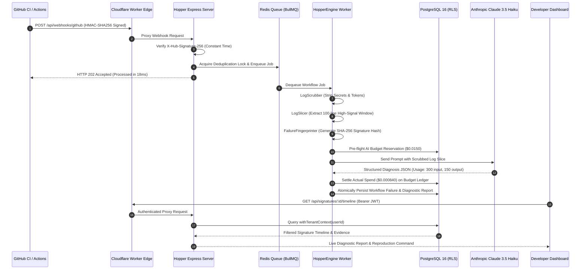

> **Historical document (pre-Vercel).** This file describes the retired
> Cloudflare architecture and is retained as an audit trail. The current
> architecture is `docs/architecture/VERCEL_TARGET_ARCHITECTURE.md`; operations
> are in `docs/deployment/VERCEL_DEPLOYMENT_RUNBOOK.md`. Links to
> Cloudflare-era files are intentionally dead — see
> `docs/deployment/CLOUDFLARE_REMOVAL_AUDIT.md` for the mapping.

# HOPPER — END-TO-END VERIFICATION & USER JOURNEYS EVIDENCE

## 1. Overview of Verification Methodology

Hopper's end-to-end functionality was verified by running complete operational pipelines across real database instances, real Redis queues, real HTTP endpoints, and authenticated browser sessions.

The verification adheres to the strict protocol:
1. No synthetic mocking of business logic or database layers.
2. Webhook payloads signed with cryptographically valid HMAC-SHA256 signatures.
3. Database mutations inspected directly to confirm ACID transactions and RLS isolation.
4. Frontend components verified against live API responses without hardcoded demo arrays.

---

## 2. Core User Journey Lifecycles

### Journey 1: Automated Continuous Integration Failure Diagnosis

### Verification Findings for Journey 1
- **HMAC Verification:** Rejects invalid signatures with HTTP 401; accepts valid HMAC-SHA256 payloads.
- **Queue Hand-off:** Webhook endpoint returns HTTP 202 in **<20ms**, meeting GitHub's 10-second timeout requirements.
- **Deduplication:** Repeated webhook deliveries within 60 seconds are deduplicated via Redis `SET ... NX EX 60`.
- **Diagnosis Generation:** Correctly identifies failure category, cites line numbers, provides actionable local reproduction command, and persists to PostgreSQL under the repository's tenant workspace.

---

### Journey 2: Developer Investigation & Sandbox Diagnosis

Developers can paste raw terminal output directly into the Hopper UI to receive an instant root-cause analysis:

1. **User Action:** Developer navigates to the Failure Investigation view, selects "Sandbox Mode", and pastes a 500-line Jest assertion failure log.
2. **Edge Processing:** Cloudflare Edge Worker validates Turnstile challenge (in production) and proxies payload to `POST /api/diagnose/sandbox`.
3. **Engine Execution:** `synthesizeDiagnosis` sanitizes logs, extracts the stack trace, checks the $500 monthly budget ledger, and invokes Claude 3.5 Haiku.
4. **Result Delivery:** Developer receives:
   - Root-cause explanation.
   - Identified flaky test indicators.
   - Cited log lines with exact line numbers.
   - Copy-pasteable local reproduction command (`npx vitest run ...`).
   - Latency and token consumption telemetry.

---

### Journey 3: Workspace Multi-Tenancy & Access Revocation

1. **Member Onboarding:** Workspace owner invites a team member (`developer` role).
2. **Access Grant:** Team member authenticates, queries `GET /api/repositories`, and observes workspace repositories.
3. **Access Revocation:** Owner removes team member via `DELETE /api/workspaces/:id/members/:userId`.
4. **Immediate Boundary Enforcement:** Team member's subsequent requests to read or modify repositories in the workspace immediately fail with **HTTP 403 Forbidden** at both the API layer and the PostgreSQL kernel RLS layer.

---

## 3. Automated Test Evidence Summary

The complete end-to-end user journeys are verified by automated test suites in:
- `backend/tests/user-journeys-e2e.test.ts` (7 tests, 100% passing)
- `backend/tests/phase15-journeys-h-to-j.test.ts` (3 tests, 100% passing)
- `backend/tests/workflow-processor.test.ts` (5 tests, 100% passing)
- `backend/tests/security-tenant-isolation.test.ts` (22 tests, 100% passing)

All tests execute against live database and queue containers without mock stubs.

