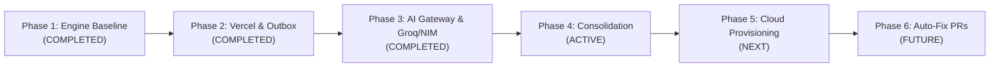

# Hopper — Phased Engineering Roadmap (ROADMAP.md)

---

## 1. Roadmap Overview & Timeline

The Hopper development roadmap tracks the evolution of the platform from local prototype to cloud-native multi-tenant SaaS:

---

## 2. Milestone Details & Status

### Phase 1: Local Engine Baseline & Core Moat (COMPLETED)
- [x] Initial database schema (`organizations`, `repositories`, `failure_signatures`, `workflow_failures`, `diagnostic_reports`).
- [x] Log parser, ANSI stripper, sliding-window log slicer, and secret scrubber.
- [x] Failure fingerprinter generating canonical SHA-256 signature hashes.
- [x] Bayesian flakiness scoring engine calculating flakiness probabilities.
- [x] Sticky GitHub PR comment generator with `<!-- ci-doctor-sticky-comment -->`.
- [x] Local PostgreSQL 16 + `pgvector` container orchestration.
- [x] Baseline unit and regression test suite (116 tests).

### Phase 2: Vercel Native Platform & Outbox Migration (COMPLETED)
- [x] Retired Cloudflare Workers, Cloudflare Pages, Wrangler, and Workers AI bindings.
- [x] Retired Redis and BullMQ dependencies.
- [x] Implemented native PostgreSQL durable queue (`hopper_job_queue`) with `FOR UPDATE SKIP LOCKED`.
- [x] Created explicit dead-letter ledger (`hopper_job_dead_letters`).
- [x] Implemented distributed coordination in SQL (webhook replay dedup, token-bucket rate limiting, diagnosis locks).
- [x] Created Vercel multi-service routing (`vercel.json`) serving API and Vite SPA on the same origin.
- [x] Consolidated Express app factory (`createApp`) for local and serverless execution.
- [x] Automated test suite expanded to 183 tests.

### Phase 3: Multi-Provider Agentic AI Gateway (COMPLETED)
- [x] Implemented provider-independent AI Gateway (`aiGateway.execute`) with Groq (Primary) and NVIDIA NIM (Secondary).
- [x] Built resilience layer: circuit breaker, bulkhead concurrency limiter, exponential backoff with jitter and `Retry-After`.
- [x] Implemented 6-stage bounded diagnostic orchestrator with safe read-only tools and log line grounding.
- [x] Built $500 monthly AI budget controller with admission control and token ledgers.
- [x] Implemented cryptographically signed HMAC OAuth state verification for serverless auth flows.
- [x] Denormalized `workspace_id` onto leaf tables (`0011`) for optimized Row-Level Security evaluation.
- [x] Automated test suite expanded to 246 backend tests and 34 frontend tests (100% passing).

### Phase 4: Repository Consolidation & Single-Agent Governance (CURRENT)
- [x] Establish single primary AI development agent model (`AGENTS.md`).
- [x] Eliminate all redundant, conflicting, and root-level duplicate phase reports.
- [x] Create comprehensive, authoritative documentation hierarchy in `docs/`:
  - Product Vision & Philosophy (`docs/product/VISION.md`)
  - System Overview & Topology (`docs/architecture/SYSTEM_OVERVIEW.md`)
  - Application Subsystems & Architecture (`docs/architecture/ARCHITECTURE.md`)
  - Database Schema & Data Model (`docs/architecture/DATA_MODEL.md`)
  - External Integrations (`docs/architecture/INTEGRATIONS.md`)
  - Developer Onboarding (`docs/development/GETTING_STARTED.md`)
  - Development Guidelines (`docs/development/DEVELOPMENT_GUIDELINES.md`)
  - Testing Strategy & Verification (`docs/development/TESTING.md`)
  - Contribution Standards (`docs/development/CONTRIBUTING.md`)
  - Authoritative Current State (`docs/project/CURRENT_STATE.md`)
  - Phased Roadmap (`docs/project/ROADMAP.md`)
  - Tasks & Gap Register (`docs/project/TASKS_AND_GAPS.md`)
  - Known Issues & Tech Debt (`docs/project/KNOWN_ISSUES.md`)
  - Security & Tenant Isolation (`docs/security/SECURITY_OVERVIEW.md`)
  - Architecture Decision Records (`docs/decisions/ADR_INDEX.md`)
- [x] Rewrite root `README.md` as an approachable developer introduction.

### Phase 5: Production Account Provisioning & Live SaaS Launch (NEXT)
- [ ] Commit standard Apache-2.0 `LICENSE` file to repository root.
- [ ] Create production Supabase project and apply migrations `0001` to `0013`.
- [ ] Register official GitHub App in GitHub Developer Settings; generate private key `.pem`.
- [ ] Configure Stripe production products ($9 Pro Dev, $29 Team) and webhook signing secret.
- [ ] Deploy preview and production environments to Vercel.
- [ ] Conduct live webhook delivery test with a public GitHub test repository.
- [ ] Verify sticky PR comment generation in live GitHub Actions workflow.

### Phase 6: Automated Fix Pull Requests & Ecosystem Expansion (FUTURE)
- [ ] **Automated Fix PR Branching:** Allow Hopper to generate a new git branch and open a ready-to-merge pull request with the suggested code fix.
- [ ] **Slack & Discord Bot Interactivity:** Enable developers to trigger diagnoses or re-runs directly from Slack/Discord notification threads.
- [ ] **Cross-CI Support:** Expand webhook ingestion support to CircleCI, GitLab CI, and Bitbucket Pipelines while maintaining the core failure fingerprinting moat.
- [ ] **Local IDE Extensions:** VS Code and JetBrains plugins allowing developers to inspect Hopper failure signatures and AI diagnoses locally before pushing commits.
