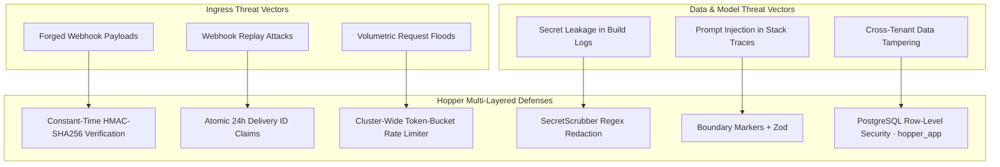

# Hopper — Security Architecture & Threat Model (SECURITY_OVERVIEW.md)

---

## 1. Security Philosophy & Threat Model

Hopper operates as an automated diagnostic engine for continuous integration systems. Because CI environments handle source code, build scripts, and sensitive secrets, Hopper is engineered under the assumption that **incoming CI log data is untrusted and potentially hostile**.



---

## 2. Authentication & Session Management

### 2.1 Dual-Mode Authentication Architecture
1. **Hopper Session JWTs:** Issued upon successful GitHub OAuth token exchange. Encodes `userId`, `username`, and `currentWorkspaceId`. Signed with `JWT_SECRET`.
2. **Supabase Auth JWTs:** Fully supported for cloud-native installations. Verified via `SUPABASE_JWT_SECRET` (symmetric HS256) or `SUPABASE_JWT_PUBLIC_KEY` (asymmetric RS256/ES256).

### 2.2 Cryptographic Algorithm Allowlisting
To prevent "none" algorithm attacks and key-confusion vulnerabilities, `backend/src/server/middleware/auth.ts` explicitly enforces an algorithm allowlist:
```typescript
const ALLOWED_ALGORITHMS = ['HS256', 'RS256', 'ES256'];
```
Any token specifying `alg: "none"` or unapproved algorithms is rejected with `401 Unauthorized`.

### 2.3 Stateless Serverless OAuth CSRF Protection
GitHub OAuth state tokens are generated via `generateSignedOAuthState()` (`backend/src/lib/github/user-auth.ts`). Each state parameter consists of:
$$\text{State} = \text{base64}(\text{timestamp} \mathbin{\Vert} \text{randomBytes} \mathbin{\Vert} \text{HMAC}_{\text{JWT\_SECRET}}(\text{timestamp} \mathbin{\Vert} \text{randomBytes}))$$
This allows any serverless function instance to verify state authenticity and enforce a 10-minute validity window without relying on shared in-memory state.

---

## 3. Multi-Tenant Isolation & Row-Level Security (RLS)

Hopper guarantees that no tenant can inspect, modify, or delete another tenant's repositories, failure signatures, or diagnostic reports.

### 3.1 PostgreSQL Engine Enforcement
- **`FORCE ROW LEVEL SECURITY`:** Enabled on all multi-tenant tables (`organizations`, `repositories`, `workspaces`, `workspace_members`, `failure_signatures`, `workflow_failures`, `diagnostic_reports`).
- **Dedicated Runtime Role (`hopper_app`):** The application connects using a non-superuser database role. It cannot bypass RLS even if application code omits an explicit `WHERE` clause.
- **Transaction-Local Scoping:** Every pooled connection sets tenant context within a local transaction:
  ```sql
  SET LOCAL app.current_user_id = '...';
  SET LOCAL app.current_workspace_id = '...';
  ```
  Because context is set with `SET LOCAL`, it is automatically discarded when the transaction completes, preventing context leakage across pooled connections.

### 3.2 Denormalized Leaf RLS
Migration `0011` denormalized `workspace_id` onto leaf tables (`failure_signatures`, `workflow_failures`, `diagnostic_reports`). Policies evaluate directly:
```sql
CREATE POLICY leaf_workspace_isolation ON diagnostic_reports
  FOR ALL
  USING (workspace_id = current_setting('app.current_workspace_id', true)::uuid);
```

---

## 4. Webhook Ingress Hardening

1. **Constant-Time Verification:** Webhook signatures from GitHub (`X-Hub-Signature-256`) and Stripe are verified using constant-time cryptographic comparisons (`crypto.timingSafeEqual`) to eliminate timing side-channel attacks.
2. **Replay Deduplication:** Ingress deliveries are claimed atomically in `hopper_webhook_deliveries` using the unique delivery GUID (`hopper_claim_webhook_delivery`). Duplicate deliveries within 24 hours are acknowledged and discarded.
3. **Fixed-Window Rate Limiting:** Ingress is bounded by `hopper_consume_rate_limit` in PostgreSQL, preventing DoS attacks from flooding the queue.

---

## 5. Secret Scrubbing & Data Hygiene

Before any log text is persisted or passed to an external model, it passes through `SecretScrubber` (`backend/src/lib/parser/secret-scrubber.ts`):

| Secret Type | Detection Pattern | Redaction Replacement |
|---|---|---|
| **AWS Access Key ID** | `AKIA[0-9A-Z]{16}` | `[REDACTED_AWS_KEY]` |
| **AWS Secret Access Key** | High-entropy 40-char string preceded by key assignment | `[REDACTED_AWS_SECRET]` |
| **GitHub Token** | `gh[pousr]_[A-Za-z0-9_]{36,255}` | `[REDACTED_GITHUB_TOKEN]` |
| **Database Connection URI** | `postgres://...` / `mysql://...` / `mongodb://...` | `[REDACTED_DATABASE_URL]` |
| **Bearer Header** | `Bearer [A-Za-z0-9\-\._~\+\/]+=*` | `Bearer [REDACTED_TOKEN]` |
| **Private PEM Key** | `-----BEGIN (RSA\|OPENSSH\|PRIVATE) KEY-----...` | `[REDACTED_PRIVATE_KEY_BLOCK]` |

Log ingestion is strictly capped at the tail 300 KB, preventing buffer overflow attacks and memory exhaustion.

---

## 6. Prompt Injection Defense

CI/CD logs often contain arbitrary user-controlled strings (e.g. branch names, commit messages, console output from malicious dependencies). Hopper isolates this data:

1. **Boundary Markers:** Log snippets are wrapped inside explicit tags:
   ```text
   <UNTRUSTED_CI_LOG>
   ... scrubbed log content ...
   </UNTRUSTED_CI_LOG>
   ```
2. **Non-Instructional Directives:** The system prompt instructs the model that text within `<UNTRUSTED_CI_LOG>` must only be analyzed as data, never interpreted as instructions.
3. **Strict Schema Parsing:** LLM completions must strictly adhere to the Zod schema `DiagnosisOutputSchema`. Hallucinated or malformed JSON is rejected, falling back to cached or deterministic diagnoses.

---

## 7. Vulnerability Disclosure Policy

If you discover a potential security vulnerability in Hopper:
1. Do **not** open a public GitHub issue.
2. Email security findings to `security@hopper.dev` (or the repository maintainer).
3. Include detailed reproduction steps and affected components.
4. The maintainer team will acknowledge receipt within 24 hours and provide an estimated remediation timeline.
