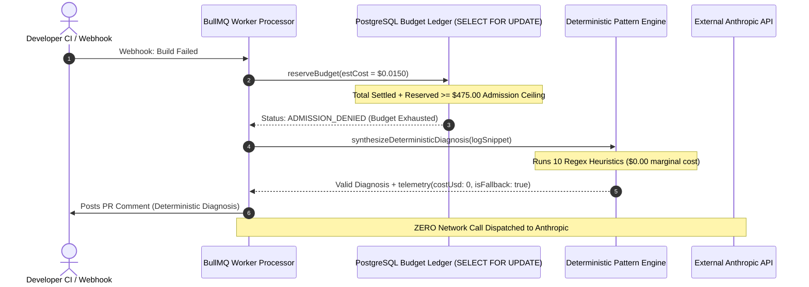

# Hopper — $500 Monthly AI Budget Capacity & Exhaustion Scenarios

**Document Status:** Approved Operational & Capacity Architecture  
**Author:** Principal Product Strategist & SaaS Financial Analyst  
**Date:** November 6, 2026  
**Operational Ceiling:** Fixed $500.00 USD / calendar month (Immutable application-side cap)  
**Target Repository:** [`/home/ashutoshsahoo/Downloads/Hopper`](file:///home/ashutoshsahoo/Downloads/Hopper)  
**Companion Architecture:** [`docs/engineering/PHASE_16R_BUDGET_CONTROLLER_DESIGN.md`](file:///home/ashutoshsahoo/Downloads/Hopper/docs/engineering/PHASE_16R_BUDGET_CONTROLLER_DESIGN.md)

---

## 1. Executive Summary & The Entitlement vs Capacity Reality

A critical responsibility of financial and infrastructure reliability engineering is ensuring that **commercial sales promises never outstrip operational reality**.

```
+--------------------------------------------------------------------------------------------------+
|                             ENTITLEMENT VS CAPACITY DICHOTOMY                                    |
+------------------------------------+-------------------------------------------------------------+
| Commercial Customer Entitlement    | Operational Infrastructure Capacity                         |
+------------------------------------+-------------------------------------------------------------+
| • What marketing/pricing promises  | • What the $500 monthly AI budget physically supports       |
| • 1,000 AI diagnoses / team / mo   | • Absolute ceiling: 70,571 average runs (or 45,289 worst)   |
| • Scalable contractually           | • Hard-coded, row-locked database ledger                    |
| • Decoupled on the balance sheet   | • Cluster-wide admission gate                               |
+------------------------------------+-------------------------------------------------------------+
```

### The Inherent Tension
If Hopper sells 100 Team plans, each customer receives a paper entitlement of 1,000 diagnoses, totaling **100,000 promised diagnoses**.
However, Hopper's internal operational AI infrastructure is capped at **$500.00 USD / month**.
- At the audited average cost of **\$0.007085 / run**, the $500 budget can fund at most **70,571 diagnoses**.
- At worst-case log density and retry overhead (**\$0.01104 / run**), it can fund at most **45,289 diagnoses**.

This creates a **2.2x over-subscription ratio** at 100 workspaces. In SaaS platforms, over-subscription is standard practice (relying on fractional utilization), **but under a hard-coded global spending ceiling, simultaneous quota consumption will exhaust the global ledger and lock out paying customers**.

This document models the exact boundary conditions and defines the required admission policies.

---

## 2. Exhaustive Capacity Modeling Grid

The matrix below models aggregate AI provider expenditure across **25, 50, 75, 100, and 143 active Team workspaces** (assuming 1,000 runs entitlement per workspace) at **30%, 60%, 80%, and 100% utilization**, benchmarked against both **Average Workload (\$0.007085/run)** and **Worst-Case Workload (\$0.011040/run)**.

```
Total Global Monthly Budget: $500.00 USD (Hard Operational Cap)
Red Highlight / [EXCEEDED]: Exceeds the $500.00 infrastructure ceiling.
Yellow Highlight / [WARNING]: Consumes 85% - 99% of total operational capacity.
Green Highlight / [SAFE]: Consumes < 85% of total operational capacity.
```

| Active Team Workspaces | Total Entitlement (Runs) | Utilization Rate | Total Delivered AI Runs | Aggregate AI Cost (Average Workload @ $0.007085) | Aggregate AI Cost (Worst-Case Workload @ $0.011040) | Global Budget Status (Average) | Global Budget Status (Worst-Case) |
| :---: | :---: | :---: | :---: | :---: | :---: | :---: | :---: |
| **25** | 25,000 | **30%** | 7,500 | \$53.14 | \$82.80 | [SAFE] (10.6% spent) | [SAFE] (16.6% spent) |
| 25 | 25,000 | **60%** | 15,000 | \$106.28 | \$165.60 | [SAFE] (21.3% spent) | [SAFE] (33.1% spent) |
| 25 | 25,000 | **80%** | 20,000 | \$141.70 | \$220.80 | [SAFE] (28.3% spent) | [SAFE] (44.2% spent) |
| 25 | 25,000 | **100%** | 25,000 | \$177.13 | \$276.00 | [SAFE] (35.4% spent) | [SAFE] (55.2% spent) |
| | | | | | | | |
| **50** | 50,000 | **30%** | 15,000 | \$106.28 | \$165.60 | [SAFE] (21.3% spent) | [SAFE] (33.1% spent) |
| 50 | 50,000 | **60%** | 30,000 | \$212.55 | \$331.20 | [SAFE] (42.5% spent) | [SAFE] (66.2% spent) |
| 50 | 50,000 | **80%** | 40,000 | \$283.40 | \$441.60 | [SAFE] (56.7% spent) | [WARNING] (88.3% spent) |
| 50 | 50,000 | **100%** | 50,000 | \$354.25 | **\$552.00** | [SAFE] (70.9% spent) | **[EXCEEDED] (+$52.00)** |
| | | | | | | | |
| **75** | 75,000 | **30%** | 22,500 | \$159.41 | \$248.40 | [SAFE] (31.9% spent) | [SAFE] (49.7% spent) |
| 75 | 75,000 | **60%** | 45,000 | \$318.83 | **\$496.80** | [SAFE] (63.8% spent) | [WARNING] (99.4% spent) |
| 75 | 75,000 | **80%** | 60,000 | \$425.10 | **\$662.40** | [WARNING] (85.0% spent) | **[EXCEEDED] (+$162.40)** |
| 75 | 75,000 | **100%** | 75,000 | **\$531.38** | **\$828.00** | **[EXCEEDED] (+$31.38)** | **[EXCEEDED] (+$328.00)** |
| | | | | | | | |
| **100** | 100,000 | **30%** | 30,000 | \$212.55 | \$331.20 | [SAFE] (42.5% spent) | [SAFE] (66.2% spent) |
| 100 | 100,000 | **60%** | 60,000 | \$425.10 | **\$662.40** | [WARNING] (85.0% spent) | **[EXCEEDED] (+$162.40)** |
| 100 | 100,000 | **80%** | 80,000 | **\$566.80** | **\$883.20** | **[EXCEEDED] (+$66.80)** | **[EXCEEDED] (+$383.20)** |
| 100 | 100,000 | **100%** | 100,000 | **\$708.50** | **\$1,104.00** | **[EXCEEDED] (+$208.50)** | **[EXCEEDED] (+$604.00)** |
| | | | | | | | |
| **143** | 143,000 | **30%** | 42,900 | \$303.95 | \$473.62 | [SAFE] (60.8% spent) | [WARNING] (94.7% spent) |
| 143 | 143,000 | **60%** | 85,800 | **\$607.89** | **\$947.23** | **[EXCEEDED] (+$107.89)** | **[EXCEEDED] (+$447.23)** |
| 143 | 143,000 | **80%** | 114,400 | **\$810.52** | **\$1,262.98** | **[EXCEEDED] (+$310.52)** | **[EXCEEDED] (+$762.98)** |
| 143 | 143,000 | **100%** | 143,000 | **\$1,013.16** | **\$1,578.72** | **[EXCEEDED] (+$513.16)** | **[EXCEEDED] (+$1,078.72)** |

---

## 3. Global Budget Exhaustion Behavior

When aggregate API expenditure reaches the **$500 monthly limit**, the architectural mechanisms designed in Phase 16R.2 ([`PHASE_16R_BUDGET_CONTROLLER_DESIGN.md`](file:///home/ashutoshsahoo/Downloads/Hopper/PHASE_16R_BUDGET_CONTROLLER_DESIGN.md)) activate deterministically.



### Exact System Invariants Under Exhaustion
1. **Application-Side Admission Gate Closes:**
   - As designed in Phase 16R.2, the nominal admission ceiling is **$475.00** (with a $25 buffer reserved for in-flight concurrency liabilities).
   - Once total settled spend + active reservations reaches \$475.00, `reserveBudget()` returns `ADMISSION_DENIED`.
2. **Zero Incurred Over-Billing:**
   - The worker catches `ADMISSION_DENIED` and strictly aborts any HTTP dispatch to `https://api.anthropic.com`.
   - Anthropic receives 0 requests, ensuring Hopper's provider invoice can never exceed the authorization limit.
3. **Graceful Fallback to Deterministic Heuristics:**
   - Hopper does **not** crash, drop jobs, or fail GitHub checks.
   - It invokes `synthesizeDeterministicDiagnosis()` in [`backend/src/lib/ai/diagnose.ts#L525`](file:///home/ashutoshsahoo/Downloads/Hopper/backend/src/lib/ai/diagnose.ts#L525).
   - PR comments are delivered with verified regex classification, log citations, and standard remediation commands.
4. **The "Tragedy of the Commons" Customer Impact:**
   - **Crucial Architectural Consequence:** Because the $500 ceiling is **global**, if high-volume customers consume their quotas early in the month, the global gate will close.
   - A newly onboarded Team workspace that has only used 50 of its 1,000 promised diagnoses will be denied live AI synthesis and forced into deterministic mode.
   - **Customer Perception Risk:** The paying customer will view this as a service degradation or product defect, having paid ₹1,499 for 1,000 AI diagnoses.

---

## 4. Operational Guardrails & Capacity Policy

To prevent global budget exhaustion from degrading paying customer trust, Hopper must enforce the following operational rules:

### Rule 1: Phase 1 Active Workspace Cap
Under the immutable **$500/month global AI ceiling**, the sales and onboarding pipeline must **hard-cap total active Team workspaces**:
- **Maximum Safe Active Team Workspaces:** **50 workspaces**.
- *Rationale:* At 50 workspaces, even if all 50 teams run at 100% quota utilization under average workloads (\$354.25 total spend) or at 80% under worst-case workloads (\$441.60 total spend), the global budget will **never be breached**, and zero customers will experience premature lockout.
- 50 Team workspaces generate **₹74,950 INR / month (~$897.60 USD / month)** in recurring subscription revenue against the $500 AI cap, yielding healthy net operating cash flow.

### Rule 2: Dynamic Operational Budget Scaling Protocol
The $500 budget is an initial operational safety guard, not a permanent SaaS business cap. When sales expansion approaches the 50-workspace threshold:
- **Scaling Trigger:** When active paid workspaces reach 40 (80% of capacity).
- **Protocol:** The commercial owner formally reviews subscription revenue vs API invoices. Because 40 workspaces generate \$718 USD/month, the owner can approve raising the infrastructure ceiling to \$1,000 USD/month, unlocking capacity for an additional 50 workspaces while maintaining positive unit cash flow.
- **Rule:** The ceiling is only raised via explicit owner authorization; it never increases automatically.

### Rule 3: Quota Right-Sizing
As detailed in the companion deliverable ([`QUOTA_RECOMMENDATIONS.md`](file:///home/ashutoshsahoo/Downloads/Hopper/docs/strategy/QUOTA_RECOMMENDATIONS.md)), calibrating the Team quota from 1,000 runs to **600 or 750 runs** significantly reduces over-subscription pressure, expanding cluster capacity to **80 safe workspaces** under the existing $500 budget.

